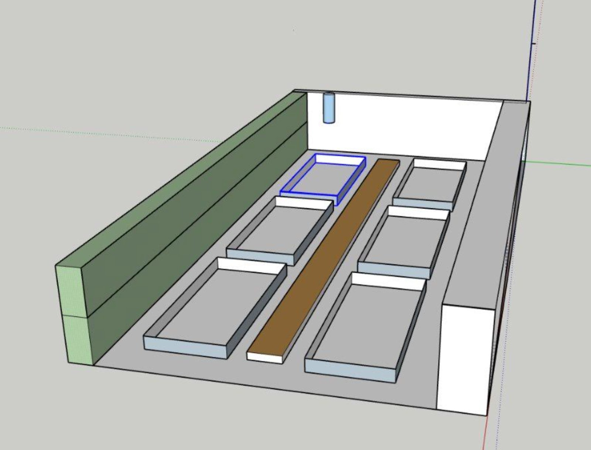

# Sketchup - projet Jardin sec

Nous avons modélisé l'espace du Jardin sec sous Sketchup. Projet fédérateur de technologie mené sur les trois niveaux du cycle 4, dans le couloir gravillonné situé le long du bâtiment, entre la haie et le mur de soutènement.

<!-- more -->

*L'espaceen 3D*

---

*Article proposé par E (4e).*
