# Palier 1 (vert) : premiers circuits, premiers programmes

Dix missions pour découvrir Tinkercad Circuits et la carte Arduino quand on n'a jamais programmé : un circuit qui s'allume, puis une carte qui commande des LED et un buzzer, en blocs. Chaque mission tient en une séance.

Classe de départ : **5e**. Les élèves qui ont terminé continuent au palier rose.

| Mission | Titre | Notions |
|---|---|---|
| [01](#mission-01) | Mon premier circuit | circuit fermé, pile, LED, résistance, sens de la LED |
| [02](#mission-02) | J'allume et j'éteins | interrupteur, circuit ouvert, circuit fermé |
| [03](#mission-03) | La carte cligne de l'œil | carte Arduino, LED intégrée, sortie, attendre, boucle infinie |
| [04](#mission-04) | Une LED sur la plaque d'essai | plaque d'essai, broche numérique, résistance, GND |
| [05](#mission-05) | Le phare | séquence d'instructions, durées différentes |
| [06](#mission-06) | Le passage à niveau | deux sorties, alternance, séquence |
| [07](#mission-07) | Le feu tricolore | séquence, durées, plusieurs sorties, cahier des charges |
| [08](#mission-08) | Le buzzer | haut-parleur piézo, son, fréquence, durée |
| [09](#mission-09) | SOS | boucle répéter, motif, sous-séquences |
| [10](#mission-10) | Atelier vert : le feu pour piétons | synthèse : séquence, deux feux, son, boucle |

!!! info "Comment travailler"

    Je regarde le schéma de câblage et je lis ce que je dois obtenir. J'ouvre Tinkercad Circuits, je câble, puis je programme en suivant le pas à pas. Je lance la simulation et je compare avec l'objectif. Si je suis bloqué, j'ouvre les coups de pouce dans l'ordre : 1, je réfléchis ; 2, les blocs ou les instructions à utiliser ; 3, le squelette du programme. « Si ça ne marche pas » liste les erreurs les plus courantes. En fin de séance, j'envoie ma progression avec une capture d'écran (bas de la page).

## Mission 01 · Mon premier circuit { #mission-01 }

<strong>Ce que je dois obtenir.</strong> La LED rouge s'allume dès que je démarre la simulation. Si je la retourne, elle reste éteinte.

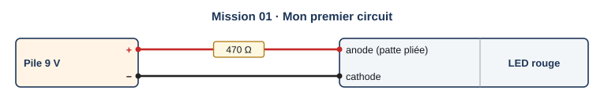{ .schema }

??? info "Le câblage, fil par fil"

    | Depuis | Broche ou borne | Sur le fil | Vers le composant | Borne du composant |
    |---|---|---|---|---|
    | Pile 9 V | + | 470 Ω | LED rouge | anode (patte pliée) |
    | Pile 9 V | − |   | LED rouge | cathode |

[:material-open-in-new: Ouvrir Tinkercad Circuits](https://www.tinkercad.com/circuits){ .md-button .md-button--primary target=_blank rel=noopener }

**Notions :** circuit fermé, pile, LED, résistance, sens de la LED.

**Programmation :** Circuit seul, sans programme.

**Pas à pas**

1. Je me connecte à Tinkercad, je clique sur **Créer**, puis **Circuit**.
2. Dans la liste des composants, je fais glisser une **pile 9 V**, une **LED** et une **résistance**.
3. Je clique sur la résistance et je règle sa valeur sur **470 Ω**.
4. Je relie la borne + de la pile à la résistance, la résistance à l'anode de la LED (la patte pliée), puis la cathode à la borne − de la pile. Je clique sur un point de connexion puis sur un autre pour tracer un fil.
5. Je clique sur **Démarrer la simulation** : la LED s'allume.
6. J'arrête la simulation, je retourne la LED (touche R ou bouton de rotation, puis j'inverse ses fils) et je recommence.

??? question "Coup de pouce 1 : je réfléchis avant de câbler et de programmer"

    - Par où le courant sort-il de la pile, et par où revient-il ?
    - Que se passe-t-il si un seul fil est débranché ?
    - La LED a deux pattes différentes. Laquelle va vers le + ?
    - À quoi sert la résistance ?

??? note "Coup de pouce 2 : les composants que je vais utiliser"

    - une pile 9 V
    - une LED rouge
    - une résistance de 470 Ω
    - trois fils

??? abstract "Coup de pouce 3 : le circuit, fil par fil"

    Je suis le tableau « Le câblage, fil par fil » ligne par ligne, en partant de la borne + de la pile et en revenant à la borne −. Le courant doit pouvoir faire le tour sans interruption.

??? warning "Si ça ne marche pas"

    - La LED reste éteinte : je vérifie que l'anode (patte pliée) est du côté du + de la pile.
    - Un fil n'est pas accroché : il doit se terminer sur un point rouge de connexion, pas dans le vide.
    - La LED affiche un message d'alerte : la résistance manque ou sa valeur est trop faible.

!!! example "Sur le vrai matériel"

    Avec le kit de la classe : la même chose se fait sur une plaque d'essai, avec une pile ou la sortie 5 V de la carte. La patte longue de la LED est l'anode.

!!! tip "Mon défi"

    Je place deux LED l'une derrière l'autre dans le même circuit. Les deux s'allument-elles ? Que se passe-t-il si j'en retire une ?

**Je vérifie avant de cocher**

- [ ] La LED s'allume quand la simulation démarre.
- [ ] Retournée, la LED reste éteinte : j'ai compris pourquoi.
- [ ] J'ai renommé mon circuit « Mission 01 nom prénom ».

<label class="mission-reussie"><input type="checkbox" data-mission="01"> J'ai réussi la mission 01</label>

## Mission 02 · J'allume et j'éteins { #mission-02 }

<strong>Ce que je dois obtenir.</strong> La LED s'allume seulement quand je bascule l'interrupteur, et s'éteint quand je le rebascule.

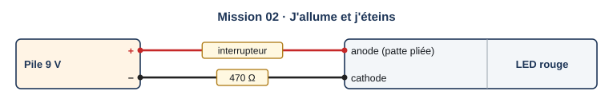{ .schema }

??? info "Le câblage, fil par fil"

    | Depuis | Broche ou borne | Sur le fil | Vers le composant | Borne du composant |
    |---|---|---|---|---|
    | Pile 9 V | + | interrupteur | LED rouge | anode (patte pliée) |
    | Pile 9 V | − | 470 Ω | LED rouge | cathode |

[:material-open-in-new: Ouvrir Tinkercad Circuits](https://www.tinkercad.com/circuits){ .md-button .md-button--primary target=_blank rel=noopener }

**Notions :** interrupteur, circuit ouvert, circuit fermé.

**Programmation :** Circuit seul, sans programme.

**Pas à pas**

1. Je reprends le circuit de la mission 01 (bouton **Dupliquer** dans mon tableau de bord).
2. J'ajoute un **interrupteur à glissière** et je l'intercale sur le fil qui part de la borne +.
3. J'utilise la borne du milieu de l'interrupteur et une borne d'extrémité.
4. Je démarre la simulation et je clique sur l'interrupteur pour le basculer.
5. Je déplace la résistance du côté de la borne − : la LED fonctionne-t-elle toujours ?

??? question "Coup de pouce 1 : je réfléchis avant de câbler et de programmer"

    - Quand l'interrupteur est ouvert, le courant peut-il faire le tour du circuit ?
    - L'ordre des composants dans la boucle a-t-il de l'importance ?
    - Quelle borne de l'interrupteur est reliée à toutes les positions ?

??? note "Coup de pouce 2 : les composants que je vais utiliser"

    - le circuit de la mission 01
    - un interrupteur à glissière
    - un fil de plus

??? abstract "Coup de pouce 3 : le circuit, fil par fil"

    Je suis le tableau « Le câblage, fil par fil » ligne par ligne, en partant de la borne + de la pile et en revenant à la borne −. Le courant doit pouvoir faire le tour sans interruption.

??? warning "Si ça ne marche pas"

    - La LED reste toujours allumée : l'interrupteur est contourné par un fil, ou je n'utilise pas la borne du milieu.
    - La LED ne s'allume jamais : j'ai pris les deux bornes d'extrémité, elles ne sont jamais reliées entre elles.

!!! example "Sur le vrai matériel"

    Sur le kit Grove, le bouton est un module tout prêt : il se branche avec un câble Grove sur un port numérique, sans plaque d'essai.

!!! tip "Mon défi"

    J'ajoute un second interrupteur dans la même boucle. Que faut-il faire pour allumer la LED ?

**Je vérifie avant de cocher**

- [ ] L'interrupteur allume et éteint la LED.
- [ ] J'ai essayé la résistance des deux côtés de la LED.
- [ ] Je sais dire ce qu'est un circuit ouvert et un circuit fermé.

<label class="mission-reussie"><input type="checkbox" data-mission="02"> J'ai réussi la mission 02</label>

## Mission 03 · La carte cligne de l'œil { #mission-03 }

<strong>Ce que je dois obtenir.</strong> La petite LED « L » de la carte Arduino s'allume une seconde, s'éteint une seconde, et recommence sans fin.

<iframe loading="lazy" title="Comment réaliser un câblage Arduino avec Tinkercad" src="https://tube-sciences-technologies.apps.education.fr/videos/embed/i24ru8QUAoYA1U5iagSZsa" frameborder="0" allow="fullscreen" allowfullscreen></iframe>

Vidéo : « Comment réaliser un câblage Arduino avec Tinkercad », chaîne Tinkercad au collège : <a href="https://tube-sciences-technologies.apps.education.fr/w/i24ru8QUAoYA1U5iagSZsa" target="_blank" rel="noopener">ouvrir sur Tube Sciences &amp; Technologies</a>

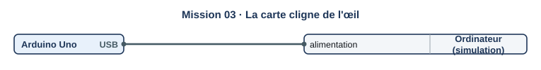{ .schema }

??? info "Le câblage, fil par fil"

    | Depuis | Broche ou borne | Sur le fil | Vers le composant | Borne du composant |
    |---|---|---|---|---|
    | Arduino Uno | USB |   | Ordinateur (simulation) | alimentation |

[:material-open-in-new: Ouvrir Tinkercad Circuits](https://www.tinkercad.com/circuits){ .md-button .md-button--primary target=_blank rel=noopener }

**Notions :** carte Arduino, LED intégrée, sortie, attendre, boucle infinie.

**Programmation :** Blocs.

**Pas à pas**

1. Nouveau circuit. Je fais glisser une carte **Arduino Uno R3**. Je ne branche rien d'autre.
2. Je clique sur **Code**, puis je choisis **Blocs** dans la liste. J'efface les blocs proposés.
3. Dans la famille **Sortie**, je prends « régler la LED intégrée sur HAUT ».
4. Dans **Contrôle**, j'ajoute « attendre 1 secondes ».
5. Je complète : LED intégrée sur BAS, puis attendre 1 seconde.
6. Je démarre la simulation : les blocs se répètent tout seuls, sans fin.

??? question "Coup de pouce 1 : je réfléchis avant de câbler et de programmer"

    - Combien d'états différents la LED peut-elle avoir ?
    - Que se passerait-il sans les blocs « attendre » ?
    - Faut-il un bloc « répéter » pour que le clignotement continue ?

??? note "Coup de pouce 2 : les blocs que je vais utiliser"

    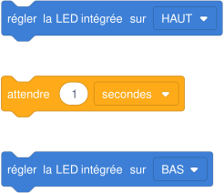{ .blocs }

    Les valeurs à choisir sont remplacées par 1 : à moi de trouver les bonnes et d'assembler les blocs. Les libellés peuvent varier légèrement selon la version de Tinkercad.

??? abstract "Coup de pouce 3 : le squelette du programme"

    Les blocs sont assemblés, les valeurs sont à trouver (cases vides). Je l'ouvre seulement si les deux premiers coups de pouce ne suffisent pas.

    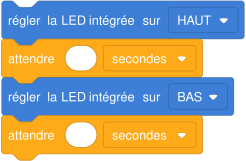{ .blocs }

??? warning "Si ça ne marche pas"

    - La LED reste allumée : il manque le bloc qui la remet sur BAS.
    - La LED semble éteinte : sans « attendre », le changement est trop rapide pour être vu.
    - Rien ne se passe : la simulation n'est pas démarrée, ou les blocs ne sont pas accrochés les uns aux autres.

!!! example "Sur le vrai matériel"

    Avec le kit de la classe : je branche la carte en USB, j'ouvre l'Arduino IDE, menu Fichier, Exemples, 01.Basics, Blink, puis je téléverse. Le programme est le même.

!!! tip "Mon défi"

    Je fais clignoter la LED deux fois plus vite.

**Je vérifie avant de cocher**

- [ ] La LED L clignote : une seconde allumée, une seconde éteinte.
- [ ] J'ai trouvé l'onglet Code et le mode Blocs.
- [ ] Je sais que le programme se répète sans fin.

<label class="mission-reussie"><input type="checkbox" data-mission="03"> J'ai réussi la mission 03</label>

## Mission 04 · Une LED sur la plaque d'essai { #mission-04 }

<strong>Ce que je dois obtenir.</strong> Une LED rouge placée sur la plaque d'essai clignote : une demi-seconde allumée, une demi-seconde éteinte.

<iframe loading="lazy" title="Comment réaliser un câblage Arduino avec Tinkercad" src="https://tube-sciences-technologies.apps.education.fr/videos/embed/i24ru8QUAoYA1U5iagSZsa" frameborder="0" allow="fullscreen" allowfullscreen></iframe>

Vidéo : « Comment réaliser un câblage Arduino avec Tinkercad », chaîne Tinkercad au collège : <a href="https://tube-sciences-technologies.apps.education.fr/w/i24ru8QUAoYA1U5iagSZsa" target="_blank" rel="noopener">ouvrir sur Tube Sciences &amp; Technologies</a>

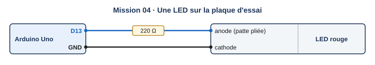{ .schema }

??? info "Le câblage, fil par fil"

    | Depuis | Broche ou borne | Sur le fil | Vers le composant | Borne du composant |
    |---|---|---|---|---|
    | Arduino Uno | D13 | 220 Ω | LED rouge | anode (patte pliée) |
    | Arduino Uno | GND |   | LED rouge | cathode |

[:material-open-in-new: Ouvrir Tinkercad Circuits](https://www.tinkercad.com/circuits){ .md-button .md-button--primary target=_blank rel=noopener }

**Notions :** plaque d'essai, broche numérique, résistance, GND.

**Programmation :** Blocs.

**Pas à pas**

1. J'ajoute une **plaque d'essai**, une LED rouge et une résistance de 220 Ω.
2. Je relie la broche **13** à la résistance, la résistance à l'anode de la LED, la cathode à une broche **GND**.
3. Dans les rangées de la plaque, les trous d'une même colonne de 5 sont reliés : j'en tiens compte.
4. Dans Code, Blocs, je prends « régler la broche 13 sur HAUT » (famille Sortie).
5. Je construis le clignotement : HAUT, attendre, BAS, attendre.
6. Je démarre la simulation et je règle les durées pour obtenir une demi-seconde.

??? question "Coup de pouce 1 : je réfléchis avant de câbler et de programmer"

    - La LED intégrée et ma LED sont-elles commandées par la même broche ?
    - Quelle durée écrire pour une demi-seconde ?
    - Si je branche la LED sur la broche 8, que dois-je changer dans le programme ?

??? note "Coup de pouce 2 : les blocs que je vais utiliser"

    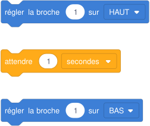{ .blocs }

    Les valeurs à choisir sont remplacées par 1 : à moi de trouver les bonnes et d'assembler les blocs. Les libellés peuvent varier légèrement selon la version de Tinkercad.

??? abstract "Coup de pouce 3 : le squelette du programme"

    Les blocs sont assemblés, les valeurs sont à trouver (cases vides). Je l'ouvre seulement si les deux premiers coups de pouce ne suffisent pas.

    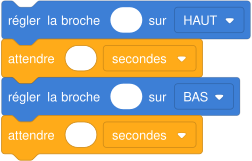{ .blocs }

??? warning "Si ça ne marche pas"

    - La LED reste éteinte : elle est à l'envers, ou ses deux pattes sont dans la même colonne de la plaque.
    - Rien ne s'allume : la cathode n'est pas reliée à GND.
    - La LED de la carte clignote mais pas la mienne : le fil part d'une autre broche que celle du programme.

!!! example "Sur le vrai matériel"

    Avec le kit de la classe : même câblage sur la plaque d'essai réelle. La patte longue de la LED va vers la résistance.

!!! tip "Mon défi"

    Je déplace la LED sur la broche 8 et je modifie le programme pour qu'elle clignote encore.

**Je vérifie avant de cocher**

- [ ] Ma LED clignote toutes les demi-secondes.
- [ ] La broche du programme est celle de mon câblage.
- [ ] J'ai expliqué le rôle de GND : le retour du courant.

<label class="mission-reussie"><input type="checkbox" data-mission="04"> J'ai réussi la mission 04</label>

## Mission 05 · Le phare { #mission-05 }

<strong>Ce que je dois obtenir.</strong> La LED fait un éclat très court (0,2 s), puis reste éteinte 2 s, comme un phare dans la nuit.

{ .schema }

??? info "Le câblage, fil par fil"

    | Depuis | Broche ou borne | Sur le fil | Vers le composant | Borne du composant |
    |---|---|---|---|---|
    | Arduino Uno | D13 | 220 Ω | LED rouge | anode (patte pliée) |
    | Arduino Uno | GND |   | LED rouge | cathode |

[:material-open-in-new: Ouvrir Tinkercad Circuits](https://www.tinkercad.com/circuits){ .md-button .md-button--primary target=_blank rel=noopener }

**Notions :** séquence d'instructions, durées différentes.

**Programmation :** Blocs.

**Pas à pas**

1. Je reprends le montage de la mission 04 (LED sur la broche 13).
2. Je règle le temps allumé sur 0,2 seconde.
3. Je règle le temps éteint sur 2 secondes.
4. J'observe : le rythme ressemble-t-il à celui d'un phare ?

??? question "Coup de pouce 1 : je réfléchis avant de câbler et de programmer"

    - Quelles sont les deux durées à régler, et dans quel ordre ?
    - Combien de temps dure un cycle complet ?

??? note "Coup de pouce 2 : les blocs que je vais utiliser"

    { .blocs }

    Les valeurs à choisir sont remplacées par 1 : à moi de trouver les bonnes et d'assembler les blocs. Les libellés peuvent varier légèrement selon la version de Tinkercad.

??? abstract "Coup de pouce 3 : le squelette du programme"

    Les blocs sont assemblés, les valeurs sont à trouver (cases vides). Je l'ouvre seulement si les deux premiers coups de pouce ne suffisent pas.

    { .blocs }

??? warning "Si ça ne marche pas"

    - Le rythme est inversé (long allumé, court éteint) : j'ai échangé les deux durées.
    - L'éclat ne se voit pas : 0,2 s est court, je regarde bien la LED pendant la simulation.

!!! example "Sur le vrai matériel"

    Avec le kit de la classe : téléverser le programme et chronométrer dix cycles pour vérifier la durée.

!!! tip "Mon défi"

    Je reproduis le phare de l'île de Batz : deux éclats rapprochés toutes les 10 secondes.

**Je vérifie avant de cocher**

- [ ] Éclat court, longue pause, sans fin.
- [ ] J'ai calculé la durée d'un cycle.

<label class="mission-reussie"><input type="checkbox" data-mission="05"> J'ai réussi la mission 05</label>

## Mission 06 · Le passage à niveau { #mission-06 }

<strong>Ce que je dois obtenir.</strong> Deux LED rouges s'allument l'une après l'autre, chacune une demi-seconde, comme à un passage à niveau.

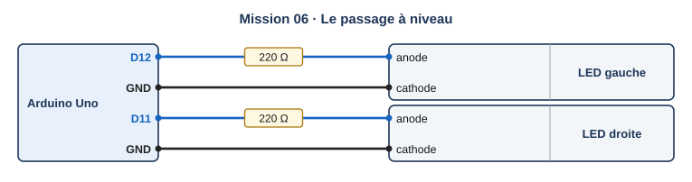{ .schema }

??? info "Le câblage, fil par fil"

    | Depuis | Broche ou borne | Sur le fil | Vers le composant | Borne du composant |
    |---|---|---|---|---|
    | Arduino Uno | D12 | 220 Ω | LED gauche | anode |
    | Arduino Uno | GND |   | LED gauche | cathode |
    | Arduino Uno | D11 | 220 Ω | LED droite | anode |
    | Arduino Uno | GND |   | LED droite | cathode |

[:material-open-in-new: Ouvrir Tinkercad Circuits](https://www.tinkercad.com/circuits){ .md-button .md-button--primary target=_blank rel=noopener }

**Notions :** deux sorties, alternance, séquence.

**Programmation :** Blocs.

**Pas à pas**

1. Je place deux LED et deux résistances de 220 Ω sur la plaque.
2. LED gauche sur la broche 12, LED droite sur la broche 11, les deux cathodes vers GND.
3. Programme : gauche allumée et droite éteinte, attendre ; puis l'inverse, attendre.
4. Je démarre la simulation et je vérifie que les deux LED ne sont jamais allumées ensemble.

??? question "Coup de pouce 1 : je réfléchis avant de câbler et de programmer"

    - Combien de blocs « régler la broche » faut-il pour un état complet ?
    - Pourquoi chaque LED a-t-elle sa propre résistance ?

??? note "Coup de pouce 2 : les blocs que je vais utiliser"

    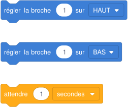{ .blocs }

    Les valeurs à choisir sont remplacées par 1 : à moi de trouver les bonnes et d'assembler les blocs. Les libellés peuvent varier légèrement selon la version de Tinkercad.

??? abstract "Coup de pouce 3 : le squelette du programme"

    Les blocs sont assemblés, les valeurs sont à trouver (cases vides). Je l'ouvre seulement si les deux premiers coups de pouce ne suffisent pas.

    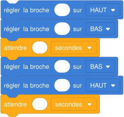{ .blocs }

??? warning "Si ça ne marche pas"

    - Les deux LED s'allument ensemble : dans un des états, j'ai oublié d'éteindre l'autre LED.
    - Une LED ne s'allume jamais : son fil part d'une broche différente de celle du programme.

!!! example "Sur le vrai matériel"

    Avec le kit de la classe : deux LED rouges du kit starter.

!!! tip "Mon défi"

    J'ajoute une troisième LED jaune sur la broche 10 qui reste allumée en permanence.

**Je vérifie avant de cocher**

- [ ] Les LED s'allument en alternance.
- [ ] Jamais les deux en même temps.

<label class="mission-reussie"><input type="checkbox" data-mission="06"> J'ai réussi la mission 06</label>

## Mission 07 · Le feu tricolore { #mission-07 }

<strong>Ce que je dois obtenir.</strong> Le feu passe au vert 4 s, à l'orange 1 s, au rouge 4 s, puis recommence.

<iframe loading="lazy" title="Concevoir un feu tricolore" src="https://tube-sciences-technologies.apps.education.fr/videos/embed/sLn8arp2Hje4atCQ24fBbG" frameborder="0" allow="fullscreen" allowfullscreen></iframe>

Vidéo : « Concevoir un feu tricolore », chaîne Tinkercad au collège : <a href="https://tube-sciences-technologies.apps.education.fr/w/sLn8arp2Hje4atCQ24fBbG" target="_blank" rel="noopener">ouvrir sur Tube Sciences &amp; Technologies</a>

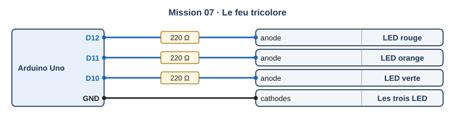{ .schema }

??? info "Le câblage, fil par fil"

    | Depuis | Broche ou borne | Sur le fil | Vers le composant | Borne du composant |
    |---|---|---|---|---|
    | Arduino Uno | D12 | 220 Ω | LED rouge | anode |
    | Arduino Uno | D11 | 220 Ω | LED orange | anode |
    | Arduino Uno | D10 | 220 Ω | LED verte | anode |
    | Arduino Uno | GND |   | Les trois LED | cathodes |

[:material-open-in-new: Ouvrir Tinkercad Circuits](https://www.tinkercad.com/circuits){ .md-button .md-button--primary target=_blank rel=noopener }

**Notions :** séquence, durées, plusieurs sorties, cahier des charges.

**Programmation :** Blocs.

**Pas à pas**

1. Je regarde la vidéo « Concevoir un feu tricolore ».
2. Je câble les trois LED : rouge sur 12, orange sur 11, verte sur 10, cathodes vers GND.
3. J'écris dans mon cahier les trois états du feu et leur durée.
4. Pour chaque état, je règle les trois broches, puis j'attends.
5. Je démarre la simulation et je chronomètre un cycle complet.

??? question "Coup de pouce 1 : je réfléchis avant de câbler et de programmer"

    - Combien d'états le feu a-t-il ? Lesquels ?
    - Dans chaque état, combien de LED sont allumées ?
    - Combien dure un cycle complet ?

??? note "Coup de pouce 2 : les blocs que je vais utiliser"

    { .blocs }

    Les valeurs à choisir sont remplacées par 1 : à moi de trouver les bonnes et d'assembler les blocs. Les libellés peuvent varier légèrement selon la version de Tinkercad.

??? abstract "Coup de pouce 3 : le squelette du programme"

    Les blocs sont assemblés, les valeurs sont à trouver (cases vides). Je l'ouvre seulement si les deux premiers coups de pouce ne suffisent pas.

    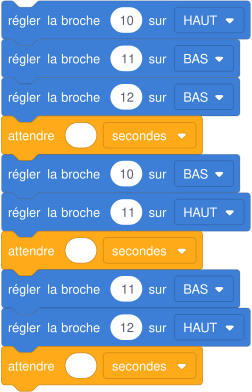{ .blocs }

??? warning "Si ça ne marche pas"

    - Deux couleurs restent allumées ensemble : dans un état, j'ai oublié de mettre une broche sur BAS.
    - L'ordre des couleurs est faux : le feu français passe du vert à l'orange, puis au rouge.

!!! example "Sur le vrai matériel"

    Avec le kit de la classe : les trois LED du kit starter, même câblage.

!!! tip "Mon défi"

    J'ajoute le clignotement de l'orange 3 fois avant le vert, comme un feu en panne la nuit.

**Je vérifie avant de cocher**

- [ ] Vert 4 s, orange 1 s, rouge 4 s.
- [ ] Une seule couleur allumée à la fois.
- [ ] Le cycle dure 9 s.

<label class="mission-reussie"><input type="checkbox" data-mission="07"> J'ai réussi la mission 07</label>

## Mission 08 · Le buzzer { #mission-08 }

<strong>Ce que je dois obtenir.</strong> Le buzzer joue deux notes l'une après l'autre (un « bip bop ») toutes les deux secondes.

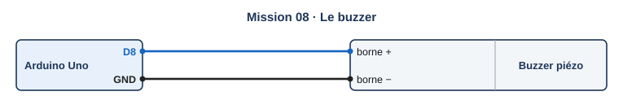{ .schema }

??? info "Le câblage, fil par fil"

    | Depuis | Broche ou borne | Sur le fil | Vers le composant | Borne du composant |
    |---|---|---|---|---|
    | Arduino Uno | D8 |   | Buzzer piézo | borne + |
    | Arduino Uno | GND |   | Buzzer piézo | borne − |

[:material-open-in-new: Ouvrir Tinkercad Circuits](https://www.tinkercad.com/circuits){ .md-button .md-button--primary target=_blank rel=noopener }

**Notions :** haut-parleur piézo, son, fréquence, durée.

**Programmation :** Blocs.

**Pas à pas**

1. J'ajoute un **piézo** (buzzer) : borne + sur la broche 8, borne − sur GND.
2. Dans Sortie, je prends « jouer le haut-parleur sur la broche 8 avec la tonalité 60 pendant 1 secondes ».
3. Je joue une première note aiguë (tonalité 72) pendant 0,2 s, puis une note grave (tonalité 60) pendant 0,2 s.
4. J'ajoute une attente pour que le motif revienne toutes les deux secondes.
5. J'active le son de mon ordinateur pour entendre la simulation.

??? question "Coup de pouce 1 : je réfléchis avant de câbler et de programmer"

    - La tonalité est-elle plus aiguë avec un grand ou un petit nombre ?
    - Combien de temps faut-il attendre après les deux notes pour que le motif dure 2 s ?

??? note "Coup de pouce 2 : les blocs que je vais utiliser"

    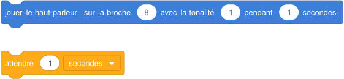{ .blocs }

    Les valeurs à choisir sont remplacées par 1 : à moi de trouver les bonnes et d'assembler les blocs. Les libellés peuvent varier légèrement selon la version de Tinkercad.

??? abstract "Coup de pouce 3 : le squelette du programme"

    Les blocs sont assemblés, les valeurs sont à trouver (cases vides). Je l'ouvre seulement si les deux premiers coups de pouce ne suffisent pas.

    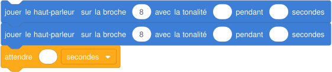{ .blocs }

??? warning "Si ça ne marche pas"

    - Aucun son : le son de l'ordinateur est coupé, ou le buzzer est branché à l'envers.
    - Le son ne s'arrête jamais : il manque l'attente, les notes s'enchaînent sans pause.

!!! example "Sur le vrai matériel"

    Avec le kit de la classe : le buzzer du kit starter se branche de la même façon (patte + sur 8).

!!! tip "Mon défi"

    Je joue le début d'« Au clair de la lune » : do do do ré mi ré.

**Je vérifie avant de cocher**

- [ ] J'entends deux notes différentes.
- [ ] Le motif revient toutes les deux secondes.

<label class="mission-reussie"><input type="checkbox" data-mission="08"> J'ai réussi la mission 08</label>

## Mission 09 · SOS { #mission-09 }

<strong>Ce que je dois obtenir.</strong> La LED envoie le signal SOS en morse : trois éclats courts, trois longs, trois courts, puis une pause de 2 s.

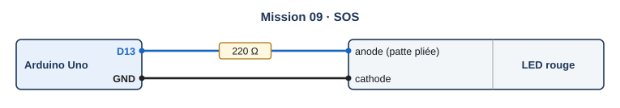{ .schema }

??? info "Le câblage, fil par fil"

    | Depuis | Broche ou borne | Sur le fil | Vers le composant | Borne du composant |
    |---|---|---|---|---|
    | Arduino Uno | D13 | 220 Ω | LED rouge | anode (patte pliée) |
    | Arduino Uno | GND |   | LED rouge | cathode |

[:material-open-in-new: Ouvrir Tinkercad Circuits](https://www.tinkercad.com/circuits){ .md-button .md-button--primary target=_blank rel=noopener }

**Notions :** boucle répéter, motif, sous-séquences.

**Programmation :** Blocs.

**Pas à pas**

1. Je reprends la LED sur la broche 13.
2. Un éclat court : allumé 0,2 s, éteint 0,2 s. Un éclat long : allumé 0,6 s, éteint 0,2 s.
3. Dans Contrôle, je prends « répéter 10 fois » et je règle 3.
4. Je place un éclat court dans le premier bloc répéter, un éclat long dans le deuxième, un court dans le troisième.
5. J'ajoute la pause de 2 s à la fin.

??? question "Coup de pouce 1 : je réfléchis avant de câbler et de programmer"

    - Qu'est-ce qui se répète dans le signal SOS, et combien de fois ?
    - Combien de blocs « répéter » faut-il ?
    - Quelle est la différence entre un éclat court et un éclat long ?

??? note "Coup de pouce 2 : les blocs que je vais utiliser"

    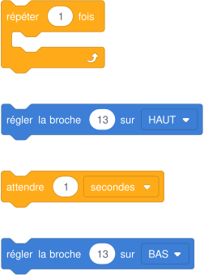{ .blocs }

    Les valeurs à choisir sont remplacées par 1 : à moi de trouver les bonnes et d'assembler les blocs. Les libellés peuvent varier légèrement selon la version de Tinkercad.

??? abstract "Coup de pouce 3 : le squelette du programme"

    Les blocs sont assemblés, les valeurs sont à trouver (cases vides). Je l'ouvre seulement si les deux premiers coups de pouce ne suffisent pas.

    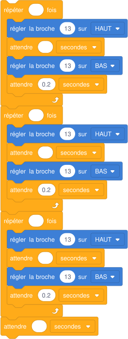{ .blocs }

??? warning "Si ça ne marche pas"

    - Tous les éclats ont la même durée : j'ai copié le même éclat dans les trois boucles sans changer la durée du milieu.
    - Le signal ne s'arrête jamais entre deux SOS : il manque la pause de 2 s après la troisième boucle.

!!! example "Sur le vrai matériel"

    Avec le kit de la classe : même programme, LED et buzzer du kit starter.

!!! tip "Mon défi"

    Je fais jouer au buzzer le même signal SOS en même temps que la LED.

**Je vérifie avant de cocher**

- [ ] J'ai trois boucles répéter 3 fois.
- [ ] On reconnaît court, long, court.
- [ ] Une pause sépare deux SOS.

<label class="mission-reussie"><input type="checkbox" data-mission="09"> J'ai réussi la mission 09</label>

## Mission 10 · Atelier vert : le feu pour piétons { #mission-10 }

<strong>Ce que je dois obtenir.</strong> Un feu voitures (rouge, orange, vert) et un feu piétons (rouge, vert) fonctionnent ensemble. Quand les piétons ont le vert, le buzzer bipe pour les personnes aveugles.

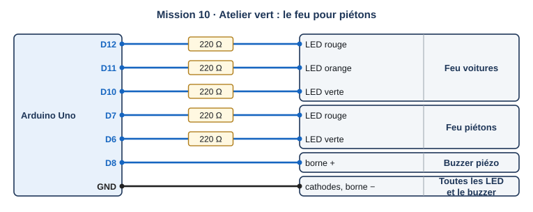{ .schema }

??? info "Le câblage, fil par fil"

    | Depuis | Broche ou borne | Sur le fil | Vers le composant | Borne du composant |
    |---|---|---|---|---|
    | Arduino Uno | D12 | 220 Ω | Feu voitures | LED rouge |
    | Arduino Uno | D11 | 220 Ω | Feu voitures | LED orange |
    | Arduino Uno | D10 | 220 Ω | Feu voitures | LED verte |
    | Arduino Uno | D7 | 220 Ω | Feu piétons | LED rouge |
    | Arduino Uno | D6 | 220 Ω | Feu piétons | LED verte |
    | Arduino Uno | D8 |   | Buzzer piézo | borne + |
    | Arduino Uno | GND |   | Toutes les LED et le buzzer | cathodes, borne − |

[:material-open-in-new: Ouvrir Tinkercad Circuits](https://www.tinkercad.com/circuits){ .md-button .md-button--primary target=_blank rel=noopener }

**Notions :** synthèse : séquence, deux feux, son, boucle.

**Programmation :** Blocs.

**Pas à pas**

1. Je reprends le feu tricolore de la mission 07 et j'ajoute deux LED piétons et le buzzer.
2. J'écris le tableau des états : voitures vert et piétons rouge (4 s) ; voitures orange et piétons rouge (1 s) ; voitures rouge et piétons vert avec bips (4 s).
3. Pour les bips : répéter 4 fois, jouer une note 0,5 s puis attendre 0,5 s.
4. Je programme les trois états dans l'ordre et je teste.

??? question "Coup de pouce 1 : je réfléchis avant de câbler et de programmer"

    - Quand les voitures ont le vert, quelle couleur ont les piétons ?
    - Combien de broches faut-il régler dans chaque état ?
    - Comment faire durer les bips exactement 4 secondes ?

??? note "Coup de pouce 2 : les blocs que je vais utiliser"

    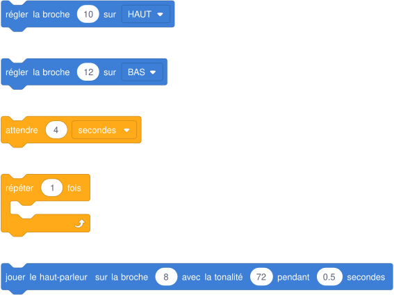{ .blocs }

    Les valeurs à choisir sont remplacées par 1 : à moi de trouver les bonnes et d'assembler les blocs. Les libellés peuvent varier légèrement selon la version de Tinkercad.

??? abstract "Coup de pouce 3 : le squelette du programme"

    Les blocs sont assemblés, les valeurs sont à trouver (cases vides). Je l'ouvre seulement si les deux premiers coups de pouce ne suffisent pas.

    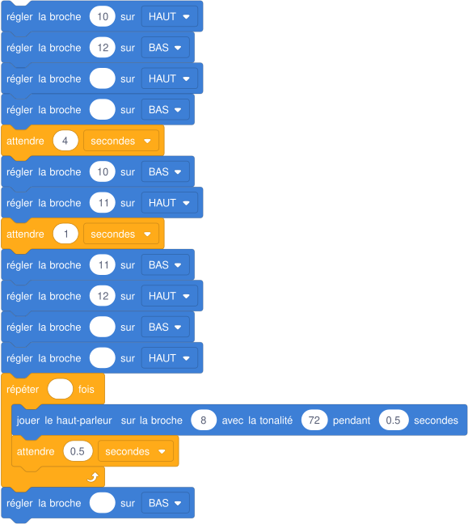{ .blocs }

??? warning "Si ça ne marche pas"

    - Voitures et piétons ont le vert en même temps : c'est dangereux, je vérifie chaque état dans mon tableau.
    - Les bips durent plus de 4 s : une note de 0,5 s plus une attente de 0,5 s font 1 s, il faut 4 répétitions.

!!! example "Sur le vrai matériel"

    Avec le kit de la classe : maquette du carrefour sur plaque d'essai. Le bouton d'appel piéton arrive au palier rose (mission 17).

!!! tip "Mon défi"

    J'ajoute un temps de sécurité : 1 seconde où les deux feux sont rouges avant le vert piétons.

**Je vérifie avant de cocher**

- [ ] Jamais de vert en même temps pour les voitures et les piétons.
- [ ] Les bips n'existent que pendant le vert piétons.
- [ ] J'ai envoyé ma capture avec le formulaire en bas de la page.

<label class="mission-reussie"><input type="checkbox" data-mission="10"> J'ai réussi la mission 10</label>

## Je vérifie que j'ai compris

**Question 1.** Dans le premier circuit, la LED reste éteinte. Donne deux causes possibles.

**Question 2.** Combien de temps la LED reste-t-elle allumée à chaque tour de ce programme ?

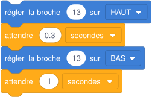{ .blocs }

**Question 3.** Le programmeur veut un clignotement, mais la LED reste allumée en permanence. Que manque-t-il ?

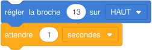{ .blocs }

**Question 4.** Combien d'éclats la LED fait-elle avant la pause ?

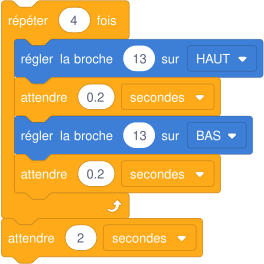{ .blocs }

## Où j'en suis

En fin de séance, j'indique la dernière mission terminée et j'ajoute une capture d'écran de mon circuit et de mon programme dans Tinkercad. Le professeur la reçoit directement.

*Missions conçues pour le site à partir des ressources officielles citées sur la [page d'accueil des missions](index.md#sources-et-licences).*
