# Palier 1 bis (rose) : la carte écoute

Dix missions pour que la carte réagisse : un bouton, un potentiomètre, une photorésistance. On découvre la condition « si alors sinon », le moniteur série, les premières variables, et on termine par l'éclairage automatique d'un couloir.

Classe de départ : **5e**. Les élèves qui ont terminé le palier vert continuent ici. Après le palier rose, on passe au palier bleu.

| Mission | Titre | Notions |
|---|---|---|
| [11](#mission-11) | Le bouton allume la LED | entrée numérique, si alors sinon, résistance de rappel |
| [12](#mission-12) | La sonnette | entrée, sortie sonore, si alors |
| [13](#mission-13) | Le moniteur série | moniteur série, afficher une valeur, déboguer |
| [14](#mission-14) | Le potentiomètre | entrée analogique, valeur de 0 à 1023 |
| [15](#mission-15) | La veilleuse | photorésistance, seuil, condition |
| [16](#mission-16) | Le variateur de clignotement | variable, valeur lue, durée réglable |
| [17](#mission-17) | Le feu à bouton d'appel | attendre un événement, séquence déclenchée |
| [18](#mission-18) | Le compteur d'appuis | variable compteur, ajouter 1, front, anti-rebond simple |
| [19](#mission-19) | La LED RVB | LED tricolore, mélange de couleurs, sorties |
| [20](#mission-20) | Atelier rose : l'éclairage automatique du couloir | synthèse : deux capteurs, condition ET, temporisation |

!!! info "Comment travailler"

    Je regarde le schéma de câblage et je lis ce que je dois obtenir. J'ouvre Tinkercad Circuits, je câble, puis je programme en suivant le pas à pas. Je lance la simulation et je compare avec l'objectif. Si je suis bloqué, j'ouvre les coups de pouce dans l'ordre : 1, je réfléchis ; 2, les blocs ou les instructions à utiliser ; 3, le squelette du programme. « Si ça ne marche pas » liste les erreurs les plus courantes. En fin de séance, j'envoie ma progression avec une capture d'écran (bas de la page).

## Mission 11 · Le bouton allume la LED { #mission-11 }

<strong>Ce que je dois obtenir.</strong> Tant que j'appuie sur le bouton, la LED s'allume. Quand je relâche, elle s'éteint.

<iframe loading="lazy" title="Comment ajouter un bouton à un circuit Arduino sous Tinkercad" src="https://tube-sciences-technologies.apps.education.fr/videos/embed/mireQ4Q3gm56gySYbcoXYD" frameborder="0" allow="fullscreen" allowfullscreen></iframe>

Vidéo : « Comment ajouter un bouton à un circuit Arduino sous Tinkercad », chaîne Tinkercad au collège : <a href="https://tube-sciences-technologies.apps.education.fr/w/mireQ4Q3gm56gySYbcoXYD" target="_blank" rel="noopener">ouvrir sur Tube Sciences &amp; Technologies</a>

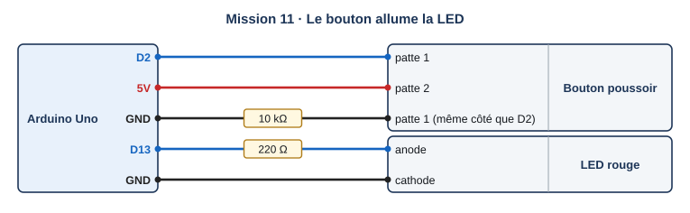{ .schema }

??? info "Le câblage, fil par fil"

    | Depuis | Broche ou borne | Sur le fil | Vers le composant | Borne du composant |
    |---|---|---|---|---|
    | Arduino Uno | D2 |   | Bouton poussoir | patte 1 |
    | Arduino Uno | 5V |   | Bouton poussoir | patte 2 |
    | Arduino Uno | GND | 10 kΩ | Bouton poussoir | patte 1 (même côté que D2) |
    | Arduino Uno | D13 | 220 Ω | LED rouge | anode |
    | Arduino Uno | GND |   | LED rouge | cathode |

[:material-open-in-new: Ouvrir Tinkercad Circuits](https://www.tinkercad.com/circuits){ .md-button .md-button--primary target=_blank rel=noopener }

**Notions :** entrée numérique, si alors sinon, résistance de rappel.

**Programmation :** Blocs.

**Pas à pas**

1. Je regarde la vidéo « Comment ajouter un bouton à un circuit Arduino sous Tinkercad ».
2. Je câble le bouton : une patte sur 5V, l'autre sur la broche 2, et une résistance de 10 kΩ entre la broche 2 et GND.
3. Je garde la LED sur la broche 13.
4. Dans Contrôle, je prends « si alors sinon ». Dans Math, je prends le comparateur « = ».
5. Dans Entrée, je prends « lire la broche numérique 2 » et je le place dans la comparaison avec 1.
6. Si la broche 2 vaut 1, j'allume la LED, sinon je l'éteins. Je teste en cliquant sur le bouton.

??? question "Coup de pouce 1 : je réfléchis avant de câbler et de programmer"

    - Quelle valeur la broche 2 lit-elle quand le bouton est enfoncé ? Et relâché ?
    - Que doit faire le programme dans chacun des deux cas ?
    - À quoi sert la résistance de 10 kΩ ?

??? note "Coup de pouce 2 : les blocs que je vais utiliser"

    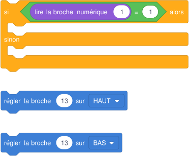{ .blocs }

    Les valeurs à choisir sont remplacées par 1 : à moi de trouver les bonnes et d'assembler les blocs. Les libellés peuvent varier légèrement selon la version de Tinkercad.

??? abstract "Coup de pouce 3 : le squelette du programme"

    Les blocs sont assemblés, les valeurs sont à trouver (cases vides). Je l'ouvre seulement si les deux premiers coups de pouce ne suffisent pas.

    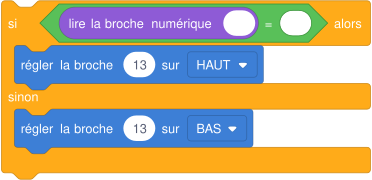{ .blocs }

??? warning "Si ça ne marche pas"

    - La LED reste toujours allumée : la résistance de 10 kΩ manque, la broche 2 « flotte ».
    - Rien ne change quand j'appuie : le bouton est tourné, ses deux pattes utilisées sont reliées en permanence ; je le tourne d'un quart de tour.
    - La LED s'allume au repos et s'éteint quand j'appuie : j'ai inversé les deux branches du si.

!!! example "Sur le vrai matériel"

    Sur le kit Grove : le module bouton se branche sur le port D2 du Base Shield. Sa résistance de rappel est déjà sur le module.

!!! tip "Mon défi"

    La LED s'allume quand le bouton est relâché et s'éteint quand j'appuie (une veilleuse de sortie de secours).

**Je vérifie avant de cocher**

- [ ] Appui : LED allumée. Relâché : LED éteinte.
- [ ] J'ai placé la résistance de 10 kΩ.

<label class="mission-reussie"><input type="checkbox" data-mission="11"> J'ai réussi la mission 11</label>

## Mission 12 · La sonnette { #mission-12 }

<strong>Ce que je dois obtenir.</strong> Quand j'appuie sur le bouton, le buzzer joue « ding dong ». Sans appui, il reste silencieux.

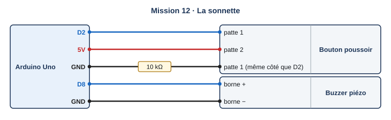{ .schema }

??? info "Le câblage, fil par fil"

    | Depuis | Broche ou borne | Sur le fil | Vers le composant | Borne du composant |
    |---|---|---|---|---|
    | Arduino Uno | D2 |   | Bouton poussoir | patte 1 |
    | Arduino Uno | 5V |   | Bouton poussoir | patte 2 |
    | Arduino Uno | GND | 10 kΩ | Bouton poussoir | patte 1 (même côté que D2) |
    | Arduino Uno | D8 |   | Buzzer piézo | borne + |
    | Arduino Uno | GND |   | Buzzer piézo | borne − |

[:material-open-in-new: Ouvrir Tinkercad Circuits](https://www.tinkercad.com/circuits){ .md-button .md-button--primary target=_blank rel=noopener }

**Notions :** entrée, sortie sonore, si alors.

**Programmation :** Blocs.

**Pas à pas**

1. Je garde le bouton de la mission 11 et j'ajoute le buzzer sur la broche 8.
2. Si la broche 2 vaut 1 : je joue une note aiguë (tonalité 76) 0,4 s puis une note plus grave (tonalité 72) 0,6 s.
3. Cette fois, pas besoin de « sinon » : sans appui, il ne se passe rien.
4. Je teste plusieurs appuis, longs et courts.

??? question "Coup de pouce 1 : je réfléchis avant de câbler et de programmer"

    - Faut-il un « sinon » ? Que ferait-il ?
    - Pourquoi le ding dong se rejoue-t-il si je garde le doigt appuyé ?

??? note "Coup de pouce 2 : les blocs que je vais utiliser"

    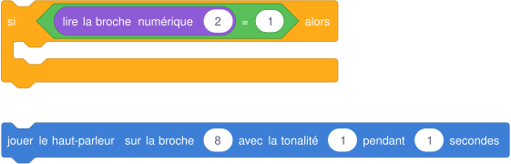{ .blocs }

    Les valeurs à choisir sont remplacées par 1 : à moi de trouver les bonnes et d'assembler les blocs. Les libellés peuvent varier légèrement selon la version de Tinkercad.

??? abstract "Coup de pouce 3 : le squelette du programme"

    Les blocs sont assemblés, les valeurs sont à trouver (cases vides). Je l'ouvre seulement si les deux premiers coups de pouce ne suffisent pas.

    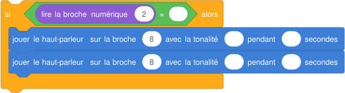{ .blocs }

??? warning "Si ça ne marche pas"

    - Le son se joue sans appui : la condition compare à 0 au lieu de 1, ou la résistance de rappel manque.
    - Le ding dong se répète tant que j'appuie : c'est normal, le programme relit le bouton à chaque tour.

!!! example "Sur le vrai matériel"

    Sur le kit Grove : module bouton sur D2. Le kit Plant Care n'a pas de buzzer : on le prend dans le kit starter.

!!! tip "Mon défi"

    Je fais clignoter la LED de la broche 13 pendant le ding dong, comme une sonnette pour les malentendants.

**Je vérifie avant de cocher**

- [ ] Un appui donne ding dong.
- [ ] Sans appui, silence.

<label class="mission-reussie"><input type="checkbox" data-mission="12"> J'ai réussi la mission 12</label>

## Mission 13 · Le moniteur série { #mission-13 }

<strong>Ce que je dois obtenir.</strong> Le moniteur série affiche « Bonjour » au démarrage, puis l'état du bouton (0 ou 1) deux fois par seconde.

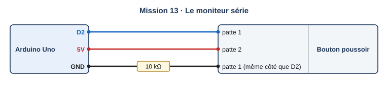{ .schema }

??? info "Le câblage, fil par fil"

    | Depuis | Broche ou borne | Sur le fil | Vers le composant | Borne du composant |
    |---|---|---|---|---|
    | Arduino Uno | D2 |   | Bouton poussoir | patte 1 |
    | Arduino Uno | 5V |   | Bouton poussoir | patte 2 |
    | Arduino Uno | GND | 10 kΩ | Bouton poussoir | patte 1 (même côté que D2) |

[:material-open-in-new: Ouvrir Tinkercad Circuits](https://www.tinkercad.com/circuits){ .md-button .md-button--primary target=_blank rel=noopener }

**Notions :** moniteur série, afficher une valeur, déboguer.

**Programmation :** Blocs.

**Pas à pas**

1. Je garde le bouton sur la broche 2.
2. Dans Sortie, je prends « imprimer sur le moniteur série ». J'écris Bonjour.
3. J'ajoute un deuxième bloc d'impression et j'y glisse « lire la broche numérique 2 ».
4. J'ajoute « attendre 0,5 seconde ».
5. Je démarre la simulation, puis j'ouvre **Moniteur série** en bas de la zone de code. J'appuie sur le bouton.

??? question "Coup de pouce 1 : je réfléchis avant de câbler et de programmer"

    - Pourquoi « Bonjour » s'affiche-t-il plusieurs fois ?
    - Quels nombres vois-je défiler quand j'appuie et quand je relâche ?
    - À quoi peut servir le moniteur série quand un programme ne marche pas ?

??? note "Coup de pouce 2 : les blocs que je vais utiliser"

    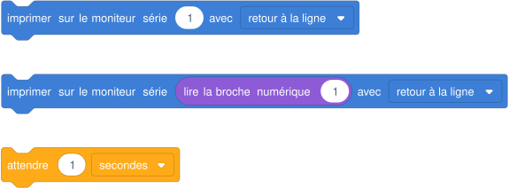{ .blocs }

    Les valeurs à choisir sont remplacées par 1 : à moi de trouver les bonnes et d'assembler les blocs. Les libellés peuvent varier légèrement selon la version de Tinkercad.

??? abstract "Coup de pouce 3 : le squelette du programme"

    Les blocs sont assemblés, les valeurs sont à trouver (cases vides). Je l'ouvre seulement si les deux premiers coups de pouce ne suffisent pas.

    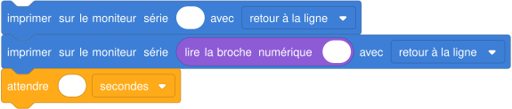{ .blocs }

??? warning "Si ça ne marche pas"

    - Rien ne s'affiche : je n'ai pas ouvert le moniteur série, ou la simulation est arrêtée.
    - Les nombres défilent trop vite : il manque l'attente.

!!! example "Sur le vrai matériel"

    Avec la vraie carte : Arduino IDE, menu Outils, Moniteur série, réglé à 9600 bauds.

!!! tip "Mon défi"

    J'affiche un message en clair : « appuyé » ou « relâché » selon l'état du bouton.

**Je vérifie avant de cocher**

- [ ] Je vois les 0 et les 1 changer quand j'appuie.
- [ ] J'ai ouvert le moniteur série seul.

<label class="mission-reussie"><input type="checkbox" data-mission="13"> J'ai réussi la mission 13</label>

## Mission 14 · Le potentiomètre { #mission-14 }

<strong>Ce que je dois obtenir.</strong> En tournant le potentiomètre, je vois une valeur changer entre 0 et 1023 dans le moniteur série.

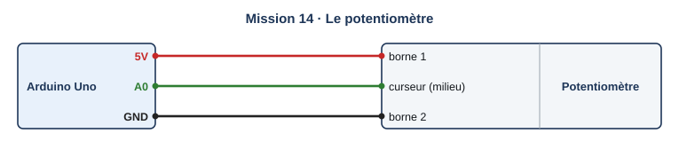{ .schema }

??? info "Le câblage, fil par fil"

    | Depuis | Broche ou borne | Sur le fil | Vers le composant | Borne du composant |
    |---|---|---|---|---|
    | Arduino Uno | 5V |   | Potentiomètre | borne 1 |
    | Arduino Uno | A0 |   | Potentiomètre | curseur (milieu) |
    | Arduino Uno | GND |   | Potentiomètre | borne 2 |

[:material-open-in-new: Ouvrir Tinkercad Circuits](https://www.tinkercad.com/circuits){ .md-button .md-button--primary target=_blank rel=noopener }

**Notions :** entrée analogique, valeur de 0 à 1023.

**Programmation :** Blocs.

**Pas à pas**

1. J'ajoute un **potentiomètre** : bornes extrêmes sur 5V et GND, curseur (patte du milieu) sur A0.
2. Dans Entrée, je prends « lire la broche analogique A0 ».
3. Je l'imprime sur le moniteur série, puis j'attends 0,2 s.
4. Je démarre la simulation et je tourne le bouton du potentiomètre avec la souris.

??? question "Coup de pouce 1 : je réfléchis avant de câbler et de programmer"

    - Quelle est la plus petite valeur affichée ? Et la plus grande ?
    - Quelle différence entre une entrée numérique (bouton) et une entrée analogique (potentiomètre) ?

??? note "Coup de pouce 2 : les blocs que je vais utiliser"

    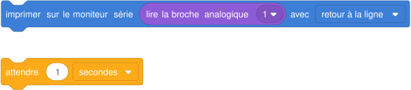{ .blocs }

    Les valeurs à choisir sont remplacées par 1 : à moi de trouver les bonnes et d'assembler les blocs. Les libellés peuvent varier légèrement selon la version de Tinkercad.

??? abstract "Coup de pouce 3 : le squelette du programme"

    Les blocs sont assemblés, les valeurs sont à trouver (cases vides). Je l'ouvre seulement si les deux premiers coups de pouce ne suffisent pas.

    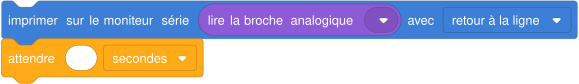{ .blocs }

??? warning "Si ça ne marche pas"

    - La valeur reste à 0 ou à 1023 : le curseur n'est pas sur A0, ou les deux bornes extrêmes sont du même côté.
    - La valeur va de 1023 à 0 dans le mauvais sens : j'échange 5V et GND sur les bornes extrêmes.

!!! example "Sur le vrai matériel"

    Sur le kit Grove : l'encodeur rotatif sert aussi à régler une valeur, mais il compte des crans au lieu de donner une valeur de 0 à 1023. Le potentiomètre du kit starter se câble comme dans Tinkercad.

!!! tip "Mon défi"

    J'allume la LED de la broche 13 quand la valeur dépasse 512 (la moitié).

**Je vérifie avant de cocher**

- [ ] J'ai vu 0 et 1023.
- [ ] Je sais que l'entrée analogique donne beaucoup de valeurs.

<label class="mission-reussie"><input type="checkbox" data-mission="14"> J'ai réussi la mission 14</label>

## Mission 15 · La veilleuse { #mission-15 }

<strong>Ce que je dois obtenir.</strong> Quand la lumière baisse (je déplace le curseur de lumière de la photorésistance), la LED s'allume. En pleine lumière, elle s'éteint.

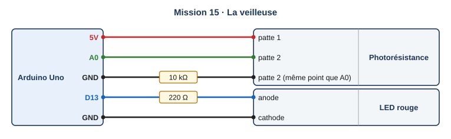{ .schema }

??? info "Le câblage, fil par fil"

    | Depuis | Broche ou borne | Sur le fil | Vers le composant | Borne du composant |
    |---|---|---|---|---|
    | Arduino Uno | 5V |   | Photorésistance | patte 1 |
    | Arduino Uno | A0 |   | Photorésistance | patte 2 |
    | Arduino Uno | GND | 10 kΩ | Photorésistance | patte 2 (même point que A0) |
    | Arduino Uno | D13 | 220 Ω | LED rouge | anode |
    | Arduino Uno | GND |   | LED rouge | cathode |

[:material-open-in-new: Ouvrir Tinkercad Circuits](https://www.tinkercad.com/circuits){ .md-button .md-button--primary target=_blank rel=noopener }

**Notions :** photorésistance, seuil, condition.

**Programmation :** Blocs.

**Pas à pas**

1. J'ajoute une **photorésistance** et une résistance de 10 kΩ selon le schéma (pont diviseur vers A0).
2. Avec le programme de la mission 14, je relève la valeur en pleine lumière puis dans le noir.
3. Je choisis un seuil entre les deux, par exemple 300.
4. Si la valeur lue sur A0 est inférieure au seuil, j'allume la LED, sinon je l'éteins.

??? question "Coup de pouce 1 : je réfléchis avant de câbler et de programmer"

    - Quelle valeur lis-je en pleine lumière ? Dans le noir ?
    - Comment choisir le seuil ?
    - Faut-il « plus petit que » ou « plus grand que » ?

??? note "Coup de pouce 2 : les blocs que je vais utiliser"

    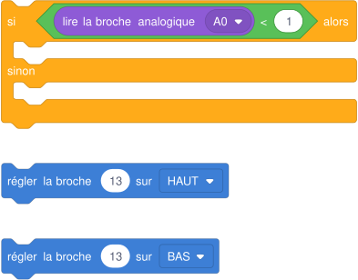{ .blocs }

    Les valeurs à choisir sont remplacées par 1 : à moi de trouver les bonnes et d'assembler les blocs. Les libellés peuvent varier légèrement selon la version de Tinkercad.

??? abstract "Coup de pouce 3 : le squelette du programme"

    Les blocs sont assemblés, les valeurs sont à trouver (cases vides). Je l'ouvre seulement si les deux premiers coups de pouce ne suffisent pas.

    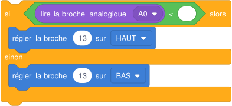{ .blocs }

??? warning "Si ça ne marche pas"

    - La LED fait l'inverse : je remplace « < » par « > ».
    - La LED ne s'allume jamais : mon seuil est plus bas que la valeur dans le noir ; je regarde le moniteur série.

!!! example "Sur le vrai matériel"

    Sur le kit Grove : le capteur de lumière du soleil (Sunlight Sensor) se branche sur le port I2C. Il ne donne pas une valeur de 0 à 1023 : on lit l'éclairement avec la bibliothèque du module.

!!! tip "Mon défi"

    J'ajoute une seconde LED qui s'allume seulement quand il fait très sombre (deuxième seuil plus bas).

**Je vérifie avant de cocher**

- [ ] La LED s'allume dans le noir et s'éteint en lumière.
- [ ] J'ai choisi mon seuil d'après mes mesures.

<label class="mission-reussie"><input type="checkbox" data-mission="15"> J'ai réussi la mission 15</label>

## Mission 16 · Le variateur de clignotement { #mission-16 }

<strong>Ce que je dois obtenir.</strong> Plus je tourne le potentiomètre, plus la LED clignote lentement.

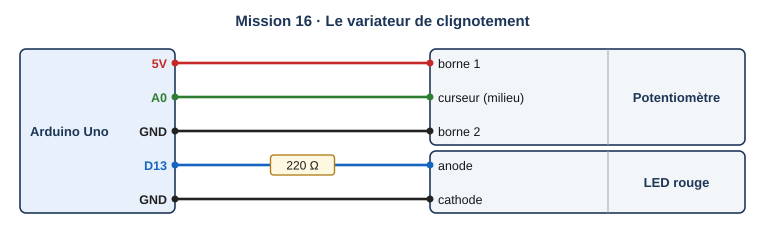{ .schema }

??? info "Le câblage, fil par fil"

    | Depuis | Broche ou borne | Sur le fil | Vers le composant | Borne du composant |
    |---|---|---|---|---|
    | Arduino Uno | 5V |   | Potentiomètre | borne 1 |
    | Arduino Uno | A0 |   | Potentiomètre | curseur (milieu) |
    | Arduino Uno | GND |   | Potentiomètre | borne 2 |
    | Arduino Uno | D13 | 220 Ω | LED rouge | anode |
    | Arduino Uno | GND |   | LED rouge | cathode |

[:material-open-in-new: Ouvrir Tinkercad Circuits](https://www.tinkercad.com/circuits){ .md-button .md-button--primary target=_blank rel=noopener }

**Notions :** variable, valeur lue, durée réglable.

**Programmation :** Blocs.

**Pas à pas**

1. Je câble le potentiomètre sur A0 et la LED sur 13.
2. Dans Variables, je crée une variable « attente ».
3. Je mets dans « attente » la valeur lue sur A0.
4. J'allume la LED, j'attends « attente » millisecondes, je l'éteins, j'attends encore.

??? question "Coup de pouce 1 : je réfléchis avant de câbler et de programmer"

    - Quelle est l'attente la plus courte possible ? La plus longue ?
    - Pourquoi ranger la valeur dans une variable avant de l'utiliser ?

??? note "Coup de pouce 2 : les blocs que je vais utiliser"

    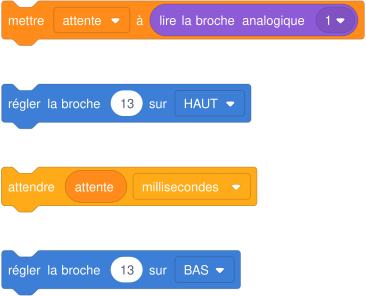{ .blocs }

    Les valeurs à choisir sont remplacées par 1 : à moi de trouver les bonnes et d'assembler les blocs. Les libellés peuvent varier légèrement selon la version de Tinkercad.

??? abstract "Coup de pouce 3 : le squelette du programme"

    Les blocs sont assemblés, les valeurs sont à trouver (cases vides). Je l'ouvre seulement si les deux premiers coups de pouce ne suffisent pas.

    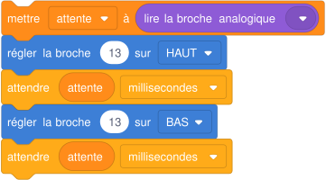{ .blocs }

??? warning "Si ça ne marche pas"

    - La LED ne clignote plus du tout : l'attente est en secondes, 1023 secondes c'est très long ; je choisis l'unité millisecondes.
    - Le rythme ne change pas : je n'utilise pas la variable dans les blocs attendre.

!!! example "Sur le vrai matériel"

    Sur le kit Grove : le même réglage se fait avec l'encodeur (palier violet).

!!! tip "Mon défi"

    Je limite l'attente entre 100 et 1000 ms pour que le clignotement reste visible.

**Je vérifie avant de cocher**

- [ ] Le rythme suit le potentiomètre.
- [ ] J'ai créé et utilisé une variable.

<label class="mission-reussie"><input type="checkbox" data-mission="16"> J'ai réussi la mission 16</label>

## Mission 17 · Le feu à bouton d'appel { #mission-17 }

<strong>Ce que je dois obtenir.</strong> Le feu voitures reste au vert. Quand un piéton appuie sur le bouton, le feu passe à l'orange puis au rouge, le feu piétons passe au vert 5 s, puis tout revient comme avant.

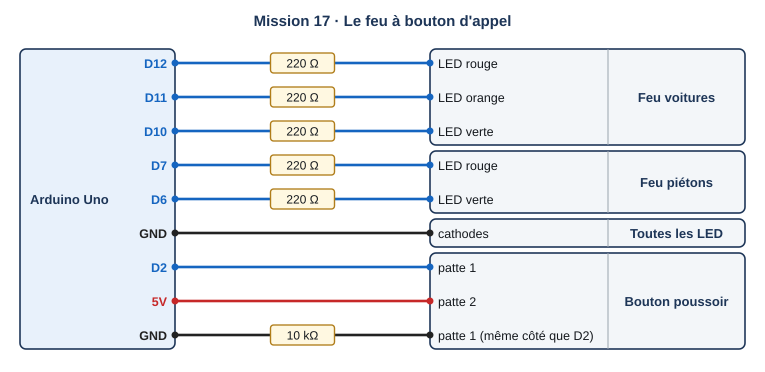{ .schema }

??? info "Le câblage, fil par fil"

    | Depuis | Broche ou borne | Sur le fil | Vers le composant | Borne du composant |
    |---|---|---|---|---|
    | Arduino Uno | D12 | 220 Ω | Feu voitures | LED rouge |
    | Arduino Uno | D11 | 220 Ω | Feu voitures | LED orange |
    | Arduino Uno | D10 | 220 Ω | Feu voitures | LED verte |
    | Arduino Uno | D7 | 220 Ω | Feu piétons | LED rouge |
    | Arduino Uno | D6 | 220 Ω | Feu piétons | LED verte |
    | Arduino Uno | GND |   | Toutes les LED | cathodes |
    | Arduino Uno | D2 |   | Bouton poussoir | patte 1 |
    | Arduino Uno | 5V |   | Bouton poussoir | patte 2 |
    | Arduino Uno | GND | 10 kΩ | Bouton poussoir | patte 1 (même côté que D2) |

[:material-open-in-new: Ouvrir Tinkercad Circuits](https://www.tinkercad.com/circuits){ .md-button .md-button--primary target=_blank rel=noopener }

**Notions :** attendre un événement, séquence déclenchée.

**Programmation :** Blocs.

**Pas à pas**

1. Je reprends le montage de la mission 10 et j'ajoute le bouton sur la broche 2.
2. État de repos : voitures vert, piétons rouge.
3. Si le bouton vaut 1 : voitures orange 1 s, voitures rouge, piétons vert 5 s, puis retour au repos.
4. Je teste : sans appui, le feu ne change jamais.

??? question "Coup de pouce 1 : je réfléchis avant de câbler et de programmer"

    - Que fait le feu tant que personne n'appuie ?
    - Où place-t-on la séquence piéton : avant, dans ou après le si ?

??? note "Coup de pouce 2 : les blocs que je vais utiliser"

    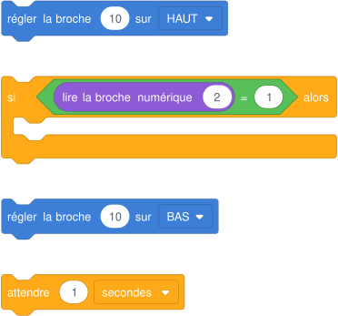{ .blocs }

    Les valeurs à choisir sont remplacées par 1 : à moi de trouver les bonnes et d'assembler les blocs. Les libellés peuvent varier légèrement selon la version de Tinkercad.

??? abstract "Coup de pouce 3 : le squelette du programme"

    Les blocs sont assemblés, les valeurs sont à trouver (cases vides). Je l'ouvre seulement si les deux premiers coups de pouce ne suffisent pas.

    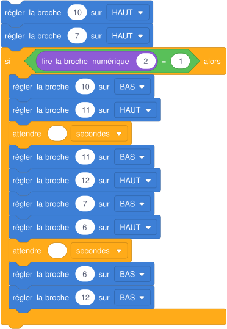{ .blocs }

??? warning "Si ça ne marche pas"

    - Le feu change tout seul : la séquence piéton est en dehors du si.
    - Le vert voitures ne revient pas : je n'ai pas remis l'état de repos à la fin de la séquence.

!!! example "Sur le vrai matériel"

    Sur le kit Grove : le module bouton sur D2 remplace le bouton et sa résistance.

!!! tip "Mon défi"

    J'empêche un nouvel appel pendant 10 s après le passage des piétons, pour laisser rouler les voitures.

**Je vérifie avant de cocher**

- [ ] Le feu ne change que si j'appuie.
- [ ] Jamais de vert pour tout le monde en même temps.

<label class="mission-reussie"><input type="checkbox" data-mission="17"> J'ai réussi la mission 17</label>

## Mission 18 · Le compteur d'appuis { #mission-18 }

<strong>Ce que je dois obtenir.</strong> Chaque appui sur le bouton ajoute 1 au compteur affiché dans le moniteur série : 1, puis 2, puis 3, et ainsi de suite

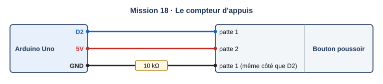{ .schema }

??? info "Le câblage, fil par fil"

    | Depuis | Broche ou borne | Sur le fil | Vers le composant | Borne du composant |
    |---|---|---|---|---|
    | Arduino Uno | D2 |   | Bouton poussoir | patte 1 |
    | Arduino Uno | 5V |   | Bouton poussoir | patte 2 |
    | Arduino Uno | GND | 10 kΩ | Bouton poussoir | patte 1 (même côté que D2) |

[:material-open-in-new: Ouvrir Tinkercad Circuits](https://www.tinkercad.com/circuits){ .md-button .md-button--primary target=_blank rel=noopener }

**Notions :** variable compteur, ajouter 1, front, anti-rebond simple.

**Programmation :** Blocs.

**Pas à pas**

1. Je crée une variable « compteur » et je la mets à 0 au départ (en texte : dans setup).
2. Si le bouton vaut 1 : j'ajoute 1 au compteur, je l'imprime, puis j'attends que le bouton soit relâché.
3. Pour attendre le relâchement : « répéter jusqu'à ce que » la broche 2 vaille 0.
4. Je teste dix appuis et je vérifie que le compteur affiche 10.

??? question "Coup de pouce 1 : je réfléchis avant de câbler et de programmer"

    - Pourquoi le compteur grimpe-t-il très vite si je n'attends pas le relâchement ?
    - Où mettre le compteur à zéro pour qu'il ne revienne pas à 0 à chaque tour ?

??? note "Coup de pouce 2 : les blocs que je vais utiliser"

    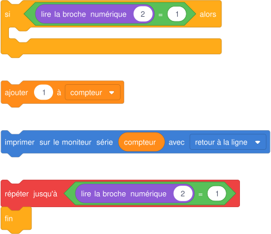{ .blocs }

    Les valeurs à choisir sont remplacées par 1 : à moi de trouver les bonnes et d'assembler les blocs. Les libellés peuvent varier légèrement selon la version de Tinkercad.

??? abstract "Coup de pouce 3 : le squelette du programme"

    Les blocs sont assemblés, les valeurs sont à trouver (cases vides). Je l'ouvre seulement si les deux premiers coups de pouce ne suffisent pas.

    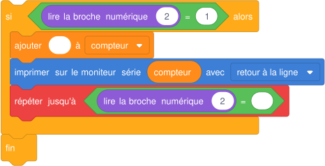{ .blocs }

??? warning "Si ça ne marche pas"

    - Le compteur reste à 1 : je le remets à 0 à chaque tour du programme. En blocs, je le fais une seule fois avec une condition, ou je passe en texte.
    - Un appui compte plusieurs fois : il manque l'attente du relâchement.

!!! example "Sur le vrai matériel"

    Sur le kit Grove : le capteur de débit d'eau envoie une impulsion par petit volume d'eau ; compter ses impulsions, c'est mesurer le volume. Même principe que ce compteur.

!!! tip "Mon défi"

    Au dixième appui, la LED s'allume et le compteur repart à 0.

**Je vérifie avant de cocher**

- [ ] Un appui = +1.
- [ ] Le compteur ne repart pas à 0 tout seul.

<label class="mission-reussie"><input type="checkbox" data-mission="18"> J'ai réussi la mission 18</label>

## Mission 19 · La LED RVB { #mission-19 }

<strong>Ce que je dois obtenir.</strong> Une LED RVB affiche rouge, vert, bleu, puis jaune, cyan, violet et blanc, une seconde chacun.

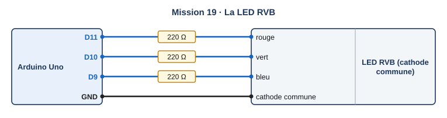{ .schema }

??? info "Le câblage, fil par fil"

    | Depuis | Broche ou borne | Sur le fil | Vers le composant | Borne du composant |
    |---|---|---|---|---|
    | Arduino Uno | D11 | 220 Ω | LED RVB (cathode commune) | rouge |
    | Arduino Uno | D10 | 220 Ω | LED RVB (cathode commune) | vert |
    | Arduino Uno | D9 | 220 Ω | LED RVB (cathode commune) | bleu |
    | Arduino Uno | GND |   | LED RVB (cathode commune) | cathode commune |

[:material-open-in-new: Ouvrir Tinkercad Circuits](https://www.tinkercad.com/circuits){ .md-button .md-button--primary target=_blank rel=noopener }

**Notions :** LED tricolore, mélange de couleurs, sorties.

**Programmation :** Blocs.

**Pas à pas**

1. J'ajoute une **LED RVB**, réglée en cathode commune, et trois résistances de 220 Ω.
2. Rouge sur 11, vert sur 10, bleu sur 9, la patte commune sur GND.
3. J'allume une seule couleur à la fois pendant 1 s, puis deux couleurs ensemble.
4. Je note dans un tableau : rouge + vert = ?, vert + bleu = ?, rouge + bleu = ?, les trois = ?

??? question "Coup de pouce 1 : je réfléchis avant de câbler et de programmer"

    - Combien de LED y a-t-il dans une LED RVB ?
    - Quelles couleurs dois-je allumer ensemble pour obtenir du jaune ?

??? note "Coup de pouce 2 : les blocs que je vais utiliser"

    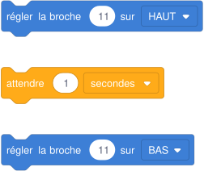{ .blocs }

    Les valeurs à choisir sont remplacées par 1 : à moi de trouver les bonnes et d'assembler les blocs. Les libellés peuvent varier légèrement selon la version de Tinkercad.

??? abstract "Coup de pouce 3 : le squelette du programme"

    Les blocs sont assemblés, les valeurs sont à trouver (cases vides). Je l'ouvre seulement si les deux premiers coups de pouce ne suffisent pas.

    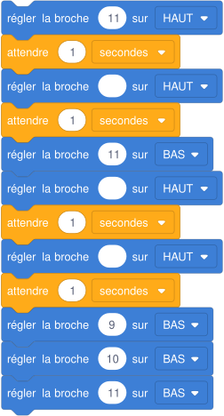{ .blocs }

??? warning "Si ça ne marche pas"

    - Une couleur manque : la résistance de cette patte n'est pas reliée à la bonne broche.
    - Rien ne s'allume : la LED est réglée en anode commune ; je la passe en cathode commune dans ses propriétés.

!!! example "Sur le vrai matériel"

    Avec le kit de la classe : la LED RVB du kit starter (vérifier si elle est à cathode ou à anode commune).

!!! tip "Mon défi"

    Je fais un arc-en-ciel progressif avec la sortie analogique (PWM) : « régler la broche analogique 11 à 128 ».

**Je vérifie avant de cocher**

- [ ] J'ai vu les sept couleurs.
- [ ] Mon tableau des mélanges est rempli.

<label class="mission-reussie"><input type="checkbox" data-mission="19"> J'ai réussi la mission 19</label>

## Mission 20 · Atelier rose : l'éclairage automatique du couloir { #mission-20 }

<strong>Ce que je dois obtenir.</strong> Dans un couloir sombre, la lumière s'allume 5 s quand quelqu'un appuie sur le bouton de passage. En plein jour, elle ne s'allume pas.

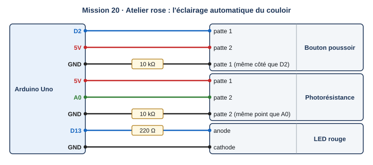{ .schema }

??? info "Le câblage, fil par fil"

    | Depuis | Broche ou borne | Sur le fil | Vers le composant | Borne du composant |
    |---|---|---|---|---|
    | Arduino Uno | D2 |   | Bouton poussoir | patte 1 |
    | Arduino Uno | 5V |   | Bouton poussoir | patte 2 |
    | Arduino Uno | GND | 10 kΩ | Bouton poussoir | patte 1 (même côté que D2) |
    | Arduino Uno | 5V |   | Photorésistance | patte 1 |
    | Arduino Uno | A0 |   | Photorésistance | patte 2 |
    | Arduino Uno | GND | 10 kΩ | Photorésistance | patte 2 (même point que A0) |
    | Arduino Uno | D13 | 220 Ω | LED rouge | anode |
    | Arduino Uno | GND |   | LED rouge | cathode |

[:material-open-in-new: Ouvrir Tinkercad Circuits](https://www.tinkercad.com/circuits){ .md-button .md-button--primary target=_blank rel=noopener }

**Notions :** synthèse : deux capteurs, condition ET, temporisation.

**Programmation :** Blocs.

**Pas à pas**

1. Je câble le bouton (D2), la photorésistance (A0) et la LED (13).
2. Je mesure la valeur de la photorésistance de jour et de nuit pour choisir mon seuil.
3. Dans Math, je prends le bloc « et » pour combiner deux conditions.
4. Si le bouton vaut 1 ET la lumière est sous le seuil : LED allumée 5 s, puis éteinte.
5. Je teste les quatre cas : jour sans appui, jour avec appui, nuit sans appui, nuit avec appui.

??? question "Coup de pouce 1 : je réfléchis avant de câbler et de programmer"

    - Combien de cas différents faut-il tester ? Lesquels allument la lumière ?
    - Que se passerait-il avec « ou » au lieu de « et » ?

??? note "Coup de pouce 2 : les blocs que je vais utiliser"

    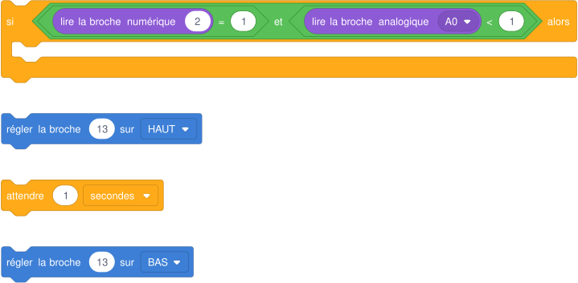{ .blocs }

    Les valeurs à choisir sont remplacées par 1 : à moi de trouver les bonnes et d'assembler les blocs. Les libellés peuvent varier légèrement selon la version de Tinkercad.

??? abstract "Coup de pouce 3 : le squelette du programme"

    Les blocs sont assemblés, les valeurs sont à trouver (cases vides). Je l'ouvre seulement si les deux premiers coups de pouce ne suffisent pas.

    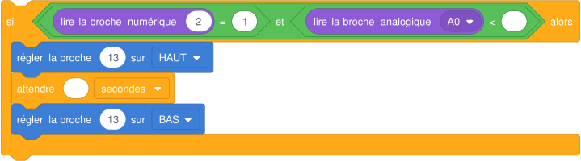{ .blocs }

??? warning "Si ça ne marche pas"

    - La lumière s'allume en plein jour : la condition de lumière est inversée, ou j'ai mis « ou ».
    - La lumière ne s'éteint plus : il manque le bloc qui éteint la LED après les 5 s.

!!! example "Sur le vrai matériel"

    Sur le kit Grove : le guide éduscol utilise un module bouton et un capteur de lumière Grove ; même programme, avec les ports du Base Shield.

!!! tip "Mon défi"

    La minuterie repart à zéro si quelqu'un rappuie pendant les 5 s.

**Je vérifie avant de cocher**

- [ ] Un seul cas sur quatre allume la lumière.
- [ ] La lumière s'éteint seule après 5 s.
- [ ] J'ai envoyé ma capture avec le formulaire en bas de la page.

<label class="mission-reussie"><input type="checkbox" data-mission="20"> J'ai réussi la mission 20</label>

## Je vérifie que j'ai compris

**Question 1.** Le bouton est relâché. Que fait la LED ?

{ .blocs }

**Question 2.** Un potentiomètre est lu sur A0. Entre quelles valeurs le nombre lu peut-il varier ?

**Question 3.** La veilleuse s'allume en plein jour et s'éteint la nuit. Quelle correction faire ?

**Question 4.** Pourquoi faut-il attendre le relâchement du bouton dans le compteur d'appuis ?

**Question 5.** Avec « et », combien de conditions doivent être vraies pour allumer la lumière du couloir ?

## Où j'en suis

En fin de séance, j'indique la dernière mission terminée et j'ajoute une capture d'écran de mon circuit et de mon programme dans Tinkercad. Le professeur la reçoit directement.

*Missions conçues pour le site à partir des ressources officielles citées sur la [page d'accueil des missions](index.md#sources-et-licences).*
