# Palier 2 (bleu) : capteurs, actionneurs et station du jardin

Dix missions pour mesurer le monde et agir sur lui : servomoteur, température, distance, humidité de la terre, relais et pompe, écran. On termine par la station du jardin, que l'on transpose ensuite au kit Grove de la classe.

Classe de départ : **4e**. Les élèves qui ont terminé le palier rose continuent ici.

| Mission | Titre | Notions |
|---|---|---|
| [21](#mission-21) | Le servomoteur | actionneur, angle, position |
| [22](#mission-22) | Le servo suit le potentiomètre | mise à l'échelle (mapper), entrée vers sortie |
| [23](#mission-23) | Le thermomètre | capteur de température, conversion en °C, moniteur série |
| [24](#mission-24) | L'alarme de chaleur | seuil, alarme, sortie sonore et lumineuse |
| [25](#mission-25) | Mesurer une distance | capteur à ultrasons, centimètres, mesure sans contact |
| [26](#mission-26) | Le radar de recul | plusieurs conditions, zones, rythme du son |
| [27](#mission-27) | L'humidité de la terre | capteur d'humidité du sol, étalonnage, pourcentage |
| [28](#mission-28) | L'arrosage automatique | relais, moteur, chaîne d'énergie, chaîne d'information |
| [29](#mission-29) | L'écran LCD | afficheur, texte, position du curseur, affichage d'une variable |
| [30](#mission-30) | Atelier bleu : la station du jardin | synthèse : capteur, seuil, relais, écran, alerte |

!!! info "Comment travailler"

    Je regarde le schéma de câblage et je lis ce que je dois obtenir. J'ouvre Tinkercad Circuits, je câble, puis je programme en suivant le pas à pas. Je lance la simulation et je compare avec l'objectif. Si je suis bloqué, j'ouvre les coups de pouce dans l'ordre : 1, je réfléchis ; 2, les blocs ou les instructions à utiliser ; 3, le squelette du programme. « Si ça ne marche pas » liste les erreurs les plus courantes. En fin de séance, j'envoie ma progression avec une capture d'écran (bas de la page).

## Mission 21 · Le servomoteur { #mission-21 }

<strong>Ce que je dois obtenir.</strong> Le bras du servomoteur va à 0°, attend 1 s, va à 90°, attend 1 s, va à 180°, attend 1 s, et recommence.

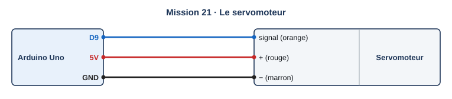{ .schema }

??? info "Le câblage, fil par fil"

    | Depuis | Broche ou borne | Sur le fil | Vers le composant | Borne du composant |
    |---|---|---|---|---|
    | Arduino Uno | D9 |   | Servomoteur | signal (orange) |
    | Arduino Uno | 5V |   | Servomoteur | + (rouge) |
    | Arduino Uno | GND |   | Servomoteur | − (marron) |

[:material-open-in-new: Ouvrir Tinkercad Circuits](https://www.tinkercad.com/circuits){ .md-button .md-button--primary target=_blank rel=noopener }

**Notions :** actionneur, angle, position.

**Programmation :** Blocs.

**Pas à pas**

1. J'ajoute un **micro servomoteur** : fil de signal sur 9, + sur 5V, − sur GND.
2. Dans Sortie, je prends « faire pivoter le servo sur la broche 9 à 0 degrés ».
3. J'enchaîne les trois positions avec une attente d'une seconde après chacune.
4. Je démarre la simulation et j'observe le bras.

??? question "Coup de pouce 1 : je réfléchis avant de câbler et de programmer"

    - Quelle est la différence entre un servomoteur et un moteur ordinaire ?
    - Pourquoi faut-il attendre après chaque ordre ?

??? note "Coup de pouce 2 : les blocs que je vais utiliser"

    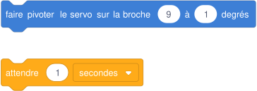{ .blocs }

    Les valeurs à choisir sont remplacées par 1 : à moi de trouver les bonnes et d'assembler les blocs. Les libellés peuvent varier légèrement selon la version de Tinkercad.

??? abstract "Coup de pouce 3 : le squelette du programme"

    Les blocs sont assemblés, les valeurs sont à trouver (cases vides). Je l'ouvre seulement si les deux premiers coups de pouce ne suffisent pas.

    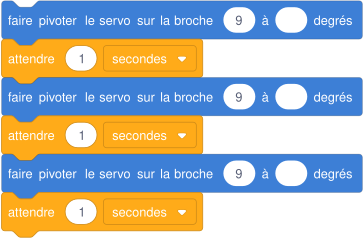{ .blocs }

??? warning "Si ça ne marche pas"

    - Le bras ne bouge pas : le fil de signal n'est pas sur la broche du programme.
    - Le bras tremble ou saute une position : il manque une attente, le servo n'a pas le temps d'arriver.

!!! example "Sur le vrai matériel"

    Avec le kit de la classe : le servomoteur du kit starter (fil orange sur 9). Le kit Plant Care n'en contient pas.

!!! tip "Mon défi"

    Le bras fait un balayage lent de 0 à 180° par pas de 10°, comme un essuie-glace.

**Je vérifie avant de cocher**

- [ ] Trois positions bien distinctes.
- [ ] Le cycle recommence sans fin.

<label class="mission-reussie"><input type="checkbox" data-mission="21"> J'ai réussi la mission 21</label>

## Mission 22 · Le servo suit le potentiomètre { #mission-22 }

<strong>Ce que je dois obtenir.</strong> Quand je tourne le potentiomètre, le bras du servomoteur suit, de 0° à 180°.

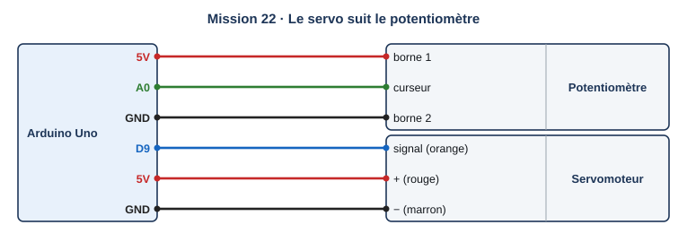{ .schema }

??? info "Le câblage, fil par fil"

    | Depuis | Broche ou borne | Sur le fil | Vers le composant | Borne du composant |
    |---|---|---|---|---|
    | Arduino Uno | 5V |   | Potentiomètre | borne 1 |
    | Arduino Uno | A0 |   | Potentiomètre | curseur |
    | Arduino Uno | GND |   | Potentiomètre | borne 2 |
    | Arduino Uno | D9 |   | Servomoteur | signal (orange) |
    | Arduino Uno | 5V |   | Servomoteur | + (rouge) |
    | Arduino Uno | GND |   | Servomoteur | − (marron) |

[:material-open-in-new: Ouvrir Tinkercad Circuits](https://www.tinkercad.com/circuits){ .md-button .md-button--primary target=_blank rel=noopener }

**Notions :** mise à l'échelle (mapper), entrée vers sortie.

**Programmation :** Blocs.

**Pas à pas**

1. Je garde le servomoteur sur 9 et j'ajoute le potentiomètre sur A0.
2. Je crée une variable « angle ».
3. Dans Math, je prends « mapper » : la valeur lue sur A0, de 0 à 1023, vers 0 à 180.
4. Je fais pivoter le servo à « angle », puis j'attends 0,05 s.

??? question "Coup de pouce 1 : je réfléchis avant de câbler et de programmer"

    - Le potentiomètre donne 0 à 1023, le servo attend 0 à 180 : comment passer de l'un à l'autre ?
    - Quel angle obtient-on pour la valeur 512 ?

??? note "Coup de pouce 2 : les blocs que je vais utiliser"

    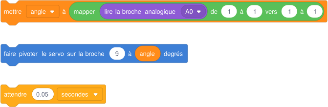{ .blocs }

    Les valeurs à choisir sont remplacées par 1 : à moi de trouver les bonnes et d'assembler les blocs. Les libellés peuvent varier légèrement selon la version de Tinkercad.

??? abstract "Coup de pouce 3 : le squelette du programme"

    Les blocs sont assemblés, les valeurs sont à trouver (cases vides). Je l'ouvre seulement si les deux premiers coups de pouce ne suffisent pas.

    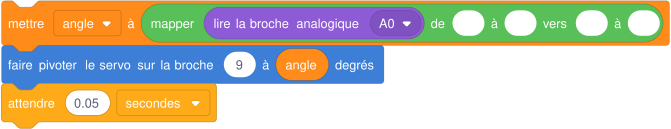{ .blocs }

??? warning "Si ça ne marche pas"

    - Le bras va toujours à 180° : je n'ai pas mis la valeur à l'échelle, 1023 degrés n'existe pas.
    - Le bras tourne à l'envers : j'inverse 0 et 180 dans « vers », ou les bornes 5V et GND du potentiomètre.

!!! example "Sur le vrai matériel"

    Sur le kit Grove : l'encodeur rotatif peut jouer le rôle du potentiomètre (palier violet).

!!! tip "Mon défi"

    Je limite le bras entre 30° et 150° pour protéger le mécanisme.

**Je vérifie avant de cocher**

- [ ] Le bras suit le bouton du potentiomètre.
- [ ] Je sais expliquer « mapper ».

<label class="mission-reussie"><input type="checkbox" data-mission="22"> J'ai réussi la mission 22</label>

## Mission 23 · Le thermomètre { #mission-23 }

<strong>Ce que je dois obtenir.</strong> Le moniteur série affiche la température en °C toutes les secondes. Quand je change la température du capteur dans la simulation, la valeur suit.

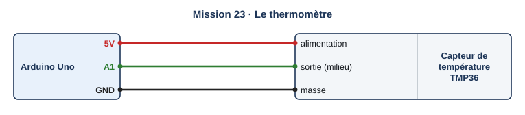{ .schema }

??? info "Le câblage, fil par fil"

    | Depuis | Broche ou borne | Sur le fil | Vers le composant | Borne du composant |
    |---|---|---|---|---|
    | Arduino Uno | 5V |   | Capteur de température TMP36 | alimentation |
    | Arduino Uno | A1 |   | Capteur de température TMP36 | sortie (milieu) |
    | Arduino Uno | GND |   | Capteur de température TMP36 | masse |

[:material-open-in-new: Ouvrir Tinkercad Circuits](https://www.tinkercad.com/circuits){ .md-button .md-button--primary target=_blank rel=noopener }

**Notions :** capteur de température, conversion en °C, moniteur série.

**Programmation :** Blocs.

**Pas à pas**

1. J'ajoute un capteur **TMP36** : alimentation sur 5V, sortie (patte du milieu) sur A1, masse sur GND.
2. Je crée une variable « temperature ».
3. Dans Entrée, je prends « lire le capteur de température sur la broche A1 en °C ».
4. J'imprime « Température : » puis la variable, et j'attends 1 s.
5. Pendant la simulation, je clique sur le capteur et je déplace le curseur de température.

??? question "Coup de pouce 1 : je réfléchis avant de câbler et de programmer"

    - Que mesure le capteur, et en quoi la carte le transforme-t-elle ?
    - La valeur affichée correspond-elle à celle du curseur ?

??? note "Coup de pouce 2 : les blocs que je vais utiliser"

    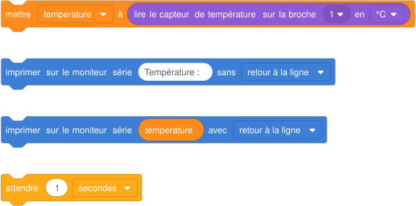{ .blocs }

    Les valeurs à choisir sont remplacées par 1 : à moi de trouver les bonnes et d'assembler les blocs. Les libellés peuvent varier légèrement selon la version de Tinkercad.

??? abstract "Coup de pouce 3 : le squelette du programme"

    Les blocs sont assemblés, les valeurs sont à trouver (cases vides). Je l'ouvre seulement si les deux premiers coups de pouce ne suffisent pas.

    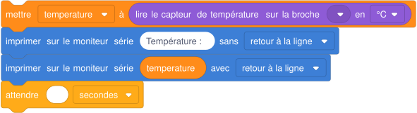{ .blocs }

??? warning "Si ça ne marche pas"

    - La température affichée est fausse de beaucoup : le capteur est câblé à l'envers ; la face plate doit être devant moi.
    - Les nombres sont entre 0 et 1023 : j'ai pris « lire la broche analogique » au lieu du bloc température.

!!! example "Sur le vrai matériel"

    Sur le kit Grove : le capteur de température et d'humidité de l'air se branche sur le port I2C ; on lit la température avec la bibliothèque indiquée sur la notice Seeed du module.

!!! tip "Mon défi"

    J'affiche aussi la température en degrés Fahrenheit.

**Je vérifie avant de cocher**

- [ ] La valeur suit le curseur.
- [ ] J'affiche une phrase complète avec l'unité.

<label class="mission-reussie"><input type="checkbox" data-mission="23"> J'ai réussi la mission 23</label>

## Mission 24 · L'alarme de chaleur { #mission-24 }

<strong>Ce que je dois obtenir.</strong> Si la température dépasse 30 °C, la LED rouge s'allume et le buzzer bipe. En dessous, tout est calme.

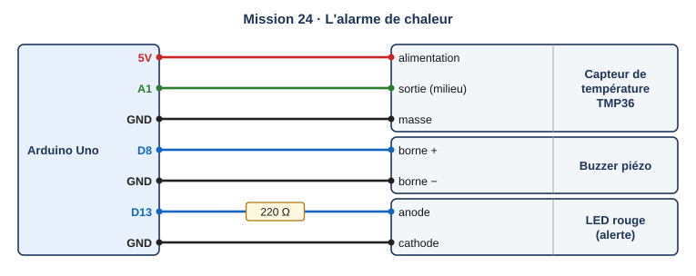{ .schema }

??? info "Le câblage, fil par fil"

    | Depuis | Broche ou borne | Sur le fil | Vers le composant | Borne du composant |
    |---|---|---|---|---|
    | Arduino Uno | 5V |   | Capteur de température TMP36 | alimentation |
    | Arduino Uno | A1 |   | Capteur de température TMP36 | sortie (milieu) |
    | Arduino Uno | GND |   | Capteur de température TMP36 | masse |
    | Arduino Uno | D8 |   | Buzzer piézo | borne + |
    | Arduino Uno | GND |   | Buzzer piézo | borne − |
    | Arduino Uno | D13 | 220 Ω | LED rouge (alerte) | anode |
    | Arduino Uno | GND |   | LED rouge (alerte) | cathode |

[:material-open-in-new: Ouvrir Tinkercad Circuits](https://www.tinkercad.com/circuits){ .md-button .md-button--primary target=_blank rel=noopener }

**Notions :** seuil, alarme, sortie sonore et lumineuse.

**Programmation :** Blocs.

**Pas à pas**

1. Je reprends le thermomètre et j'ajoute le buzzer (8) et la LED (13).
2. Si la température est supérieure à 30 : LED allumée et bip de 0,2 s, sinon LED éteinte.
3. Je teste en faisant monter puis descendre la température du capteur.

??? question "Coup de pouce 1 : je réfléchis avant de câbler et de programmer"

    - Quelle condition déclenche l'alarme ?
    - Pourquoi garder l'affichage dans le moniteur série ?

??? note "Coup de pouce 2 : les blocs que je vais utiliser"

    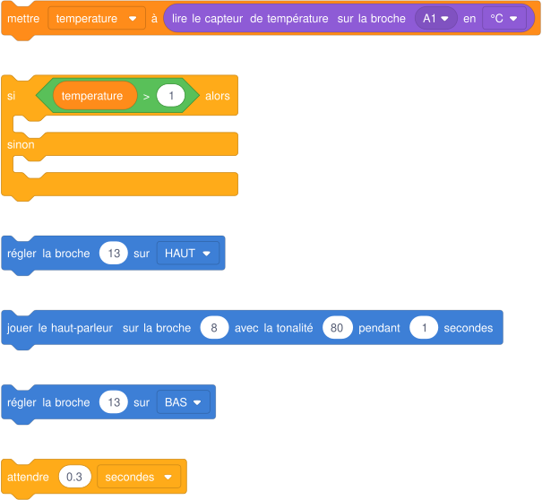{ .blocs }

    Les valeurs à choisir sont remplacées par 1 : à moi de trouver les bonnes et d'assembler les blocs. Les libellés peuvent varier légèrement selon la version de Tinkercad.

??? abstract "Coup de pouce 3 : le squelette du programme"

    Les blocs sont assemblés, les valeurs sont à trouver (cases vides). Je l'ouvre seulement si les deux premiers coups de pouce ne suffisent pas.

    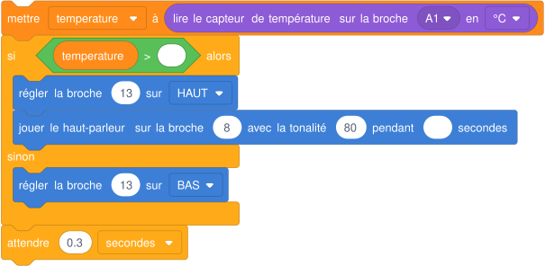{ .blocs }

??? warning "Si ça ne marche pas"

    - L'alarme sonne tout le temps : la comparaison est inversée.
    - L'alarme ne s'arrête pas quand la température redescend : il manque l'extinction de la LED dans le sinon.

!!! example "Sur le vrai matériel"

    Sur le kit Grove : même logique avec le capteur de température de l'air du kit, pour protéger les plantes d'une chaleur excessive.

!!! tip "Mon défi"

    Deux niveaux : LED seule au-dessus de 30 °C, LED et buzzer au-dessus de 35 °C.

**Je vérifie avant de cocher**

- [ ] Alarme au-dessus de 30 °C seulement.
- [ ] Elle s'arrête quand la température redescend.

<label class="mission-reussie"><input type="checkbox" data-mission="24"> J'ai réussi la mission 24</label>

## Mission 25 · Mesurer une distance { #mission-25 }

<strong>Ce que je dois obtenir.</strong> Le moniteur série affiche la distance de l'objet placé devant le capteur, en centimètres, cinq fois par seconde.

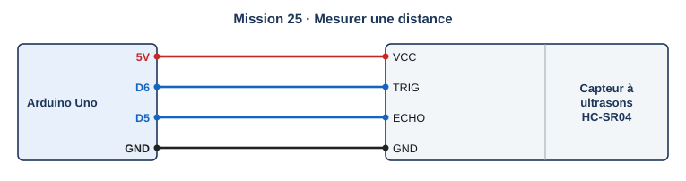{ .schema }

??? info "Le câblage, fil par fil"

    | Depuis | Broche ou borne | Sur le fil | Vers le composant | Borne du composant |
    |---|---|---|---|---|
    | Arduino Uno | 5V |   | Capteur à ultrasons HC-SR04 | VCC |
    | Arduino Uno | D6 |   | Capteur à ultrasons HC-SR04 | TRIG |
    | Arduino Uno | D5 |   | Capteur à ultrasons HC-SR04 | ECHO |
    | Arduino Uno | GND |   | Capteur à ultrasons HC-SR04 | GND |

[:material-open-in-new: Ouvrir Tinkercad Circuits](https://www.tinkercad.com/circuits){ .md-button .md-button--primary target=_blank rel=noopener }

**Notions :** capteur à ultrasons, centimètres, mesure sans contact.

**Programmation :** Blocs.

**Pas à pas**

1. J'ajoute un **capteur de distance à ultrasons** (4 broches) : VCC sur 5V, TRIG sur 6, ECHO sur 5, GND sur GND.
2. Je crée une variable « distance ».
3. Dans Entrée, je prends « lire le capteur de distance à ultrasons » : déclenchement 6, écho 5, en cm.
4. J'imprime la distance et j'attends 0,2 s.
5. Pendant la simulation, je clique sur le capteur et je déplace l'objet devant lui.

??? question "Coup de pouce 1 : je réfléchis avant de câbler et de programmer"

    - Comment le capteur mesure-t-il une distance sans toucher l'objet ?
    - Quelle distance maximale peut-il mesurer ?

??? note "Coup de pouce 2 : les blocs que je vais utiliser"

    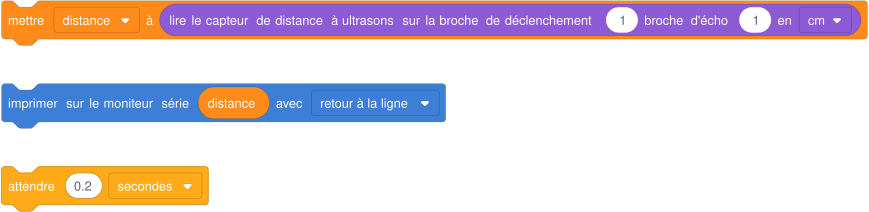{ .blocs }

    Les valeurs à choisir sont remplacées par 1 : à moi de trouver les bonnes et d'assembler les blocs. Les libellés peuvent varier légèrement selon la version de Tinkercad.

??? abstract "Coup de pouce 3 : le squelette du programme"

    Les blocs sont assemblés, les valeurs sont à trouver (cases vides). Je l'ouvre seulement si les deux premiers coups de pouce ne suffisent pas.

    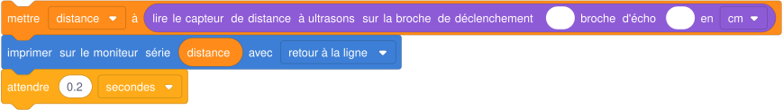{ .blocs }

??? warning "Si ça ne marche pas"

    - La distance reste à 0 : TRIG et ECHO sont inversés par rapport au bloc.
    - Valeurs étranges : l'objet est hors de la zone de détection (le cône devant le capteur).

!!! example "Sur le vrai matériel"

    Sur le kit Grove : le télémètre à ultrasons Grove (utilisé dans le guide éduscol du couloir) a une seule broche de signal. Le kit Plant Care n'en contient pas.

!!! tip "Mon défi"

    Je mesure la hauteur d'eau dans un fût : le capteur est au-dessus, à 100 cm du fond. J'affiche la hauteur d'eau.

**Je vérifie avant de cocher**

- [ ] La distance suit l'objet.
- [ ] J'affiche l'unité.

<label class="mission-reussie"><input type="checkbox" data-mission="25"> J'ai réussi la mission 25</label>

## Mission 26 · Le radar de recul { #mission-26 }

<strong>Ce que je dois obtenir.</strong> Le buzzer bipe lentement quand l'obstacle est entre 50 et 100 cm, vite entre 20 et 50 cm, et en continu sous 20 cm. Au-delà de 100 cm, silence.

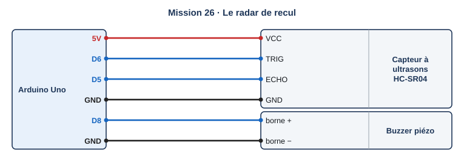{ .schema }

??? info "Le câblage, fil par fil"

    | Depuis | Broche ou borne | Sur le fil | Vers le composant | Borne du composant |
    |---|---|---|---|---|
    | Arduino Uno | 5V |   | Capteur à ultrasons HC-SR04 | VCC |
    | Arduino Uno | D6 |   | Capteur à ultrasons HC-SR04 | TRIG |
    | Arduino Uno | D5 |   | Capteur à ultrasons HC-SR04 | ECHO |
    | Arduino Uno | GND |   | Capteur à ultrasons HC-SR04 | GND |
    | Arduino Uno | D8 |   | Buzzer piézo | borne + |
    | Arduino Uno | GND |   | Buzzer piézo | borne − |

[:material-open-in-new: Ouvrir Tinkercad Circuits](https://www.tinkercad.com/circuits){ .md-button .md-button--primary target=_blank rel=noopener }

**Notions :** plusieurs conditions, zones, rythme du son.

**Programmation :** Blocs.

**Pas à pas**

1. Je garde le capteur à ultrasons et j'ajoute le buzzer sur 8.
2. J'écris le tableau des zones : distance, comportement du buzzer.
3. J'utilise des « si alors sinon » imbriqués, en partant de la zone la plus proche.
4. Je teste chaque zone en déplaçant l'objet.

??? question "Coup de pouce 1 : je réfléchis avant de câbler et de programmer"

    - Combien de zones y a-t-il ?
    - Pourquoi tester d'abord la zone la plus proche ?
    - Que doit faire le buzzer dans la zone la plus éloignée ?

??? note "Coup de pouce 2 : les blocs que je vais utiliser"

    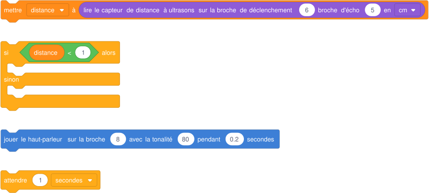{ .blocs }

    Les valeurs à choisir sont remplacées par 1 : à moi de trouver les bonnes et d'assembler les blocs. Les libellés peuvent varier légèrement selon la version de Tinkercad.

??? abstract "Coup de pouce 3 : le squelette du programme"

    Les blocs sont assemblés, les valeurs sont à trouver (cases vides). Je l'ouvre seulement si les deux premiers coups de pouce ne suffisent pas.

    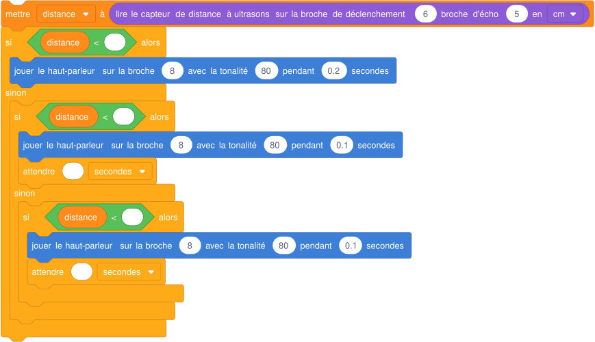{ .blocs }

??? warning "Si ça ne marche pas"

    - Le bip lent sonne aussi tout près : l'ordre des tests est mauvais, la condition « < 100 » est vraie aussi à 10 cm.
    - Le son ne s'arrête jamais loin : il manque la branche finale « silence ».

!!! example "Sur le vrai matériel"

    Avec le kit de la classe : capteur HC-SR04 et buzzer du kit starter, même câblage.

!!! tip "Mon défi"

    J'ajoute trois LED (vert, orange, rouge) qui indiquent la zone.

**Je vérifie avant de cocher**

- [ ] Quatre comportements différents.
- [ ] Silence au-delà de 100 cm.

<label class="mission-reussie"><input type="checkbox" data-mission="26"> J'ai réussi la mission 26</label>

## Mission 27 · L'humidité de la terre { #mission-27 }

<strong>Ce que je dois obtenir.</strong> Le moniteur série affiche la valeur brute du capteur d'humidité et l'humidité en pourcentage, de 0 % (terre sèche) à 100 % (terre détrempée).

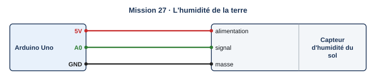{ .schema }

??? info "Le câblage, fil par fil"

    | Depuis | Broche ou borne | Sur le fil | Vers le composant | Borne du composant |
    |---|---|---|---|---|
    | Arduino Uno | 5V |   | Capteur d'humidité du sol | alimentation |
    | Arduino Uno | A0 |   | Capteur d'humidité du sol | signal |
    | Arduino Uno | GND |   | Capteur d'humidité du sol | masse |

[:material-open-in-new: Ouvrir Tinkercad Circuits](https://www.tinkercad.com/circuits){ .md-button .md-button--primary target=_blank rel=noopener }

**Notions :** capteur d'humidité du sol, étalonnage, pourcentage.

**Programmation :** Blocs.

**Pas à pas**

1. J'ajoute un **capteur d'humidité du sol** : alimentation sur 5V, signal sur A0, masse sur GND.
2. Je lis la valeur brute avec le curseur au plus sec, puis au plus humide. Je les note.
3. Je crée une variable « humidite » : mapper la valeur brute de [sec] à [humide] vers 0 à 100.
4. J'imprime la valeur brute et le pourcentage, puis j'attends 1 s.

??? question "Coup de pouce 1 : je réfléchis avant de câbler et de programmer"

    - Quelle valeur lis-je au plus sec ? Au plus humide ?
    - Pourquoi convertir en pourcentage ?
    - Faudra-t-il refaire ces mesures avec le vrai capteur ?

??? note "Coup de pouce 2 : les blocs que je vais utiliser"

    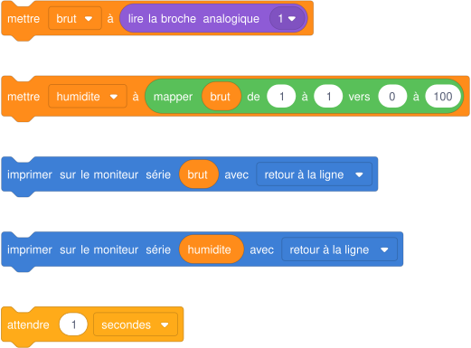{ .blocs }

    Les valeurs à choisir sont remplacées par 1 : à moi de trouver les bonnes et d'assembler les blocs. Les libellés peuvent varier légèrement selon la version de Tinkercad.

??? abstract "Coup de pouce 3 : le squelette du programme"

    Les blocs sont assemblés, les valeurs sont à trouver (cases vides). Je l'ouvre seulement si les deux premiers coups de pouce ne suffisent pas.

    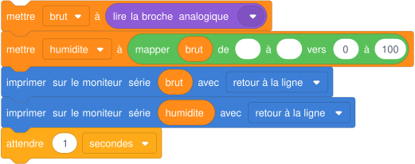{ .blocs }

??? warning "Si ça ne marche pas"

    - Le pourcentage dépasse 100 ou devient négatif : mes valeurs « sec » et « humide » ne sont pas les extrêmes réels ; je les remesure.
    - La valeur ne change pas : le signal n'est pas relié à A0.

!!! example "Sur le vrai matériel"

    Sur le kit Grove : le capteur d'humidité se branche sur le port A0 du Base Shield, comme dans la séquence jardin sec. Ses valeurs d'étalonnage sont à remesurer dans la vraie terre.

!!! tip "Mon défi"

    J'affiche un message : « terre sèche » sous 30 %, « humidité correcte » entre 30 et 70 %, « trop d'eau » au-delà.

**Je vérifie avant de cocher**

- [ ] J'ai noté mes deux valeurs d'étalonnage.
- [ ] Le pourcentage va de 0 à 100.

<label class="mission-reussie"><input type="checkbox" data-mission="27"> J'ai réussi la mission 27</label>

## Mission 28 · L'arrosage automatique { #mission-28 }

<strong>Ce que je dois obtenir.</strong> Quand l'humidité passe sous 30 %, le relais colle et le moteur (la pompe) tourne 3 s. Ensuite le système attend avant de relire.

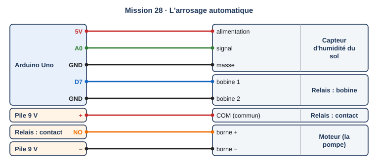{ .schema }

??? info "Le câblage, fil par fil"

    | Depuis | Broche ou borne | Sur le fil | Vers le composant | Borne du composant |
    |---|---|---|---|---|
    | Arduino Uno | 5V |   | Capteur d'humidité du sol | alimentation |
    | Arduino Uno | A0 |   | Capteur d'humidité du sol | signal |
    | Arduino Uno | GND |   | Capteur d'humidité du sol | masse |
    | Arduino Uno | D7 |   | Relais : bobine | bobine 1 |
    | Arduino Uno | GND |   | Relais : bobine | bobine 2 |
    | Pile 9 V | + |   | Relais : contact | COM (commun) |
    | Relais : contact | NO |   | Moteur (la pompe) | borne + |
    | Pile 9 V | − |   | Moteur (la pompe) | borne − |

[:material-open-in-new: Ouvrir Tinkercad Circuits](https://www.tinkercad.com/circuits){ .md-button .md-button--primary target=_blank rel=noopener }

**Notions :** relais, moteur, chaîne d'énergie, chaîne d'information.

**Programmation :** Blocs.

**Pas à pas**

1. Je garde le capteur d'humidité sur A0.
2. J'ajoute un **relais** : sa bobine entre la broche 7 et GND.
3. J'ajoute une **pile 9 V** et un **moteur à courant continu** : la pile alimente le moteur à travers le contact du relais (COM et NO).
4. Si l'humidité est sous 30 % : broche 7 HAUT, attendre 3 s, broche 7 BAS, attendre 10 s.
5. Je teste avec le curseur d'humidité du capteur.

??? question "Coup de pouce 1 : je réfléchis avant de câbler et de programmer"

    - Quel composant mesure ? Lequel décide ? Lequel agit ?
    - Pourquoi le moteur n'est-il pas branché directement sur la carte ?
    - Pourquoi attendre 10 s (30 min dans le vrai jardin) après un arrosage ?

??? note "Coup de pouce 2 : les blocs que je vais utiliser"

    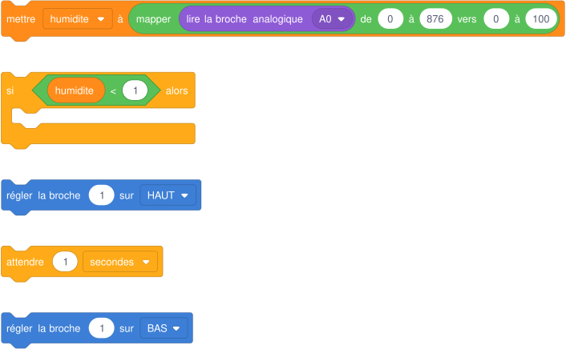{ .blocs }

    Les valeurs à choisir sont remplacées par 1 : à moi de trouver les bonnes et d'assembler les blocs. Les libellés peuvent varier légèrement selon la version de Tinkercad.

??? abstract "Coup de pouce 3 : le squelette du programme"

    Les blocs sont assemblés, les valeurs sont à trouver (cases vides). Je l'ouvre seulement si les deux premiers coups de pouce ne suffisent pas.

    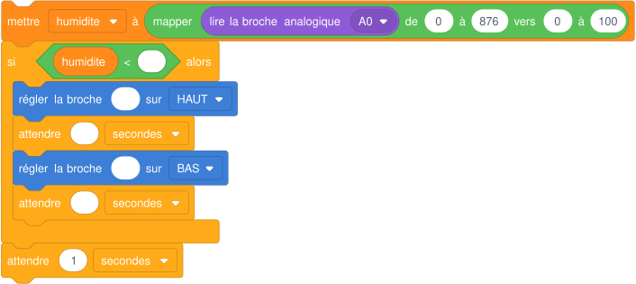{ .blocs }

??? warning "Si ça ne marche pas"

    - Le moteur tourne tout le temps : il est branché sur NC au lieu de NO.
    - Le relais ne colle jamais : la bobine n'est pas entre la broche 7 et GND, ou la condition est inversée.

!!! example "Sur le vrai matériel"

    Sur le kit Grove : le relais Grove sur D7, la pompe 12 V du kit à la place du moteur, le capteur sur A0. C'est le programme jardin-4e-arrosage.ino de la séquence jardin sec.

!!! tip "Mon défi"

    Le moteur ne peut pas tourner plus de 4 fois par minute de simulation, même si le capteur reste sec (sécurité si le capteur tombe en panne).

**Je vérifie avant de cocher**

- [ ] Terre sèche : 3 s de moteur.
- [ ] Terre humide : moteur arrêté.
- [ ] Je sais citer les deux chaînes.

<label class="mission-reussie"><input type="checkbox" data-mission="28"> J'ai réussi la mission 28</label>

## Mission 29 · L'écran LCD { #mission-29 }

<strong>Ce que je dois obtenir.</strong> L'écran affiche « Jardin sec » sur la première ligne et « Humidite : 45 % » sur la seconde, mis à jour chaque seconde.

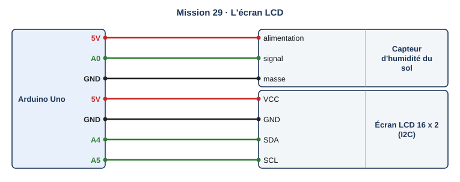{ .schema }

??? info "Le câblage, fil par fil"

    | Depuis | Broche ou borne | Sur le fil | Vers le composant | Borne du composant |
    |---|---|---|---|---|
    | Arduino Uno | 5V |   | Capteur d'humidité du sol | alimentation |
    | Arduino Uno | A0 |   | Capteur d'humidité du sol | signal |
    | Arduino Uno | GND |   | Capteur d'humidité du sol | masse |
    | Arduino Uno | 5V |   | Écran LCD 16 x 2 (I2C) | VCC |
    | Arduino Uno | GND |   | Écran LCD 16 x 2 (I2C) | GND |
    | Arduino Uno | A4 |   | Écran LCD 16 x 2 (I2C) | SDA |
    | Arduino Uno | A5 |   | Écran LCD 16 x 2 (I2C) | SCL |

[:material-open-in-new: Ouvrir Tinkercad Circuits](https://www.tinkercad.com/circuits){ .md-button .md-button--primary target=_blank rel=noopener }

**Notions :** afficheur, texte, position du curseur, affichage d'une variable.

**Programmation :** Blocs.

**Pas à pas**

1. J'ajoute un **écran LCD 16 x 2 (I2C)** : VCC sur 5V, GND sur GND, SDA sur A4, SCL sur A5.
2. Dans Sortie, je trouve les blocs de l'écran : effacer, positionner le curseur, imprimer.
3. Ligne 0 : « Jardin sec ». Ligne 1 : « Humidite : », puis la valeur, puis « % ».
4. J'attends 1 s, puis le programme recommence et met l'affichage à jour.

??? question "Coup de pouce 1 : je réfléchis avant de câbler et de programmer"

    - Combien de caractères tiennent sur une ligne ?
    - Pourquoi effacer l'écran avant de réécrire ?
    - Pourquoi éviter les accents sur cet écran ?

??? note "Coup de pouce 2 : les blocs que je vais utiliser"

    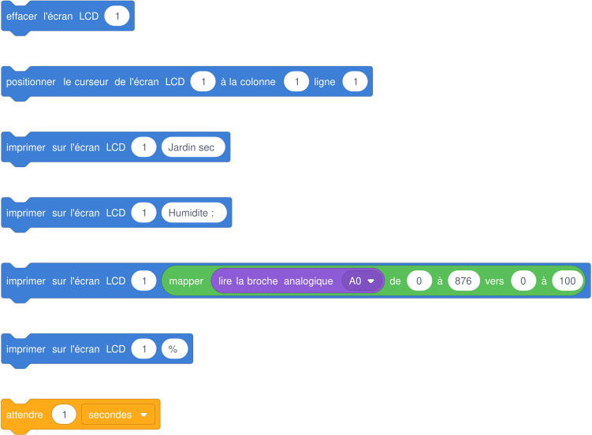{ .blocs }

    Les valeurs à choisir sont remplacées par 1 : à moi de trouver les bonnes et d'assembler les blocs. Les libellés peuvent varier légèrement selon la version de Tinkercad.

??? abstract "Coup de pouce 3 : le squelette du programme"

    Les blocs sont assemblés, les valeurs sont à trouver (cases vides). Je l'ouvre seulement si les deux premiers coups de pouce ne suffisent pas.

    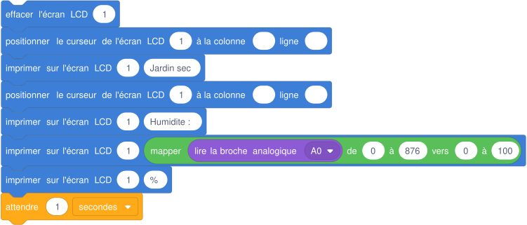{ .blocs }

??? warning "Si ça ne marche pas"

    - L'écran reste vide : SDA et SCL sont inversés, ou l'adresse de l'écran ne correspond pas à celle du programme.
    - Il reste des chiffres en trop (45 % devient 9 %5) : j'efface l'écran avant d'écrire.

!!! example "Sur le vrai matériel"

    Sur le kit Grove : l'afficheur est un petit écran OLED sur le port I2C ; on l'utilise avec la bibliothèque indiquée sur la notice Seeed. Les étapes restent les mêmes : effacer, positionner, écrire.

!!! tip "Mon défi"

    J'affiche « ARROSAGE » à la place du pourcentage pendant que la pompe tourne.

**Je vérifie avant de cocher**

- [ ] Deux lignes lisibles.
- [ ] La valeur se met à jour sans caractères parasites.

<label class="mission-reussie"><input type="checkbox" data-mission="29"> J'ai réussi la mission 29</label>

## Mission 30 · Atelier bleu : la station du jardin { #mission-30 }

<strong>Ce que je dois obtenir.</strong> La station affiche l'humidité sur l'écran, arrose 3 s sous 30 %, et allume une LED rouge d'alerte si l'humidité reste sous 10 % (fût vide ou pompe en panne).

<iframe loading="lazy" title="Comment téléverser un programme dans la carte Arduino" src="https://tube-sciences-technologies.apps.education.fr/videos/embed/63WCxEETFHyi7ywqT7AN83" frameborder="0" allow="fullscreen" allowfullscreen></iframe>

Vidéo : « Comment téléverser un programme dans la carte Arduino », chaîne Tinkercad au collège : <a href="https://tube-sciences-technologies.apps.education.fr/w/63WCxEETFHyi7ywqT7AN83" target="_blank" rel="noopener">ouvrir sur Tube Sciences &amp; Technologies</a>

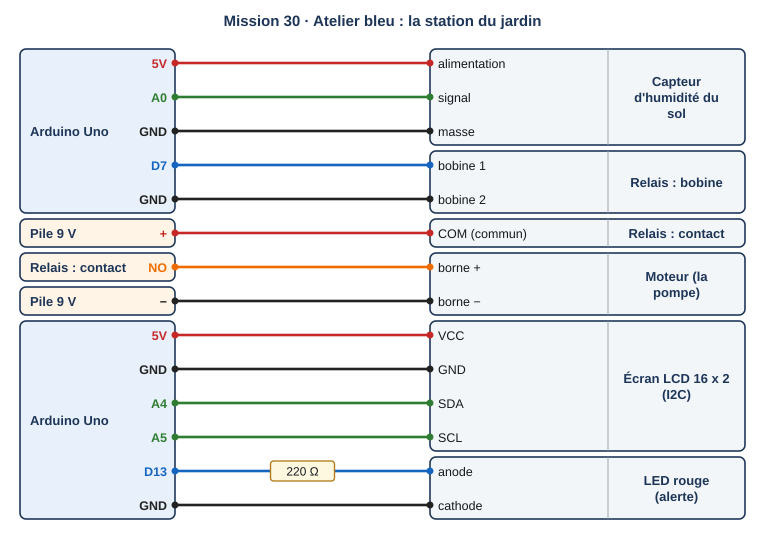{ .schema }

??? info "Le câblage, fil par fil"

    | Depuis | Broche ou borne | Sur le fil | Vers le composant | Borne du composant |
    |---|---|---|---|---|
    | Arduino Uno | 5V |   | Capteur d'humidité du sol | alimentation |
    | Arduino Uno | A0 |   | Capteur d'humidité du sol | signal |
    | Arduino Uno | GND |   | Capteur d'humidité du sol | masse |
    | Arduino Uno | D7 |   | Relais : bobine | bobine 1 |
    | Arduino Uno | GND |   | Relais : bobine | bobine 2 |
    | Pile 9 V | + |   | Relais : contact | COM (commun) |
    | Relais : contact | NO |   | Moteur (la pompe) | borne + |
    | Pile 9 V | − |   | Moteur (la pompe) | borne − |
    | Arduino Uno | 5V |   | Écran LCD 16 x 2 (I2C) | VCC |
    | Arduino Uno | GND |   | Écran LCD 16 x 2 (I2C) | GND |
    | Arduino Uno | A4 |   | Écran LCD 16 x 2 (I2C) | SDA |
    | Arduino Uno | A5 |   | Écran LCD 16 x 2 (I2C) | SCL |
    | Arduino Uno | D13 | 220 Ω | LED rouge (alerte) | anode |
    | Arduino Uno | GND |   | LED rouge (alerte) | cathode |

[:material-open-in-new: Ouvrir Tinkercad Circuits](https://www.tinkercad.com/circuits){ .md-button .md-button--primary target=_blank rel=noopener }

**Notions :** synthèse : capteur, seuil, relais, écran, alerte.

**Programmation :** Blocs.

**Pas à pas**

1. Je réunis les missions 27, 28 et 29 dans un seul circuit, et j'ajoute la LED d'alerte sur 13.
2. J'écris l'algorigramme : lire, afficher, si sous 30 % arroser, si sous 10 % alerte.
3. Je programme bloc par bloc, en testant après chaque ajout.
4. Je teste trois situations : terre humide, terre sèche, terre très sèche.
5. Je regarde la vidéo « Comment téléverser un programme dans la carte Arduino » : c'est l'étape suivante, sur le vrai kit.

??? question "Coup de pouce 1 : je réfléchis avant de câbler et de programmer"

    - Quelles sont les trois situations à tester, et que doit faire la station dans chacune ?
    - Dans quel ordre écrire les deux conditions (30 % et 10 %) ?
    - Qu'est-ce qui change entre la simulation et le kit Grove réel ?

??? note "Coup de pouce 2 : les blocs que je vais utiliser"

    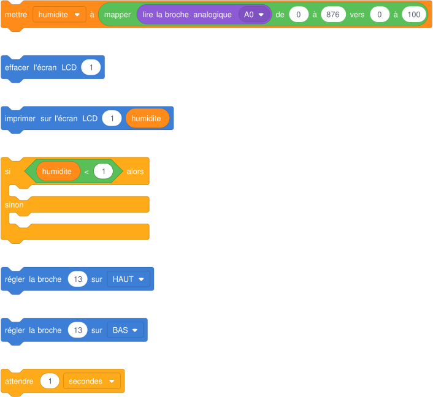{ .blocs }

    Les valeurs à choisir sont remplacées par 1 : à moi de trouver les bonnes et d'assembler les blocs. Les libellés peuvent varier légèrement selon la version de Tinkercad.

??? abstract "Coup de pouce 3 : le squelette du programme"

    Les blocs sont assemblés, les valeurs sont à trouver (cases vides). Je l'ouvre seulement si les deux premiers coups de pouce ne suffisent pas.

    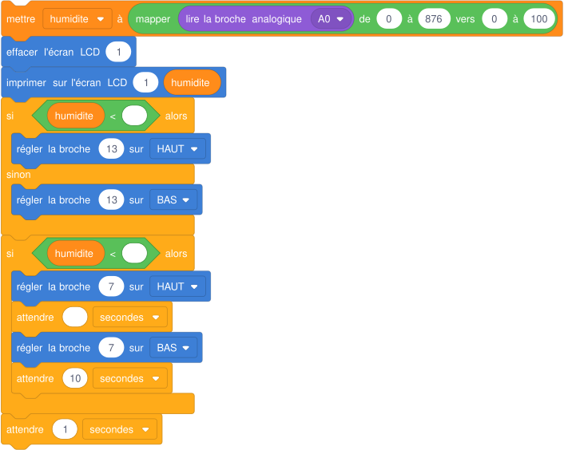{ .blocs }

??? warning "Si ça ne marche pas"

    - L'écran clignote ou se brouille : j'efface l'écran une seule fois par tour.
    - L'alerte ne s'éteint jamais : il manque l'extinction de la LED quand l'humidité remonte.

!!! example "Sur le vrai matériel"

    Sur le kit Grove : c'est la station réelle du jardin. Capteur sur A0, relais sur D7, écran OLED sur I2C. On téléverse depuis l'Arduino IDE, puis on refait les trois tests dans de la vraie terre.

!!! tip "Mon défi"

    La station compte les arrosages de la journée et l'affiche sur l'écran.

**Je vérifie avant de cocher**

- [ ] Trois situations testées et conformes.
- [ ] Mon algorigramme correspond à mon programme.
- [ ] J'ai envoyé ma capture avec le formulaire en bas de la page.

<label class="mission-reussie"><input type="checkbox" data-mission="30"> J'ai réussi la mission 30</label>

## Je vérifie que j'ai compris

**Question 1.** Le potentiomètre donne 0 à 1023 et le servomoteur attend 0 à 180. Quel bloc permet de passer de l'un à l'autre ?

**Question 2.** Dans le radar de recul, pourquoi teste-t-on la zone la plus proche en premier ?

**Question 3.** Pourquoi la pompe passe-t-elle par un relais au lieu d'être branchée sur la carte ?

**Question 4.** Le capteur d'humidité donne 438. Avec sec = 0 et humide = 876, quelle est l'humidité en pourcentage ?

**Question 5.** Quelles sont les deux chaînes de la station du jardin ? Cite un composant de chacune.

## Où j'en suis

En fin de séance, j'indique la dernière mission terminée et j'ajoute une capture d'écran de mon circuit et de mon programme dans Tinkercad. Le professeur la reçoit directement.

*Missions conçues pour le site à partir des ressources officielles citées sur la [page d'accueil des missions](index.md#sources-et-licences).*
