# Palier 3 (orange) : du bloc au texte, des systèmes fiables

Dix missions pour passer des blocs au texte C++ et rendre les systèmes fiables : constantes, conditions combinées, hystérésis, filtres de mesure, temporisation sans blocage, commandes et journal de données. On termine par l'arrosage intelligent du jardin sec.

Classe de départ : **3e**. Les élèves qui ont terminé le palier bleu continuent ici. À partir de la mission 32, chaque mission a un fichier de départ à coller dans l'onglet Code, mode Texte.

| Mission | Titre | Notions |
|---|---|---|
| [31](#mission-31) | Des blocs au texte | setup et loop, pinMode, digitalWrite, delay, point-virgule |
| [32](#mission-32) | Constantes et commentaires | const int, nommer les broches, commentaires, lisibilité |
| [33](#mission-33) | L'alarme de la serre | conditions combinées ET, OU, NON, opérateurs && || ! |
| [34](#mission-34) | Le chauffage de la serre | hystérésis, deux seuils, variable d'état |
| [35](#mission-35) | Des mesures qui tremblent | bruit de mesure, moyenne, médiane, fonction qui renvoie une valeur |
| [36](#mission-36) | La lumière qui attend | capteur de présence PIR, temporisation relancée, millis() |
| [37](#mission-37) | La jauge lumineuse | anneau de LED NeoPixel, boucle for, couleur |
| [38](#mission-38) | Piloter depuis le moniteur série | réception série, caractère, commande, switch |
| [39](#mission-39) | Le journal de données | enregistrement daté, format CSV, tableur |
| [40](#mission-40) | Atelier orange : l'arrosage intelligent | synthèse : hystérésis, filtre, journal, écran |

!!! info "Comment travailler"

    Je regarde le schéma de câblage et je lis ce que je dois obtenir. J'ouvre Tinkercad Circuits, je câble, puis je programme en suivant le pas à pas. Je lance la simulation et je compare avec l'objectif. Si je suis bloqué, j'ouvre les coups de pouce dans l'ordre : 1, je réfléchis ; 2, les blocs ou les instructions à utiliser ; 3, le squelette du programme. « Si ça ne marche pas » liste les erreurs les plus courantes. En fin de séance, j'envoie ma progression avec une capture d'écran (bas de la page).

## Mission 31 · Des blocs au texte { #mission-31 }

<div class="mission palier-3" markdown>

<p class="mission-objectif"><strong>Ce que je dois obtenir.</strong> Je reconstruis le feu tricolore en blocs, je lis le texte que Tinkercad en tire, puis je modifie les durées directement dans le texte.</p>

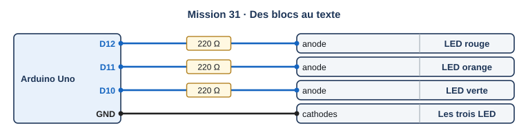{ .schema }

??? info "Le câblage, fil par fil"

    | Depuis | Broche ou borne | Sur le fil | Vers le composant | Borne du composant |
    |---|---|---|---|---|
    | Arduino Uno | D12 | 220 Ω | LED rouge | anode |
    | Arduino Uno | D11 | 220 Ω | LED orange | anode |
    | Arduino Uno | D10 | 220 Ω | LED verte | anode |
    | Arduino Uno | GND |   | Les trois LED | cathodes |

[:material-open-in-new: Ouvrir Tinkercad Circuits](https://www.tinkercad.com/circuits){ .md-button .md-button--primary target=_blank rel=noopener }

**Notions :** setup et loop, pinMode, digitalWrite, delay, point-virgule.

**Programmation :** Blocs, puis lecture du texte.

**Pas à pas**

1. Je refais le feu tricolore de la mission 07 en blocs (ou je reprends mon circuit).
2. Dans le menu de l'éditeur, je choisis **Blocs + texte** : le texte C++ s'affiche à côté des blocs.
3. Je repère dans le texte : setup, loop, pinMode, digitalWrite, delay.
4. Je passe en mode **Texte** (Tinkercad prévient que les blocs seront perdus : j'accepte, j'ai une copie).
5. Je change les durées pour obtenir vert 5 s, orange 2 s, rouge 5 s, et je teste.

??? question "Coup de pouce 1 : je réfléchis avant de câbler et de programmer"

    - Quelle partie du texte s'exécute une seule fois, et laquelle se répète ?
    - Combien de millisecondes y a-t-il dans 5 secondes ?
    - Par quel signe se termine chaque instruction ?

??? note "Coup de pouce 2 : les blocs que je vais utiliser"

    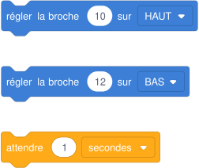{ .blocs }

    Les valeurs à choisir sont remplacées par 1 : à moi de trouver les bonnes et d'assembler les blocs. Les libellés peuvent varier légèrement selon la version de Tinkercad.

??? abstract "Coup de pouce 3 : le squelette du programme"

    Les blocs sont assemblés, les valeurs sont à trouver (cases vides). Je l'ouvre seulement si les deux premiers coups de pouce ne suffisent pas.

    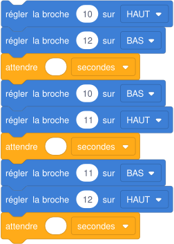{ .blocs }

??? warning "Si ça ne marche pas"

    - Message d'erreur à la compilation : un point-virgule manque à la fin d'une ligne, ou une accolade n'est pas fermée.
    - Le feu va trop vite : delay compte en millisecondes, 5 veut dire 5 ms ; j'écris 5000.

!!! example "Sur le vrai matériel"

    Avec la vraie carte : le même texte se colle dans l'Arduino IDE et se téléverse sans changement.

!!! tip "Mon défi"

    J'ajoute des commentaires (// ...) qui expliquent chaque état du feu.

**Je vérifie avant de cocher**

- [ ] Mon feu fonctionne en mode Texte.
- [ ] Les nouvelles durées sont respectées.
- [ ] Je sais dire à quoi servent setup et loop.

<label class="mission-reussie"><input type="checkbox" data-mission="31"> J'ai réussi la mission 31</label>

</div>

## Mission 32 · Constantes et commentaires { #mission-32 }

<div class="mission palier-3" markdown>

<p class="mission-objectif"><strong>Ce que je dois obtenir.</strong> Le feu tricolore fonctionne comme avant, mais le programme n'utilise plus aucun numéro de broche en clair : seulement des noms (ROUGE, ORANGE, VERT) déclarés au début.</p>

{ .schema }

??? info "Le câblage, fil par fil"

    | Depuis | Broche ou borne | Sur le fil | Vers le composant | Borne du composant |
    |---|---|---|---|---|
    | Arduino Uno | D12 | 220 Ω | LED rouge | anode |
    | Arduino Uno | D11 | 220 Ω | LED orange | anode |
    | Arduino Uno | D10 | 220 Ω | LED verte | anode |
    | Arduino Uno | GND |   | Les trois LED | cathodes |

[:material-open-in-new: Ouvrir Tinkercad Circuits](https://www.tinkercad.com/circuits){ .md-button .md-button--primary target=_blank rel=noopener } [:material-download: Fichier de départ mission-32.ino](programmes/mission-32-depart.ino){ .md-button }

**Notions :** const int, nommer les broches, commentaires, lisibilité.

**Programmation :** Texte (C++).

**Pas à pas**

1. J'ouvre le fichier de départ et je le colle dans l'onglet Code, mode Texte.
2. Je déclare trois constantes en haut du programme : const int ROUGE = 12; et ainsi de suite.
3. Je remplace chaque numéro de broche par le nom de la constante.
4. J'ajoute aussi trois constantes de durée en millisecondes.
5. Je déplace la LED orange sur la broche 9 : je ne change qu'une seule ligne du programme.

??? question "Coup de pouce 1 : je réfléchis avant de câbler et de programmer"

    - Pourquoi écrire ROUGE plutôt que 12 ?
    - Combien de lignes faut-il changer si la LED orange change de broche ?
    - Pourquoi les constantes sont-elles en majuscules ?

??? note "Coup de pouce 2 : les instructions que je vais utiliser"

    - `const int NOM = valeur;` : une constante, déclarée avant setup
    - `// texte` : un commentaire, ignoré par la carte
    - `pinMode(NOM, OUTPUT);` dans setup
    - `digitalWrite(NOM, HIGH);` et `delay(duree);` dans loop

??? abstract "Coup de pouce 3 : le squelette du programme"

    Le programme est écrit, les valeurs et les mots manquants sont remplacés par ___. Je l'ouvre seulement si les deux premiers coups de pouce ne suffisent pas.

    ```cpp
    // Feu tricolore : constantes et commentaires
    const int ROUGE = ___;
    const int ORANGE = ___;
    const int VERT = ___;
    const int DUREE_VERT = 4000;    // en millisecondes
    const int DUREE_ORANGE = 1000;
    const int DUREE_ROUGE = 4000;

    void setup() {
      pinMode(ROUGE, OUTPUT);
      pinMode(ORANGE, OUTPUT);
      pinMode(VERT, OUTPUT);
    }

    void loop() {
      // vert
      digitalWrite(VERT, HIGH);
      digitalWrite(ROUGE, LOW);
      delay(___);
      // orange
      digitalWrite(VERT, LOW);
      digitalWrite(___, HIGH);
      delay(DUREE_ORANGE);
      // rouge
      digitalWrite(ORANGE, LOW);
      digitalWrite(___, HIGH);
      delay(DUREE_ROUGE);
    }
    ```

??? warning "Si ça ne marche pas"

    - Erreur « 'ROUGE' was not declared » : la constante est mal orthographiée ou déclarée après son utilisation.
    - La LED orange ne s'allume plus après le déplacement : j'ai déplacé le fil mais pas la constante, ou l'inverse.

!!! example "Sur le vrai matériel"

    Sur le kit Grove : les programmes du jardin sec déclarent CAPTEUR = A0 et RELAIS = 7 de la même façon.

!!! tip "Mon défi"

    Je regroupe un état du feu dans une fonction : void etat(int r, int o, int v, int duree).

**Je vérifie avant de cocher**

- [ ] Plus aucun numéro de broche dans loop.
- [ ] Le déplacement de la LED orange n'a demandé qu'une ligne.

<label class="mission-reussie"><input type="checkbox" data-mission="32"> J'ai réussi la mission 32</label>

</div>

## Mission 33 · L'alarme de la serre { #mission-33 }

<div class="mission palier-3" markdown>

<p class="mission-objectif"><strong>Ce que je dois obtenir.</strong> L'alarme sonne si la porte s'ouvre pendant la nuit (porte ET nuit), ou à tout moment si on appuie sur le bouton panique (OU).</p>

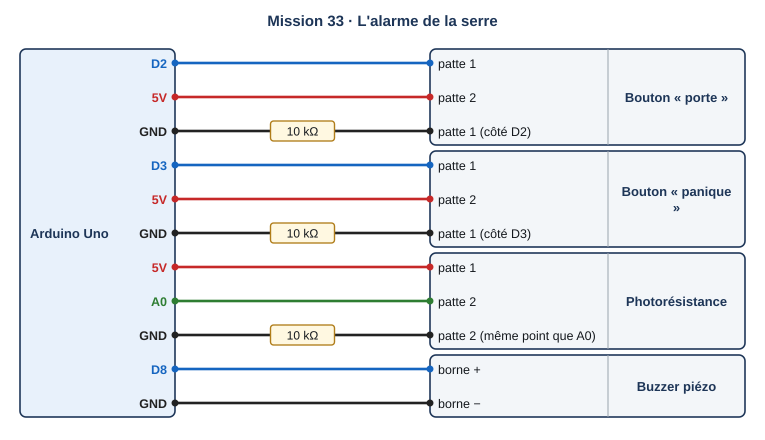{ .schema }

??? info "Le câblage, fil par fil"

    | Depuis | Broche ou borne | Sur le fil | Vers le composant | Borne du composant |
    |---|---|---|---|---|
    | Arduino Uno | D2 |   | Bouton « porte » | patte 1 |
    | Arduino Uno | 5V |   | Bouton « porte » | patte 2 |
    | Arduino Uno | GND | 10 kΩ | Bouton « porte » | patte 1 (côté D2) |
    | Arduino Uno | D3 |   | Bouton « panique » | patte 1 |
    | Arduino Uno | 5V |   | Bouton « panique » | patte 2 |
    | Arduino Uno | GND | 10 kΩ | Bouton « panique » | patte 1 (côté D3) |
    | Arduino Uno | 5V |   | Photorésistance | patte 1 |
    | Arduino Uno | A0 |   | Photorésistance | patte 2 |
    | Arduino Uno | GND | 10 kΩ | Photorésistance | patte 2 (même point que A0) |
    | Arduino Uno | D8 |   | Buzzer piézo | borne + |
    | Arduino Uno | GND |   | Buzzer piézo | borne − |

[:material-open-in-new: Ouvrir Tinkercad Circuits](https://www.tinkercad.com/circuits){ .md-button .md-button--primary target=_blank rel=noopener } [:material-download: Fichier de départ mission-33.ino](programmes/mission-33-depart.ino){ .md-button }

**Notions :** conditions combinées ET, OU, NON, opérateurs && || !.

**Programmation :** Texte (C++).

**Pas à pas**

1. Je câble le bouton porte (D2), le bouton panique (D3), la photorésistance (A0) et le buzzer (8).
2. Je mesure la valeur de nuit de la photorésistance et je fixe la constante NUIT.
3. Je crée trois variables booléennes : porte, panique, nuit.
4. J'écris la condition : (porte && nuit) || panique.
5. Je remplis la table des huit cas et je les teste un par un.

??? question "Coup de pouce 1 : je réfléchis avant de câbler et de programmer"

    - Combien de cas différents existe-t-il avec trois entrées à deux états ?
    - Dans quels cas l'alarme doit-elle sonner ?
    - Pourquoi des parenthèses autour de porte && nuit ?

??? note "Coup de pouce 2 : les instructions que je vais utiliser"

    - `bool nom = condition;` : une variable vraie ou fausse
    - `&&` : ET, les deux doivent être vraies
    - `||` : OU, une seule suffit
    - `!` : NON, inverse une condition
    - `analogRead(A0)` et `digitalRead(2)`

??? abstract "Coup de pouce 3 : le squelette du programme"

    Le programme est écrit, les valeurs et les mots manquants sont remplacés par ___. Je l'ouvre seulement si les deux premiers coups de pouce ne suffisent pas.

    ```cpp
    const int PORTE = 2, PANIQUE = 3, BUZZER = 8;
    const int NUIT = ___;   // sous cette valeur, il fait nuit (à mesurer)

    void setup() {
      pinMode(PORTE, INPUT);
      pinMode(PANIQUE, INPUT);
      pinMode(BUZZER, OUTPUT);
    }

    void loop() {
      bool porte = digitalRead(PORTE) == HIGH;
      bool panique = digitalRead(PANIQUE) == HIGH;
      bool nuit = analogRead(A0) ___ NUIT;
      if ((porte ___ nuit) ___ panique) {
        tone(BUZZER, 880, 150);
        delay(300);
      }
    }
    ```

??? warning "Si ça ne marche pas"

    - L'alarme sonne de jour quand la porte s'ouvre : la condition de nuit est inversée ou le seuil est faux.
    - Le bouton panique ne fait rien la journée : j'ai écrit && au lieu de ||.

!!! example "Sur le vrai matériel"

    Sur le kit Grove : le bouton du kit sur D2 et le capteur de lumière sur I2C ; seule la lecture de la lumière change.

!!! tip "Mon défi"

    J'ajoute un interrupteur « alarme désactivée » : rien ne sonne s'il est fermé, sauf le bouton panique.

**Je vérifie avant de cocher**

- [ ] Ma table de vérité compte huit lignes.
- [ ] Les huit cas testés sont conformes.

<label class="mission-reussie"><input type="checkbox" data-mission="33"> J'ai réussi la mission 33</label>

</div>

## Mission 34 · Le chauffage de la serre { #mission-34 }

<div class="mission palier-3" markdown>

<p class="mission-objectif"><strong>Ce que je dois obtenir.</strong> Le chauffage (LED rouge) s'allume sous 18 °C et s'éteint au-dessus de 22 °C. Entre les deux, il garde son état : il ne clignote jamais autour d'un seuil.</p>

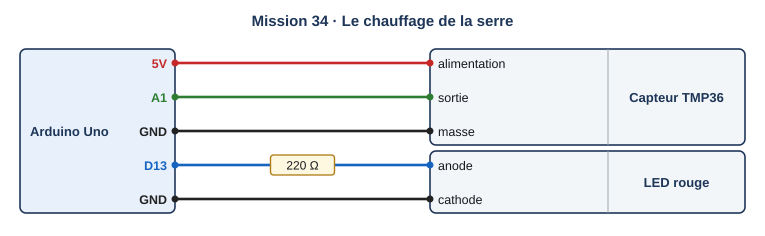{ .schema }

??? info "Le câblage, fil par fil"

    | Depuis | Broche ou borne | Sur le fil | Vers le composant | Borne du composant |
    |---|---|---|---|---|
    | Arduino Uno | 5V |   | Capteur TMP36 | alimentation |
    | Arduino Uno | A1 |   | Capteur TMP36 | sortie |
    | Arduino Uno | GND |   | Capteur TMP36 | masse |
    | Arduino Uno | D13 | 220 Ω | LED rouge | anode |
    | Arduino Uno | GND |   | LED rouge | cathode |

[:material-open-in-new: Ouvrir Tinkercad Circuits](https://www.tinkercad.com/circuits){ .md-button .md-button--primary target=_blank rel=noopener } [:material-download: Fichier de départ mission-34.ino](programmes/mission-34-depart.ino){ .md-button }

**Notions :** hystérésis, deux seuils, variable d'état.

**Programmation :** Texte (C++).

**Pas à pas**

1. Je câble le TMP36 sur A1 et la LED « chauffage » sur 13.
2. Je déclare deux seuils : SEUIL_BAS = 18 et SEUIL_HAUT = 22.
3. Je crée une variable bool chauffage, mémorisée d'un tour à l'autre.
4. Sous 18 : chauffage = true. Au-dessus de 22 : chauffage = false. Entre les deux : rien ne change.
5. Je fais monter puis descendre la température et je note quand la LED change.

??? question "Coup de pouce 1 : je réfléchis avant de câbler et de programmer"

    - Que se passerait-il avec un seul seuil à 20 °C si la température oscille autour de 20 ?
    - Pourquoi la variable chauffage doit-elle être déclarée en dehors de loop ?
    - À 20 °C, la LED est-elle allumée ou éteinte ?

??? note "Coup de pouce 2 : les instructions que je vais utiliser"

    - deux constantes de seuil
    - `bool chauffage = false;` déclarée avant setup
    - `if (...) { } else if (...) { }` sans dernier else
    - `condition ? HIGH : LOW` pour écrire l'état

??? abstract "Coup de pouce 3 : le squelette du programme"

    Le programme est écrit, les valeurs et les mots manquants sont remplacés par ___. Je l'ouvre seulement si les deux premiers coups de pouce ne suffisent pas.

    ```cpp
    const int CHAUFFAGE = 13;
    const float SEUIL_BAS = ___;
    const float SEUIL_HAUT = ___;
    bool chauffage = false;   // mémorisé d'un tour à l'autre

    float lireTemperature() {
      return (analogRead(A1) * 5.0 / 1024.0 - 0.5) * 100;
    }

    void setup() {
      pinMode(CHAUFFAGE, OUTPUT);
      Serial.begin(9600);
    }

    void loop() {
      float t = lireTemperature();
      if (t < SEUIL_BAS) {
        chauffage = ___;
      } else if (t > SEUIL_HAUT) {
        chauffage = ___;
      }
      digitalWrite(CHAUFFAGE, chauffage ? HIGH : LOW);
      Serial.println(t);
      delay(500);
    }
    ```

??? warning "Si ça ne marche pas"

    - La LED clignote autour d'un seuil : je n'ai qu'un seul test, ou je remets chauffage à false à chaque tour.
    - La LED ne s'éteint jamais : SEUIL_HAUT est plus grand que la température maximale testée.

!!! example "Sur le vrai matériel"

    Sur le kit Grove : le même principe règle l'arrosage, avec deux seuils d'humidité (programme jardin-3e-hysteresis.ino).

!!! tip "Mon défi"

    J'affiche dans le moniteur série la température et l'état du chauffage, uniquement quand l'état change.

**Je vérifie avant de cocher**

- [ ] Allumage à 18 °C en descendant, extinction à 22 °C en montant.
- [ ] À 20 °C, l'état dépend de ce qui s'est passé avant.

<label class="mission-reussie"><input type="checkbox" data-mission="34"> J'ai réussi la mission 34</label>

</div>

## Mission 35 · Des mesures qui tremblent { #mission-35 }

<div class="mission palier-3" markdown>

<p class="mission-objectif"><strong>Ce que je dois obtenir.</strong> Le moniteur série affiche trois colonnes : la mesure brute qui saute, la moyenne de 5 mesures, et la médiane de 3 mesures, plus stables.</p>

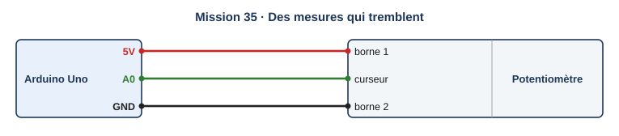{ .schema }

??? info "Le câblage, fil par fil"

    | Depuis | Broche ou borne | Sur le fil | Vers le composant | Borne du composant |
    |---|---|---|---|---|
    | Arduino Uno | 5V |   | Potentiomètre | borne 1 |
    | Arduino Uno | A0 |   | Potentiomètre | curseur |
    | Arduino Uno | GND |   | Potentiomètre | borne 2 |

[:material-open-in-new: Ouvrir Tinkercad Circuits](https://www.tinkercad.com/circuits){ .md-button .md-button--primary target=_blank rel=noopener } [:material-download: Fichier de départ mission-35.ino](programmes/mission-35-depart.ino){ .md-button }

**Notions :** bruit de mesure, moyenne, médiane, fonction qui renvoie une valeur.

**Programmation :** Texte (C++).

**Pas à pas**

1. Je câble le potentiomètre sur A0. Pour imiter un vrai capteur, le programme ajoute un bruit au hasard à chaque lecture.
2. Je complète la fonction moyenne() : elle lit 5 fois et renvoie la moyenne.
3. Je complète la fonction mediane3() : elle range trois valeurs et renvoie celle du milieu.
4. J'ouvre le **traceur série** (icône graphique du moniteur) pour voir les trois courbes.
5. J'imite une valeur aberrante (0 de temps en temps) et je compare moyenne et médiane.

??? question "Coup de pouce 1 : je réfléchis avant de câbler et de programmer"

    - Pourquoi un vrai capteur donne-t-il des valeurs qui tremblent ?
    - Une valeur aberrante (0) influence-t-elle davantage la moyenne ou la médiane ?
    - Que coûte une moyenne de 100 mesures ?

??? note "Coup de pouce 2 : les instructions que je vais utiliser"

    - `int nom() { ... return valeur; }` : une fonction qui renvoie un nombre
    - `for (int i = 0; i < 5; i++) { }` : répéter 5 fois
    - `random(min, max)`
    - `long somme` pour additionner sans débordement
    - le traceur série pour voir les courbes

??? abstract "Coup de pouce 3 : le squelette du programme"

    Le programme est écrit, les valeurs et les mots manquants sont remplacés par ___. Je l'ouvre seulement si les deux premiers coups de pouce ne suffisent pas.

    ```cpp
    int lireBruite() {
      int v = analogRead(A0) + random(-30, 31);   // bruit imité
      if (random(0, 20) == 0) v = 0;              // une valeur aberrante de temps en temps
      return v;
    }

    int moyenne() {
      long somme = 0;
      for (int i = 0; i < ___; i++) {
        somme = somme + lireBruite();
      }
      return somme / ___;
    }

    int mediane3(int a, int b, int c) {
      if ((a <= b && b <= c) || (c <= b && b <= a)) return b;
      if ((b <= a && a <= c) || (c <= a && a <= b)) return ___;
      return ___;
    }

    void setup() {
      Serial.begin(9600);
    }

    void loop() {
      int brut = lireBruite();
      int med = mediane3(lireBruite(), lireBruite(), lireBruite());
      Serial.print(brut);
      Serial.print(" ");
      Serial.print(moyenne());
      Serial.print(" ");
      Serial.println(med);
      delay(200);
    }
    ```

??? warning "Si ça ne marche pas"

    - La moyenne est fausse : la somme est déclarée en int et déborde, ou je divise avant d'avoir tout additionné.
    - La médiane renvoie toujours la même valeur : j'ai oublié de comparer les trois valeurs entre elles.

!!! example "Sur le vrai matériel"

    Sur le kit Grove : le capteur d'humidité réel tremble de quelques unités ; la médiane évite qu'un faux contact déclenche la pompe.

!!! tip "Mon défi"

    Je remplace la moyenne de 5 mesures par une moyenne glissante sur les 5 dernières mesures (un tableau).

**Je vérifie avant de cocher**

- [ ] Les trois colonnes s'affichent.
- [ ] Je sais expliquer pourquoi la médiane résiste mieux à l'aberration.

<label class="mission-reussie"><input type="checkbox" data-mission="35"> J'ai réussi la mission 35</label>

</div>

## Mission 36 · La lumière qui attend { #mission-36 }

<div class="mission palier-3" markdown>

<p class="mission-objectif"><strong>Ce que je dois obtenir.</strong> La lumière s'allume quand le capteur détecte quelqu'un, et s'éteint 10 s après la dernière détection. Chaque nouveau passage relance les 10 s.</p>

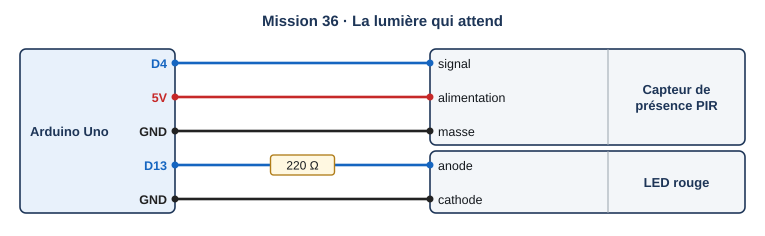{ .schema }

??? info "Le câblage, fil par fil"

    | Depuis | Broche ou borne | Sur le fil | Vers le composant | Borne du composant |
    |---|---|---|---|---|
    | Arduino Uno | D4 |   | Capteur de présence PIR | signal |
    | Arduino Uno | 5V |   | Capteur de présence PIR | alimentation |
    | Arduino Uno | GND |   | Capteur de présence PIR | masse |
    | Arduino Uno | D13 | 220 Ω | LED rouge | anode |
    | Arduino Uno | GND |   | LED rouge | cathode |

[:material-open-in-new: Ouvrir Tinkercad Circuits](https://www.tinkercad.com/circuits){ .md-button .md-button--primary target=_blank rel=noopener } [:material-download: Fichier de départ mission-36.ino](programmes/mission-36-depart.ino){ .md-button }

**Notions :** capteur de présence PIR, temporisation relancée, millis().

**Programmation :** Texte (C++).

**Pas à pas**

1. J'ajoute un **capteur de mouvement PIR** : signal sur 4.
2. Je déclare unsigned long derniere = 0; pour garder le moment de la dernière détection.
3. À chaque détection : derniere = millis(); et j'allume la lumière.
4. Si millis() − derniere dépasse 10 000 ms, j'éteins.
5. Pendant la simulation, je déplace l'objet devant le capteur, plusieurs fois.

??? question "Coup de pouce 1 : je réfléchis avant de câbler et de programmer"

    - Que renvoie millis() ?
    - Pourquoi ne pas utiliser delay(10000) ici ?
    - Comment savoir combien de temps s'est écoulé depuis la dernière détection ?

??? note "Coup de pouce 2 : les instructions que je vais utiliser"

    - `millis()` : le temps écoulé depuis le démarrage, en millisecondes
    - `unsigned long` : un très grand nombre positif, pour le temps
    - `millis() - derniere` : la durée depuis la dernière détection

??? abstract "Coup de pouce 3 : le squelette du programme"

    Le programme est écrit, les valeurs et les mots manquants sont remplacés par ___. Je l'ouvre seulement si les deux premiers coups de pouce ne suffisent pas.

    ```cpp
    const int PIR = 4, LUMIERE = 13;
    const unsigned long DUREE = ___;   // 10 s
    unsigned long derniere = 0;

    void setup() {
      pinMode(PIR, INPUT);
      pinMode(LUMIERE, OUTPUT);
    }

    void loop() {
      if (digitalRead(PIR) == HIGH) {
        derniere = ___;
        digitalWrite(LUMIERE, HIGH);
      }
      if (millis() - derniere > ___) {
        digitalWrite(LUMIERE, LOW);
      }
    }
    ```

??? warning "Si ça ne marche pas"

    - La lumière ne s'éteint jamais : je remets derniere à millis() à chaque tour, même sans détection.
    - La lumière s'éteint pendant un passage : la durée est comptée depuis la première détection au lieu de la dernière.

!!! example "Sur le vrai matériel"

    Sur le kit Grove : le même calcul avec millis() permet d'arroser sans bloquer la lecture du bouton ou de l'écran.

!!! tip "Mon défi"

    Un buzzer bipe une fois seulement à l'allumage, pas à chaque détection.

**Je vérifie avant de cocher**

- [ ] Extinction 10 s après le dernier passage.
- [ ] Un nouveau passage relance le temps.

<label class="mission-reussie"><input type="checkbox" data-mission="36"> J'ai réussi la mission 36</label>

</div>

## Mission 37 · La jauge lumineuse { #mission-37 }

<div class="mission palier-3" markdown>

<p class="mission-objectif"><strong>Ce que je dois obtenir.</strong> Un anneau de 12 LED NeoPixel montre l'humidité : 3 LED pour 25 %, 6 pour 50 %, 12 pour 100 %. Rouge sous 30 %, vert au-dessus.</p>

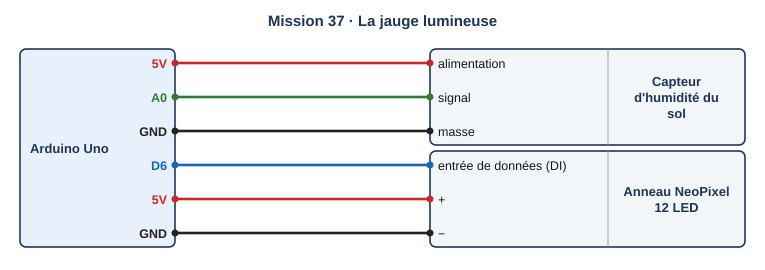{ .schema }

??? info "Le câblage, fil par fil"

    | Depuis | Broche ou borne | Sur le fil | Vers le composant | Borne du composant |
    |---|---|---|---|---|
    | Arduino Uno | 5V |   | Capteur d'humidité du sol | alimentation |
    | Arduino Uno | A0 |   | Capteur d'humidité du sol | signal |
    | Arduino Uno | GND |   | Capteur d'humidité du sol | masse |
    | Arduino Uno | D6 |   | Anneau NeoPixel 12 LED | entrée de données (DI) |
    | Arduino Uno | 5V |   | Anneau NeoPixel 12 LED | + |
    | Arduino Uno | GND |   | Anneau NeoPixel 12 LED | − |

[:material-open-in-new: Ouvrir Tinkercad Circuits](https://www.tinkercad.com/circuits){ .md-button .md-button--primary target=_blank rel=noopener } [:material-download: Fichier de départ mission-37.ino](programmes/mission-37-depart.ino){ .md-button }

**Notions :** anneau de LED NeoPixel, boucle for, couleur.

**Programmation :** Texte (C++).

**Pas à pas**

1. J'ajoute un **anneau NeoPixel de 12 LED** : données sur 6, + sur 5V, − sur GND.
2. Je calcule le nombre de LED à allumer : humidité × 12 ÷ 100.
3. Avec une boucle for, j'allume les LED de 0 à n − 1 et j'éteins les autres.
4. Je choisis la couleur selon le seuil de 30 %, puis j'appelle show().

??? question "Coup de pouce 1 : je réfléchis avant de câbler et de programmer"

    - Combien de LED pour 75 % ?
    - Pourquoi faut-il éteindre les LED au-delà de n ?
    - À quoi sert show() ?

??? note "Coup de pouce 2 : les instructions que je vais utiliser"

    - `pixels.setPixelColor(i, couleur);` : colorer la LED numéro i
    - `pixels.Color(r, v, b)` : une couleur de 0 à 255 par composante
    - `pixels.show();` : envoyer les couleurs à l'anneau
    - `for (int i = 0; i < NB; i++)` : parcourir les 12 LED

??? abstract "Coup de pouce 3 : le squelette du programme"

    Le programme est écrit, les valeurs et les mots manquants sont remplacés par ___. Je l'ouvre seulement si les deux premiers coups de pouce ne suffisent pas.

    ```cpp
    #include <Adafruit_NeoPixel.h>

    const int BROCHE = 6, NB = ___;
    Adafruit_NeoPixel pixels(NB, BROCHE, NEO_GRB + NEO_KHZ800);

    void setup() {
      pixels.begin();
    }

    void loop() {
      int humidite = map(analogRead(A0), 0, 876, 0, 100);
      int n = humidite * NB / ___;
      uint32_t couleur = humidite < 30 ? pixels.Color(255, 0, 0) : pixels.Color(0, 200, 0);
      for (int i = 0; i < NB; i++) {
        if (i < ___) pixels.setPixelColor(i, couleur);
        else pixels.setPixelColor(i, 0);
      }
      pixels.___();
      delay(200);
    }
    ```

??? warning "Si ça ne marche pas"

    - Rien ne s'allume : j'ai oublié pixels.show(), ou le nombre de LED déclaré n'est pas 12.
    - Les LED restent allumées quand l'humidité baisse : je n'éteins pas les LED au-delà de n.

!!! example "Sur le vrai matériel"

    Sur le kit Grove : pas d'anneau NeoPixel dans le kit Plant Care ; la jauge peut s'afficher sur l'écran OLED sous forme de barre.

!!! tip "Mon défi"

    La couleur passe progressivement du rouge au vert selon l'humidité.

**Je vérifie avant de cocher**

- [ ] Le nombre de LED suit l'humidité.
- [ ] La couleur change à 30 %.

<label class="mission-reussie"><input type="checkbox" data-mission="37"> J'ai réussi la mission 37</label>

</div>

## Mission 38 · Piloter depuis le moniteur série { #mission-38 }

<div class="mission palier-3" markdown>

<p class="mission-objectif"><strong>Ce que je dois obtenir.</strong> En tapant une lettre dans le moniteur série, je commande le système : a allume la LED, e l'éteint, p arrose 2 s, ? affiche l'humidité.</p>

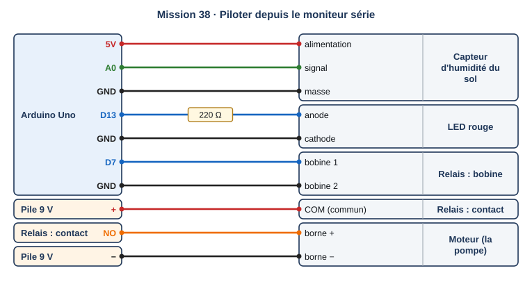{ .schema }

??? info "Le câblage, fil par fil"

    | Depuis | Broche ou borne | Sur le fil | Vers le composant | Borne du composant |
    |---|---|---|---|---|
    | Arduino Uno | 5V |   | Capteur d'humidité du sol | alimentation |
    | Arduino Uno | A0 |   | Capteur d'humidité du sol | signal |
    | Arduino Uno | GND |   | Capteur d'humidité du sol | masse |
    | Arduino Uno | D13 | 220 Ω | LED rouge | anode |
    | Arduino Uno | GND |   | LED rouge | cathode |
    | Arduino Uno | D7 |   | Relais : bobine | bobine 1 |
    | Arduino Uno | GND |   | Relais : bobine | bobine 2 |
    | Pile 9 V | + |   | Relais : contact | COM (commun) |
    | Relais : contact | NO |   | Moteur (la pompe) | borne + |
    | Pile 9 V | − |   | Moteur (la pompe) | borne − |

[:material-open-in-new: Ouvrir Tinkercad Circuits](https://www.tinkercad.com/circuits){ .md-button .md-button--primary target=_blank rel=noopener } [:material-download: Fichier de départ mission-38.ino](programmes/mission-38-depart.ino){ .md-button }

**Notions :** réception série, caractère, commande, switch.

**Programmation :** Texte (C++).

**Pas à pas**

1. Je câble le capteur (A0), la LED (13) et le relais avec le moteur (7).
2. Dans loop : si Serial.available() > 0, je lis un caractère avec Serial.read().
3. Avec switch, je traite chaque lettre dans un case.
4. Je réponds toujours par un message (« LED allumée », « Arrosage 2 s ») pour confirmer.
5. Dans le moniteur série, je tape une lettre puis Envoyer.

??? question "Coup de pouce 1 : je réfléchis avant de câbler et de programmer"

    - Que renvoie Serial.available() ?
    - Que doit faire le programme si on tape une lettre inconnue ?
    - Pourquoi répondre à chaque commande ?

??? note "Coup de pouce 2 : les instructions que je vais utiliser"

    - `Serial.available()` : nombre de caractères reçus en attente
    - `char c = Serial.read();` : lire un caractère
    - `switch (c) { case 'a': ... break; }`
    - `default:` : tous les autres cas

??? abstract "Coup de pouce 3 : le squelette du programme"

    Le programme est écrit, les valeurs et les mots manquants sont remplacés par ___. Je l'ouvre seulement si les deux premiers coups de pouce ne suffisent pas.

    ```cpp
    const int LED = 13, RELAIS = 7;

    void setup() {
      pinMode(LED, OUTPUT);
      pinMode(RELAIS, OUTPUT);
      Serial.begin(9600);
      Serial.println("Commandes : a, e, p, ?");
    }

    void loop() {
      if (Serial.available() > 0) {
        char c = Serial.read();
        switch (c) {
          case 'a': digitalWrite(LED, HIGH); Serial.println("LED allumee"); break;
          case 'e': digitalWrite(LED, LOW);  Serial.println("LED eteinte"); break;
          case 'p':
            Serial.println("Arrosage 2 s");
            digitalWrite(RELAIS, HIGH); delay(___); digitalWrite(RELAIS, LOW);
            break;
          case '?':
            Serial.print("Humidite : ");
            Serial.println(map(analogRead(A0), 0, 876, 0, 100));
            break;
          case '\n': case '\r': break;   // fin de ligne envoyée par le moniteur
          default: Serial.println("Commande inconnue");
        }
      }
    }
    ```

??? warning "Si ça ne marche pas"

    - Rien ne réagit : je compare à "a" (guillemets doubles, une chaîne) au lieu de 'a' (apostrophes, un caractère).
    - Un message « commande inconnue » s'affiche en plus : le moniteur envoie aussi un retour à la ligne ; je l'ignore dans un case.

!!! example "Sur le vrai matériel"

    Sur le kit Grove : la même interface permet de tester la pompe et le capteur depuis l'ordinateur, sans attendre que la terre sèche.

!!! tip "Mon défi"

    J'ajoute la commande s suivie d'un chiffre (s3) qui règle le seuil d'arrosage à 30 %.

**Je vérifie avant de cocher**

- [ ] Les quatre commandes marchent.
- [ ] Chaque commande reçoit une réponse.

<label class="mission-reussie"><input type="checkbox" data-mission="38"> J'ai réussi la mission 38</label>

</div>

## Mission 39 · Le journal de données { #mission-39 }

<div class="mission palier-3" markdown>

<p class="mission-objectif"><strong>Ce que je dois obtenir.</strong> Toutes les 2 s, le moniteur série écrit une ligne : temps;humidite;temperature. Je copie le journal dans un tableur et je trace les deux courbes.</p>

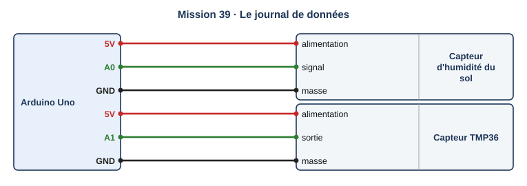{ .schema }

??? info "Le câblage, fil par fil"

    | Depuis | Broche ou borne | Sur le fil | Vers le composant | Borne du composant |
    |---|---|---|---|---|
    | Arduino Uno | 5V |   | Capteur d'humidité du sol | alimentation |
    | Arduino Uno | A0 |   | Capteur d'humidité du sol | signal |
    | Arduino Uno | GND |   | Capteur d'humidité du sol | masse |
    | Arduino Uno | 5V |   | Capteur TMP36 | alimentation |
    | Arduino Uno | A1 |   | Capteur TMP36 | sortie |
    | Arduino Uno | GND |   | Capteur TMP36 | masse |

[:material-open-in-new: Ouvrir Tinkercad Circuits](https://www.tinkercad.com/circuits){ .md-button .md-button--primary target=_blank rel=noopener } [:material-download: Fichier de départ mission-39.ino](programmes/mission-39-depart.ino){ .md-button }

**Notions :** enregistrement daté, format CSV, tableur.

**Programmation :** Texte (C++).

**Pas à pas**

1. Je câble le capteur d'humidité (A0) et le TMP36 (A1).
2. Dans setup, j'écris l'en-tête : temps;humidite;temperature.
3. Dans loop, j'écris une ligne : le temps en secondes, un point-virgule, l'humidité, un point-virgule, la température.
4. Je fais varier les deux curseurs pendant une minute de simulation.
5. Je sélectionne le texte du moniteur, je le colle dans un tableur, puis Données, Convertir, séparateur point-virgule.

??? question "Coup de pouce 1 : je réfléchis avant de câbler et de programmer"

    - Pourquoi un séparateur entre les valeurs ?
    - Pourquoi écrire le temps sur chaque ligne ?
    - Combien de lignes pour une heure de mesures toutes les 2 s ?

??? note "Coup de pouce 2 : les instructions que je vais utiliser"

    - `Serial.print(...)` puis `Serial.println(...)` pour finir la ligne
    - `";"` : le séparateur entre deux valeurs
    - `(millis() - debut) / 1000` : le temps en secondes
    - `Serial.println(valeur, 1)` : une décimale

??? abstract "Coup de pouce 3 : le squelette du programme"

    Le programme est écrit, les valeurs et les mots manquants sont remplacés par ___. Je l'ouvre seulement si les deux premiers coups de pouce ne suffisent pas.

    ```cpp
    unsigned long debut = 0;

    float lireTemperature() {
      return (analogRead(A1) * 5.0 / 1024.0 - 0.5) * 100;
    }

    void setup() {
      Serial.begin(9600);
      Serial.println("___");   // en-tête du journal
      debut = millis();
    }

    void loop() {
      int humidite = map(analogRead(A0), 0, 876, 0, 100);
      Serial.print((millis() - debut) / 1000);
      Serial.print(___);
      Serial.print(humidite);
      Serial.print(";");
      Serial.println(lireTemperature(), 1);
      delay(___);
    }
    ```

??? warning "Si ça ne marche pas"

    - Le tableur met tout dans une seule colonne : je choisis le point-virgule comme séparateur à l'import.
    - Les températures ont un point décimal que le tableur ne comprend pas : je règle le séparateur décimal, ou j'écris des entiers.

!!! example "Sur le vrai matériel"

    Sur le kit Grove : le programme jardin-3e-hysteresis.ino écrit le même type de journal ; on le copie depuis le moniteur série de l'Arduino IDE.

!!! tip "Mon défi"

    Le journal n'écrit une ligne que lorsque l'humidité change d'au moins 2 %.

**Je vérifie avant de cocher**

- [ ] L'en-tête est écrit une seule fois.
- [ ] Mon tableur affiche deux courbes.

<label class="mission-reussie"><input type="checkbox" data-mission="39"> J'ai réussi la mission 39</label>

</div>

## Mission 40 · Atelier orange : l'arrosage intelligent { #mission-40 }

<div class="mission palier-3" markdown>

<p class="mission-objectif"><strong>Ce que je dois obtenir.</strong> Le système arrose par doses de 3 s quand l'humidité passe sous 30 %, s'arrête au-dessus de 50 %, ignore les valeurs impossibles, affiche l'état sur l'écran et écrit un journal.</p>

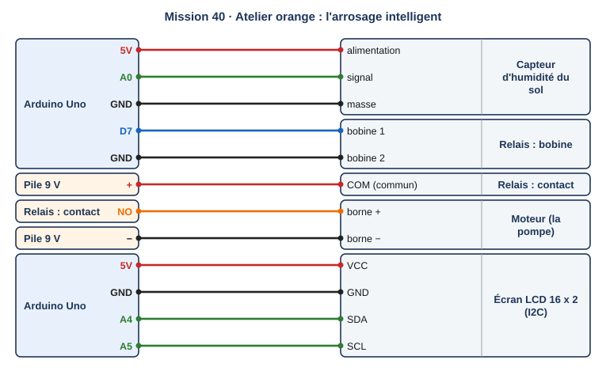{ .schema }

??? info "Le câblage, fil par fil"

    | Depuis | Broche ou borne | Sur le fil | Vers le composant | Borne du composant |
    |---|---|---|---|---|
    | Arduino Uno | 5V |   | Capteur d'humidité du sol | alimentation |
    | Arduino Uno | A0 |   | Capteur d'humidité du sol | signal |
    | Arduino Uno | GND |   | Capteur d'humidité du sol | masse |
    | Arduino Uno | D7 |   | Relais : bobine | bobine 1 |
    | Arduino Uno | GND |   | Relais : bobine | bobine 2 |
    | Pile 9 V | + |   | Relais : contact | COM (commun) |
    | Relais : contact | NO |   | Moteur (la pompe) | borne + |
    | Pile 9 V | − |   | Moteur (la pompe) | borne − |
    | Arduino Uno | 5V |   | Écran LCD 16 x 2 (I2C) | VCC |
    | Arduino Uno | GND |   | Écran LCD 16 x 2 (I2C) | GND |
    | Arduino Uno | A4 |   | Écran LCD 16 x 2 (I2C) | SDA |
    | Arduino Uno | A5 |   | Écran LCD 16 x 2 (I2C) | SCL |

[:material-open-in-new: Ouvrir Tinkercad Circuits](https://www.tinkercad.com/circuits){ .md-button .md-button--primary target=_blank rel=noopener } [:material-download: Fichier de départ mission-40.ino](programmes/mission-40-depart.ino){ .md-button }

**Notions :** synthèse : hystérésis, filtre, journal, écran.

**Programmation :** Texte (C++).

**Pas à pas**

1. Je réunis le capteur (A0), le relais et le moteur (7), l'écran LCD.
2. Je complète le fichier de départ : filtre, hystérésis à deux seuils, dose, affichage, journal.
3. Je teste quatre situations : terre sèche, terre entre les seuils en séchant, terre entre les seuils en arrosant, capteur débranché.
4. Je compare mon programme à jardin-3e-hysteresis.ino de la séquence jardin sec.

??? question "Coup de pouce 1 : je réfléchis avant de câbler et de programmer"

    - Quelles sont les trois décisions possibles à chaque tour ?
    - Que doit faire le système si la valeur lue est impossible ?
    - Pourquoi arroser par doses et non en continu ?

??? note "Coup de pouce 2 : les instructions que je vais utiliser"

    - le filtre en premier : `if (h < MINI || h > MAXI)`
    - puis `else if` pour les deux seuils
    - une dose seulement si `arrosage` est vrai
    - l'écran et le journal à chaque tour

??? abstract "Coup de pouce 3 : le squelette du programme"

    Le programme est écrit, les valeurs et les mots manquants sont remplacés par ___. Je l'ouvre seulement si les deux premiers coups de pouce ne suffisent pas.

    ```cpp
    #include <Adafruit_LiquidCrystal.h>

    Adafruit_LiquidCrystal lcd(0);
    const int RELAIS = 7;
    const int SEUIL_BAS = ___, SEUIL_HAUT = ___;   // en %
    const int MINI = 5, MAXI = 95;                       // hors de cette plage : valeur impossible
    const unsigned long DOSE = 3000, PAUSE = 5000;       // jardin réel : PAUSE de 30 min
    bool arrosage = false;

    void setup() {
      pinMode(RELAIS, OUTPUT);
      lcd.begin(16, 2);
      Serial.begin(9600);
      Serial.println("temps;humidite;arrosage");
    }

    void loop() {
      int h = map(analogRead(A0), 0, 876, 0, 100);
      if (h < MINI || h > MAXI) {
        arrosage = ___;               // filtre
      } else if (h < SEUIL_BAS) {
        arrosage = true;
      } else if (h > SEUIL_HAUT) {
        arrosage = false;
      }
      lcd.clear();
      lcd.print("Humidite ");
      lcd.print(h);
      lcd.print(" %");
      lcd.setCursor(0, 1);
      lcd.print(arrosage ? "Arrosage" : "Repos");
      if (___) {
        digitalWrite(RELAIS, HIGH);
        delay(___);
        digitalWrite(RELAIS, LOW);
      }
      Serial.print(millis() / 1000); Serial.print(";");
      Serial.print(h); Serial.print(";");
      Serial.println(arrosage ? 1 : 0);
      delay(PAUSE);
    }
    ```

??? warning "Si ça ne marche pas"

    - Le moteur tourne en continu : la dose n'est pas suivie d'une attente, ou l'arrêt au-dessus de 50 % manque.
    - Débrancher le capteur fait arroser : le filtre ne s'applique pas avant la décision.

!!! example "Sur le vrai matériel"

    Sur le kit Grove : on téléverse ce programme dans la station du jardin (capteur A0, relais D7), en remplaçant l'écran LCD par l'OLED du kit et la conversion en % par l'étalonnage réel (200 et 600).

!!! tip "Mon défi"

    L'écran affiche aussi le nombre de doses données depuis le démarrage.

**Je vérifie avant de cocher**

- [ ] Quatre situations testées et conformes.
- [ ] Le journal s'écrit à chaque tour.
- [ ] J'ai envoyé ma capture avec le formulaire en bas de la page.

<label class="mission-reussie"><input type="checkbox" data-mission="40"> J'ai réussi la mission 40</label>

</div>

## Je vérifie que j'ai compris

**Question 1.** Que fait ce programme quand on appuie sur le bouton panique en plein jour ?

```cpp
if ((porte && nuit) || panique) {
  tone(8, 880, 150);
}
```

**Question 2.** Pourquoi la variable d'état de l'hystérésis doit-elle être déclarée avant setup ?

**Question 3.** Les mesures 512, 498, 0 arrivent. Que valent la moyenne et la médiane ?

**Question 4.** Pourquoi utilise-t-on millis() plutôt que delay() dans la lumière qui attend ?

**Question 5.** Le moniteur série reçoit 'p'. Que fait le programme de la mission 38 ?

## Où j'en suis

En fin de séance, j'indique la dernière mission terminée et j'ajoute une capture d'écran de mon circuit et de mon programme dans Tinkercad. Le professeur la reçoit directement.

<div id="progression-missions" data-type="arduino" data-palier="3 (orange)" data-niveau="3e" data-couleur="orange"></div>
<script type="application/json" id="missions-data">[{"id": "31", "titre": "Des blocs au texte"}, {"id": "32", "titre": "Constantes et commentaires"}, {"id": "33", "titre": "L'alarme de la serre"}, {"id": "34", "titre": "Le chauffage de la serre"}, {"id": "35", "titre": "Des mesures qui tremblent"}, {"id": "36", "titre": "La lumière qui attend"}, {"id": "37", "titre": "La jauge lumineuse"}, {"id": "38", "titre": "Piloter depuis le moniteur série"}, {"id": "39", "titre": "Le journal de données"}, {"id": "40", "titre": "Atelier orange : l'arrosage intelligent"}]</script>

*Missions conçues pour le site à partir des ressources officielles citées sur la [page d'accueil des missions](index.md#sources-et-licences).*
