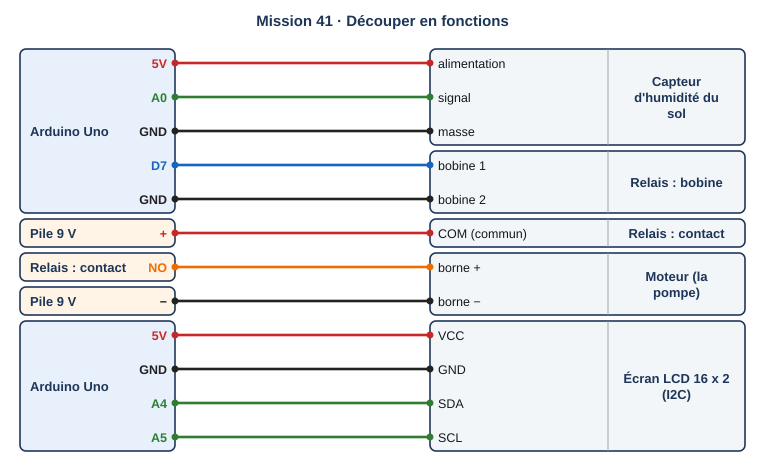
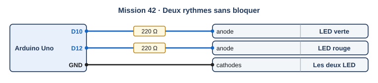
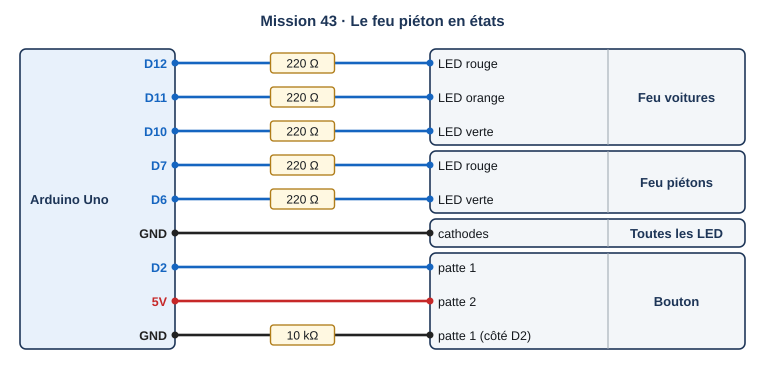
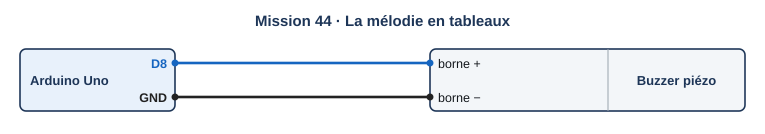
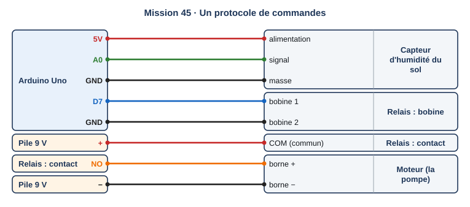
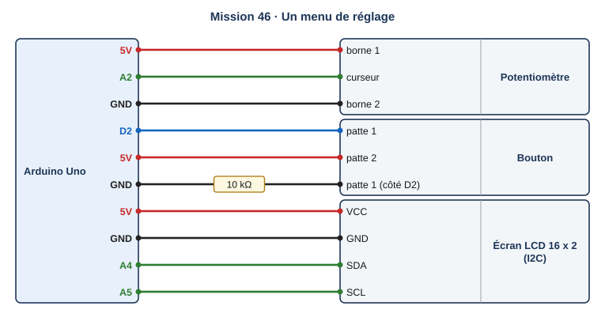
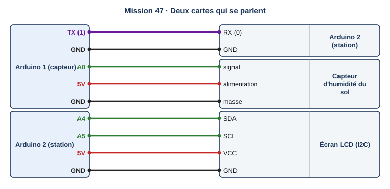
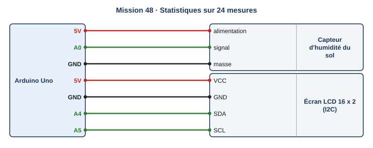
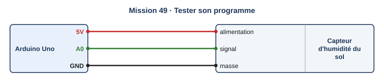
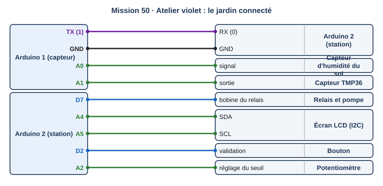

# Palier 4 (violet) : programmer un objet connecté

Dix missions pour programmer proprement un objet connecté, en texte : fonctions, temps sans blocage, machine à états, tableaux, protocole de commandes, interface de réglage, deux cartes qui communiquent, statistiques et tests. On termine par le jardin connecté.

Classe de départ : **2de**. Les élèves qui ont terminé le palier orange continuent ici. Chaque mission a un fichier de départ.

| Mission | Titre | Notions |
|---|---|---|
| [41](#mission-41) | Découper en fonctions | fonctions, paramètres, valeur de retour, lisibilité |
| [42](#mission-42) | Deux rythmes sans bloquer | millis(), tâches en parallèle, programme non bloquant |
| [43](#mission-43) | Le feu piéton en états | machine à états, enum, switch, transitions |
| [44](#mission-44) | La mélodie en tableaux | tableaux, indices, boucle for, sizeof |
| [45](#mission-45) | Un protocole de commandes | chaîne de caractères, analyse d'une commande, réponse OK ou ERREUR |
| [46](#mission-46) | Un menu de réglage | interface homme-machine, état d'interface, potentiomètre, bouton de validation |
| [47](#mission-47) | Deux cartes qui se parlent | liaison série entre deux cartes, émetteur, récepteur, trame |
| [48](#mission-48) | Statistiques sur 24 mesures | tableau circulaire, minimum, maximum, moyenne |
| [49](#mission-49) | Tester son programme | test automatique, cas limites, fonction pure, résultat attendu |
| [50](#mission-50) | Atelier violet : le jardin connecté | synthèse : deux cartes, protocole, états, réglage, journal, tests |

!!! info "Comment travailler"

    Je regarde le schéma de câblage et je lis ce que je dois obtenir. J'ouvre Tinkercad Circuits, je câble, puis je programme en suivant le pas à pas. Je lance la simulation et je compare avec l'objectif. Si je suis bloqué, j'ouvre les coups de pouce dans l'ordre : 1, je réfléchis ; 2, les blocs ou les instructions à utiliser ; 3, le squelette du programme. « Si ça ne marche pas » liste les erreurs les plus courantes. En fin de séance, j'envoie ma progression avec une capture d'écran (bas de la page).

## Mission 41 · Découper en fonctions { #mission-41 }

<div class="mission palier-4" markdown>

<p class="mission-objectif"><strong>Ce que je dois obtenir.</strong> La station du jardin fonctionne comme au palier bleu, mais loop ne contient que trois lignes : lire, afficher, décider.</p>

{ .schema }

??? info "Le câblage, fil par fil"

    | Depuis | Broche ou borne | Sur le fil | Vers le composant | Borne du composant |
    |---|---|---|---|---|
    | Arduino Uno | 5V |   | Capteur d'humidité du sol | alimentation |
    | Arduino Uno | A0 |   | Capteur d'humidité du sol | signal |
    | Arduino Uno | GND |   | Capteur d'humidité du sol | masse |
    | Arduino Uno | D7 |   | Relais : bobine | bobine 1 |
    | Arduino Uno | GND |   | Relais : bobine | bobine 2 |
    | Pile 9 V | + |   | Relais : contact | COM (commun) |
    | Relais : contact | NO |   | Moteur (la pompe) | borne + |
    | Pile 9 V | − |   | Moteur (la pompe) | borne − |
    | Arduino Uno | 5V |   | Écran LCD 16 x 2 (I2C) | VCC |
    | Arduino Uno | GND |   | Écran LCD 16 x 2 (I2C) | GND |
    | Arduino Uno | A4 |   | Écran LCD 16 x 2 (I2C) | SDA |
    | Arduino Uno | A5 |   | Écran LCD 16 x 2 (I2C) | SCL |

[:material-open-in-new: Ouvrir Tinkercad Circuits](https://www.tinkercad.com/circuits){ .md-button .md-button--primary target=_blank rel=noopener } [:material-download: Fichier de départ mission-41.ino](programmes/mission-41-depart.ino){ .md-button }

**Notions :** fonctions, paramètres, valeur de retour, lisibilité.

**Programmation :** Texte (C++).

**Pas à pas**

1. Je colle le fichier de départ : tout est écrit dans loop, en un seul bloc.
2. Je complète la fonction lireHumidite() qui renvoie l'humidité en %.
3. Je complète afficher(int h) et arroser(unsigned long dose).
4. loop appelle ces fonctions ; je vérifie que le comportement n'a pas changé.

??? question "Coup de pouce 1 : je réfléchis avant de câbler et de programmer"

    - Qu'est-ce qui distingue une fonction qui renvoie une valeur (int) d'une fonction qui agit (void) ?
    - Quel avantage a-t-on à donner la durée de la dose en paramètre ?
    - Si je change de capteur, quelle fonction devrai-je modifier ?

??? note "Coup de pouce 2 : les instructions que je vais utiliser"

    - `int nom() { return ...; }` : fonction qui renvoie un entier
    - `void nom(type param) { ... }` : fonction qui agit, avec un paramètre
    - appel : `int h = lireHumidite();`, `arroser(DOSE);`

??? abstract "Coup de pouce 3 : le squelette du programme"

    Le programme est écrit, les valeurs et les mots manquants sont remplacés par ___. Je l'ouvre seulement si les deux premiers coups de pouce ne suffisent pas.

    ```cpp
    #include <Adafruit_LiquidCrystal.h>

    Adafruit_LiquidCrystal lcd(0);
    const int RELAIS = 7, SEUIL = 30;
    const unsigned long DOSE = 3000;

    int lireHumidite() {
      return map(analogRead(A0), 0, 876, 0, ___);
    }

    void afficher(int h) {
      lcd.clear();
      lcd.print("Humidite ");
      lcd.print(___);
      lcd.print(" %");
    }

    void arroser(unsigned long dose) {
      digitalWrite(RELAIS, HIGH);
      delay(___);
      digitalWrite(RELAIS, LOW);
    }

    void setup() {
      pinMode(RELAIS, OUTPUT);
      lcd.begin(16, 2);
    }

    void loop() {
      int h = ___;
      afficher(h);
      if (h < SEUIL) arroser(DOSE);
      delay(5000);
    }
    ```

??? warning "Si ça ne marche pas"

    - « lireHumidite was not declared » : la fonction est écrite après son appel sans être déclarée ; je la place avant loop.
    - La fonction renvoie toujours 0 : il manque return.

!!! example "Sur le vrai matériel"

    Sur le kit Grove : seule lireHumidite() change (étalonnage réel 200 à 600) et afficher() (écran OLED).

!!! tip "Mon défi"

    J'écris une fonction bool doitArroser(int h) qui contient seulement la règle de décision.

**Je vérifie avant de cocher**

- [ ] loop tient en trois ou quatre lignes.
- [ ] Le comportement est le même qu'avant.

<label class="mission-reussie"><input type="checkbox" data-mission="41"> J'ai réussi la mission 41</label>

</div>

## Mission 42 · Deux rythmes sans bloquer { #mission-42 }

<div class="mission palier-4" markdown>

<p class="mission-objectif"><strong>Ce que je dois obtenir.</strong> Deux LED clignotent en même temps à deux rythmes différents : la verte toutes les 300 ms, la rouge toutes les 1 000 ms. Aucun delay dans loop.</p>

{ .schema }

??? info "Le câblage, fil par fil"

    | Depuis | Broche ou borne | Sur le fil | Vers le composant | Borne du composant |
    |---|---|---|---|---|
    | Arduino Uno | D10 | 220 Ω | LED verte | anode |
    | Arduino Uno | D12 | 220 Ω | LED rouge | anode |
    | Arduino Uno | GND |   | Les deux LED | cathodes |

[:material-open-in-new: Ouvrir Tinkercad Circuits](https://www.tinkercad.com/circuits){ .md-button .md-button--primary target=_blank rel=noopener } [:material-download: Fichier de départ mission-42.ino](programmes/mission-42-depart.ino){ .md-button }

**Notions :** millis(), tâches en parallèle, programme non bloquant.

**Programmation :** Texte (C++).

**Pas à pas**

1. Je câble les deux LED.
2. Pour chaque LED, je garde l'instant du dernier changement (unsigned long).
3. À chaque tour : si millis() − dernier ≥ période, j'inverse la LED et je mets à jour dernier.
4. Je vérifie qu'il n'y a plus aucun delay dans loop.

??? question "Coup de pouce 1 : je réfléchis avant de câbler et de programmer"

    - Pourquoi deux delay différents ne peuvent-ils pas faire deux rythmes en même temps ?
    - Combien de fois par seconde loop tourne-t-elle sans delay ?
    - Comment inverser l'état d'une LED en une ligne ?

??? note "Coup de pouce 2 : les instructions que je vais utiliser"

    - `unsigned long maintenant = millis();`
    - `if (maintenant - dernier >= periode)`
    - `etat = !etat;` : inverser un booléen
    - aucun `delay`

??? abstract "Coup de pouce 3 : le squelette du programme"

    Le programme est écrit, les valeurs et les mots manquants sont remplacés par ___. Je l'ouvre seulement si les deux premiers coups de pouce ne suffisent pas.

    ```cpp
    const int VERTE = 10, ROUGE = 12;
    const unsigned long PERIODE_V = ___, PERIODE_R = ___;
    unsigned long dernierV = 0, dernierR = 0;
    bool etatV = false, etatR = false;

    void setup() {
      pinMode(VERTE, OUTPUT);
      pinMode(ROUGE, OUTPUT);
    }

    void loop() {
      unsigned long maintenant = millis();
      if (maintenant - dernierV >= PERIODE_V) {
        dernierV = maintenant;
        etatV = ___;
        digitalWrite(VERTE, etatV);
      }
      if (maintenant - dernierR >= ___) {
        dernierR = maintenant;
        etatR = !etatR;
        digitalWrite(ROUGE, etatR);
      }
    }
    ```

??? warning "Si ça ne marche pas"

    - La LED reste allumée : je mets à jour dernier mais je n'inverse pas l'état.
    - Le rythme dérive : je mets dernier = millis() au lieu de dernier = dernier + période (les deux sont acceptables ici).

!!! example "Sur le vrai matériel"

    Sur le kit Grove : la station doit lire le bouton, l'encodeur et le capteur pendant que la pompe tourne : seul millis() le permet.

!!! tip "Mon défi"

    J'ajoute une troisième tâche : afficher l'humidité dans le moniteur série toutes les 2 s, toujours sans delay.

**Je vérifie avant de cocher**

- [ ] Les deux rythmes sont indépendants.
- [ ] Aucun delay dans loop.

<label class="mission-reussie"><input type="checkbox" data-mission="42"> J'ai réussi la mission 42</label>

</div>

## Mission 43 · Le feu piéton en états { #mission-43 }

<div class="mission palier-4" markdown>

<p class="mission-objectif"><strong>Ce que je dois obtenir.</strong> Le feu piéton à bouton d'appel (mission 17) est réécrit en machine à états : VOITURES, ORANGE, PIETONS. Le bouton reste lu pendant tout le cycle, sans delay.</p>

{ .schema }

??? info "Le câblage, fil par fil"

    | Depuis | Broche ou borne | Sur le fil | Vers le composant | Borne du composant |
    |---|---|---|---|---|
    | Arduino Uno | D12 | 220 Ω | Feu voitures | LED rouge |
    | Arduino Uno | D11 | 220 Ω | Feu voitures | LED orange |
    | Arduino Uno | D10 | 220 Ω | Feu voitures | LED verte |
    | Arduino Uno | D7 | 220 Ω | Feu piétons | LED rouge |
    | Arduino Uno | D6 | 220 Ω | Feu piétons | LED verte |
    | Arduino Uno | GND |   | Toutes les LED | cathodes |
    | Arduino Uno | D2 |   | Bouton | patte 1 |
    | Arduino Uno | 5V |   | Bouton | patte 2 |
    | Arduino Uno | GND | 10 kΩ | Bouton | patte 1 (côté D2) |

[:material-open-in-new: Ouvrir Tinkercad Circuits](https://www.tinkercad.com/circuits){ .md-button .md-button--primary target=_blank rel=noopener } [:material-download: Fichier de départ mission-43.ino](programmes/mission-43-depart.ino){ .md-button }

**Notions :** machine à états, enum, switch, transitions.

**Programmation :** Texte (C++).

**Pas à pas**

1. Je dessine le diagramme des trois états et des transitions (appui, fin de durée).
2. Je déclare enum Etat { VOITURES, ORANGE, PIETONS }; et une variable etat.
3. Dans loop, un switch sur etat : chaque case allume les bonnes LED et teste sa transition.
4. Je mémorise l'instant d'entrée dans l'état (millis) pour mesurer les durées.

??? question "Coup de pouce 1 : je réfléchis avant de câbler et de programmer"

    - Quels sont les états, et qu'est-ce qui fait passer de l'un à l'autre ?
    - Pourquoi noter l'instant d'entrée dans chaque état ?
    - Que fait le système si on appuie pendant que les piétons ont déjà le vert ?

??? note "Coup de pouce 2 : les instructions que je vais utiliser"

    - `enum Etat { ... };` : la liste des états
    - `switch (etat) { case ...: break; }`
    - une fonction `changer()` qui note l'instant d'entrée
    - `millis() - debut` : le temps passé dans l'état

??? abstract "Coup de pouce 3 : le squelette du programme"

    Le programme est écrit, les valeurs et les mots manquants sont remplacés par ___. Je l'ouvre seulement si les deux premiers coups de pouce ne suffisent pas.

    ```cpp
    enum Etat { VOITURES, ORANGE, PIETONS };
    Etat etat = VOITURES;
    unsigned long debut = 0;
    const int V_ROUGE = 12, V_ORANGE = 11, V_VERT = 10, P_ROUGE = 7, P_VERT = 6, BOUTON = 2;

    void feux(int vr, int vo, int vv, int pr, int pv) {
      digitalWrite(V_ROUGE, vr); digitalWrite(V_ORANGE, vo); digitalWrite(V_VERT, vv);
      digitalWrite(P_ROUGE, pr); digitalWrite(P_VERT, pv);
    }

    void changer(Etat nouvel) {
      etat = nouvel;
      debut = ___;
    }

    void setup() {
      for (int b = 6; b <= 12; b++) pinMode(b, OUTPUT);
      pinMode(BOUTON, INPUT);
    }

    void loop() {
      unsigned long duree = millis() - debut;
      switch (etat) {
        case VOITURES:
          feux(0, 0, 1, 1, 0);
          if (digitalRead(BOUTON) == HIGH) changer(___);
          break;
        case ORANGE:
          feux(0, 1, 0, 1, 0);
          if (duree > ___) changer(PIETONS);
          break;
        case PIETONS:
          feux(1, 0, 0, 0, 1);
          if (duree > 5000) changer(___);
          break;
      }
    }
    ```

??? warning "Si ça ne marche pas"

    - Le feu reste bloqué dans un état : la transition ne remet pas debut = millis().
    - Le feu change tout seul : la transition VOITURES → ORANGE ne teste pas le bouton.

!!! example "Sur le vrai matériel"

    Sur le kit Grove : la station du jardin se décrit aussi en états (REPOS, ARROSAGE, PAUSE, ALERTE), mission 50.

!!! tip "Mon défi"

    J'ajoute un état ATTENTE de 10 s après PIETONS, pendant lequel les appuis sont ignorés.

**Je vérifie avant de cocher**

- [ ] Mon diagramme d'états correspond au programme.
- [ ] Aucun delay dans loop.

<label class="mission-reussie"><input type="checkbox" data-mission="43"> J'ai réussi la mission 43</label>

</div>

## Mission 44 · La mélodie en tableaux { #mission-44 }

<div class="mission palier-4" markdown>

<p class="mission-objectif"><strong>Ce que je dois obtenir.</strong> Le buzzer joue « Au clair de la lune ». Les notes et leurs durées sont rangées dans deux tableaux.</p>

{ .schema }

??? info "Le câblage, fil par fil"

    | Depuis | Broche ou borne | Sur le fil | Vers le composant | Borne du composant |
    |---|---|---|---|---|
    | Arduino Uno | D8 |   | Buzzer piézo | borne + |
    | Arduino Uno | GND |   | Buzzer piézo | borne − |

[:material-open-in-new: Ouvrir Tinkercad Circuits](https://www.tinkercad.com/circuits){ .md-button .md-button--primary target=_blank rel=noopener } [:material-download: Fichier de départ mission-44.ino](programmes/mission-44-depart.ino){ .md-button }

**Notions :** tableaux, indices, boucle for, sizeof.

**Programmation :** Texte (C++).

**Pas à pas**

1. Je déclare deux tableaux de même longueur : notes (en hertz) et durees (en ms).
2. Je calcule le nombre de notes avec sizeof.
3. Une boucle for parcourt les tableaux et joue chaque note avec tone().
4. J'ajoute une courte pause entre deux notes pour les détacher.

??? question "Coup de pouce 1 : je réfléchis avant de câbler et de programmer"

    - Que contient la case notes[0] ? Et notes[3] ?
    - Pourquoi les deux tableaux doivent-ils avoir la même longueur ?
    - Comment calculer le nombre de cases d'un tableau ?

??? note "Coup de pouce 2 : les instructions que je vais utiliser"

    - `const int t[] = {a, b, c};` : un tableau
    - `t[i]` : la case numéro i (la première est 0)
    - `sizeof(t) / sizeof(t[0])` : le nombre de cases
    - `tone(broche, frequence, duree)`

??? abstract "Coup de pouce 3 : le squelette du programme"

    Le programme est écrit, les valeurs et les mots manquants sont remplacés par ___. Je l'ouvre seulement si les deux premiers coups de pouce ne suffisent pas.

    ```cpp
    const int BUZZER = 8;
    // do do do ré mi ré do mi ré ré do
    const int notes[]  = {262, 262, 262, 294, 330, 294, 262, 330, 294, 294, 262};
    const int durees[] = {400, 400, 400, 400, 800, 800, 400, 400, 400, 400, 800};
    const int NB = sizeof(notes) / sizeof(___);

    void setup() {
      pinMode(BUZZER, OUTPUT);
    }

    void loop() {
      for (int i = 0; i < ___; i++) {
        tone(BUZZER, notes[i], durees[i]);
        delay(durees[i] + ___);
      }
      delay(2000);
    }
    ```

??? warning "Si ça ne marche pas"

    - Une note bizarre à la fin : la boucle va une case trop loin (i <= n au lieu de i < n).
    - Les notes s'enchaînent sans pause : il manque un delay un peu plus long que la durée de la note.

!!! example "Sur le vrai matériel"

    Avec le kit de la classe : buzzer du kit starter.

!!! tip "Mon défi"

    J'ajoute un troisième tableau de LED : une LED différente s'allume pour chaque hauteur de note.

**Je vérifie avant de cocher**

- [ ] La mélodie est reconnaissable.
- [ ] Changer un tableau change la mélodie sans toucher à la boucle.

<label class="mission-reussie"><input type="checkbox" data-mission="44"> J'ai réussi la mission 44</label>

</div>

## Mission 45 · Un protocole de commandes { #mission-45 }

<div class="mission palier-4" markdown>

<p class="mission-objectif"><strong>Ce que je dois obtenir.</strong> Dans le moniteur série, la station comprend des commandes en texte : ETAT, SEUIL 40, ARROSE 3. Elle répond toujours OK ou ERREUR.</p>

{ .schema }

??? info "Le câblage, fil par fil"

    | Depuis | Broche ou borne | Sur le fil | Vers le composant | Borne du composant |
    |---|---|---|---|---|
    | Arduino Uno | 5V |   | Capteur d'humidité du sol | alimentation |
    | Arduino Uno | A0 |   | Capteur d'humidité du sol | signal |
    | Arduino Uno | GND |   | Capteur d'humidité du sol | masse |
    | Arduino Uno | D7 |   | Relais : bobine | bobine 1 |
    | Arduino Uno | GND |   | Relais : bobine | bobine 2 |
    | Pile 9 V | + |   | Relais : contact | COM (commun) |
    | Relais : contact | NO |   | Moteur (la pompe) | borne + |
    | Pile 9 V | − |   | Moteur (la pompe) | borne − |

[:material-open-in-new: Ouvrir Tinkercad Circuits](https://www.tinkercad.com/circuits){ .md-button .md-button--primary target=_blank rel=noopener } [:material-download: Fichier de départ mission-45.ino](programmes/mission-45-depart.ino){ .md-button }

**Notions :** chaîne de caractères, analyse d'une commande, réponse OK ou ERREUR.

**Programmation :** Texte (C++).

**Pas à pas**

1. Je lis une ligne complète avec Serial.readStringUntil('\n').
2. Je supprime les espaces en trop avec trim().
3. Si la commande commence par « SEUIL », je lis le nombre qui suit avec substring() et toInt().
4. Je vérifie que le nombre est plausible (10 à 90) avant de l'accepter.
5. Je teste les commandes valides et des commandes fausses (SEUIL 500, ARROSE, BONJOUR).

??? question "Coup de pouce 1 : je réfléchis avant de câbler et de programmer"

    - Qu'est-ce qu'un protocole ?
    - Pourquoi vérifier que la valeur reçue est plausible ?
    - Que doit répondre la station à une commande qu'elle ne connaît pas ?

??? note "Coup de pouce 2 : les instructions que je vais utiliser"

    - `String cmd = Serial.readStringUntil('\n');` puis `cmd.trim();`
    - `cmd.startsWith("SEUIL ")`, `cmd.substring(6).toInt()`
    - une réponse `OK` ou `ERREUR ...` à chaque commande

??? abstract "Coup de pouce 3 : le squelette du programme"

    Le programme est écrit, les valeurs et les mots manquants sont remplacés par ___. Je l'ouvre seulement si les deux premiers coups de pouce ne suffisent pas.

    ```cpp
    const int RELAIS = 7;
    int seuil = 30;

    void setup() {
      pinMode(RELAIS, OUTPUT);
      Serial.begin(9600);
      Serial.setTimeout(50);
    }

    void loop() {
      if (Serial.available() > 0) {
        String cmd = Serial.readStringUntil('\n');
        cmd.trim();
        if (cmd == "ETAT") {
          Serial.print("OK humidite=");
          Serial.print(map(analogRead(A0), 0, 876, 0, 100));
          Serial.print(" seuil=");
          Serial.println(seuil);
        } else if (cmd.startsWith("SEUIL ")) {
          int v = cmd.substring(___).toInt();
          if (v >= 10 && v <= ___) { seuil = v; Serial.println("OK"); }
          else Serial.println("ERREUR valeur");
        } else if (cmd.startsWith("ARROSE ")) {
          int s = cmd.substring(7).toInt();
          if (s >= 1 && s <= 10) {
            digitalWrite(RELAIS, HIGH); delay(s * 1000UL); digitalWrite(RELAIS, LOW);
            Serial.println("OK");
          } else Serial.println("ERREUR valeur");
        } else {
          Serial.println(___);
        }
      }
    }
    ```

??? warning "Si ça ne marche pas"

    - SEUIL 40 ne marche pas : je compare la ligne entière à « SEUIL » au lieu de tester son début avec startsWith.
    - Le nombre lu vaut 0 : substring commence au mauvais caractère (l'espace compte).

!!! example "Sur le vrai matériel"

    Sur le kit Grove : le même protocole permet de régler la station réelle depuis l'ordinateur, sans retéléverser.

!!! tip "Mon défi"

    J'ajoute la commande JOURNAL ON / JOURNAL OFF qui active l'écriture d'une ligne de mesures toutes les 5 s.

**Je vérifie avant de cocher**

- [ ] Trois commandes valides.
- [ ] Toute commande fausse reçoit ERREUR et ne change rien.

<label class="mission-reussie"><input type="checkbox" data-mission="45"> J'ai réussi la mission 45</label>

</div>

## Mission 46 · Un menu de réglage { #mission-46 }

<div class="mission palier-4" markdown>

<p class="mission-objectif"><strong>Ce que je dois obtenir.</strong> L'écran affiche « Seuil : 35 % ». En tournant le potentiomètre, la valeur proposée change ; un appui sur le bouton la valide et l'écran affiche « Enregistré ».</p>

{ .schema }

??? info "Le câblage, fil par fil"

    | Depuis | Broche ou borne | Sur le fil | Vers le composant | Borne du composant |
    |---|---|---|---|---|
    | Arduino Uno | 5V |   | Potentiomètre | borne 1 |
    | Arduino Uno | A2 |   | Potentiomètre | curseur |
    | Arduino Uno | GND |   | Potentiomètre | borne 2 |
    | Arduino Uno | D2 |   | Bouton | patte 1 |
    | Arduino Uno | 5V |   | Bouton | patte 2 |
    | Arduino Uno | GND | 10 kΩ | Bouton | patte 1 (côté D2) |
    | Arduino Uno | 5V |   | Écran LCD 16 x 2 (I2C) | VCC |
    | Arduino Uno | GND |   | Écran LCD 16 x 2 (I2C) | GND |
    | Arduino Uno | A4 |   | Écran LCD 16 x 2 (I2C) | SDA |
    | Arduino Uno | A5 |   | Écran LCD 16 x 2 (I2C) | SCL |

[:material-open-in-new: Ouvrir Tinkercad Circuits](https://www.tinkercad.com/circuits){ .md-button .md-button--primary target=_blank rel=noopener } [:material-download: Fichier de départ mission-46.ino](programmes/mission-46-depart.ino){ .md-button }

**Notions :** interface homme-machine, état d'interface, potentiomètre, bouton de validation.

**Programmation :** Texte (C++).

**Pas à pas**

1. Je câble le potentiomètre (A2), le bouton (D2) et l'écran.
2. La valeur proposée vaut map(potentiomètre, 0, 1023, 10, 90).
3. J'affiche la valeur proposée et la valeur enregistrée sur deux lignes.
4. Sur un appui (front montant : relâché avant, appuyé maintenant), j'enregistre la valeur.

??? question "Coup de pouce 1 : je réfléchis avant de câbler et de programmer"

    - Pourquoi distinguer la valeur proposée et la valeur enregistrée ?
    - Qu'est-ce qu'un front montant ?
    - Comment éviter que l'écran clignote ?

??? note "Coup de pouce 2 : les instructions que je vais utiliser"

    - `map(analogRead(A2), 0, 1023, 10, 90)`
    - front montant : `maintenant && !avant`, puis `avant = maintenant;`
    - ne réécrire l'écran que si la valeur a changé

??? abstract "Coup de pouce 3 : le squelette du programme"

    Le programme est écrit, les valeurs et les mots manquants sont remplacés par ___. Je l'ouvre seulement si les deux premiers coups de pouce ne suffisent pas.

    ```cpp
    #include <Adafruit_LiquidCrystal.h>

    Adafruit_LiquidCrystal lcd(0);
    const int BOUTON = 2;
    int enregistre = 30, propose = 30, affiche = -1;
    bool avant = false;

    void setup() {
      pinMode(BOUTON, INPUT);
      lcd.begin(16, 2);
    }

    void loop() {
      propose = map(analogRead(A2), 0, 1023, ___, ___);
      bool maintenant = digitalRead(BOUTON) == HIGH;
      if (maintenant && ___) {       // front montant
        enregistre = propose;
        lcd.clear();
        lcd.print("Enregistre");
        delay(800);
        affiche = -1;
      }
      avant = maintenant;
      if (propose != affiche) {          // réécrire seulement si la valeur change
        lcd.clear();
        lcd.print("Seuil : ");
        lcd.print(propose);
        lcd.print(" %");
        lcd.setCursor(0, 1);
        lcd.print("Actuel : ");
        lcd.print(___);
        affiche = propose;
      }
    }
    ```

??? warning "Si ça ne marche pas"

    - Un appui enregistre plusieurs fois : je teste l'état du bouton au lieu du front montant.
    - L'écran clignote : je l'efface à chaque tour ; je réécris seulement quand la valeur change.

!!! example "Sur le vrai matériel"

    Sur le kit Grove : l'encodeur rotatif et le bouton du kit, avec l'écran OLED, servent exactement à ce menu de réglage de la station.

!!! tip "Mon défi"

    J'ajoute un second écran de réglage pour la durée de la dose, en passant d'un écran à l'autre par un appui long.

**Je vérifie avant de cocher**

- [ ] La valeur proposée suit le potentiomètre.
- [ ] Un appui enregistre une seule fois.

<label class="mission-reussie"><input type="checkbox" data-mission="46"> J'ai réussi la mission 46</label>

</div>

## Mission 47 · Deux cartes qui se parlent { #mission-47 }

<div class="mission palier-4" markdown>

<p class="mission-objectif"><strong>Ce que je dois obtenir.</strong> La carte « capteur » mesure l'humidité et envoie une trame H:45 toutes les 2 s. La carte « station » la reçoit, l'affiche sur l'écran et arrose si nécessaire.</p>

{ .schema }

??? info "Le câblage, fil par fil"

    | Depuis | Broche ou borne | Sur le fil | Vers le composant | Borne du composant |
    |---|---|---|---|---|
    | Arduino 1 (capteur) | TX (1) |   | Arduino 2 (station) | RX (0) |
    | Arduino 1 (capteur) | GND |   | Arduino 2 (station) | GND |
    | Arduino 1 (capteur) | A0 |   | Capteur d'humidité du sol | signal |
    | Arduino 1 (capteur) | 5V |   | Capteur d'humidité du sol | alimentation |
    | Arduino 1 (capteur) | GND |   | Capteur d'humidité du sol | masse |
    | Arduino 2 (station) | A4 |   | Écran LCD (I2C) | SDA |
    | Arduino 2 (station) | A5 |   | Écran LCD (I2C) | SCL |
    | Arduino 2 (station) | 5V |   | Écran LCD (I2C) | VCC |
    | Arduino 2 (station) | GND |   | Écran LCD (I2C) | GND |

[:material-open-in-new: Ouvrir Tinkercad Circuits](https://www.tinkercad.com/circuits){ .md-button .md-button--primary target=_blank rel=noopener } [:material-download: Fichier de départ mission-47.ino](programmes/mission-47-depart.ino){ .md-button }

**Notions :** liaison série entre deux cartes, émetteur, récepteur, trame.

**Programmation :** Texte (C++).

**Pas à pas**

1. Je place deux cartes Arduino. Je relie TX de la carte 1 à RX de la carte 2, et les deux GND entre eux.
2. Je sélectionne la carte 1 dans l'éditeur de code et je colle le programme émetteur (fichier de départ, première partie).
3. Je sélectionne la carte 2 et je colle le programme récepteur (seconde partie).
4. Je démarre la simulation et je fais varier l'humidité côté capteur.

??? question "Coup de pouce 1 : je réfléchis avant de câbler et de programmer"

    - Pourquoi relier les deux GND ?
    - Pourquoi TX d'un côté et RX de l'autre ?
    - À quoi sert le préfixe « H: » dans la trame ?

??? note "Coup de pouce 2 : les instructions que je vais utiliser"

    - carte 1 : `Serial.print("H:"); Serial.println(h);`
    - carte 2 : `Serial.readStringUntil('\n')`, `startsWith("H:")`, `substring(2).toInt()`
    - même vitesse des deux côtés : `Serial.begin(9600);`

??? abstract "Coup de pouce 3 : le squelette du programme"

    Le programme est écrit, les valeurs et les mots manquants sont remplacés par ___. Je l'ouvre seulement si les deux premiers coups de pouce ne suffisent pas.

    ```cpp
    // ===== CARTE 1 : capteur (émetteur) =====
    // void setup() { Serial.begin(9600); }
    // void loop() {
    //   int h = map(analogRead(A0), 0, 876, 0, 100);
    //   Serial.print("H:");
    //   Serial.println(h);
    //   delay(2000);
    // }

    // ===== CARTE 2 : station (récepteur) =====
    #include <Adafruit_LiquidCrystal.h>

    Adafruit_LiquidCrystal lcd(0);

    void setup() {
      Serial.begin(___);
      lcd.begin(16, 2);
      lcd.print("En attente");
    }

    void loop() {
      if (Serial.available() > 0) {
        String trame = Serial.readStringUntil('\n');
        trame.trim();
        if (trame.startsWith(___)) {
          int h = trame.substring(___).toInt();
          lcd.clear();
          lcd.print("Humidite ");
          lcd.print(h);
          lcd.print(" %");
        }
      }
    }
    ```

??? warning "Si ça ne marche pas"

    - L'écran n'affiche rien : TX est relié à TX ; il faut croiser TX vers RX.
    - Valeurs fantaisistes : les deux cartes n'ont pas la même vitesse (9600 de chaque côté).

!!! example "Sur le vrai matériel"

    Sur le kit Grove : ce découpage capteur / station est celui d'un jardin connecté réel, où le capteur est au pied des plantes et l'affichage à l'intérieur.

!!! tip "Mon défi"

    La carte capteur envoie aussi la température : trame H:45;T:23. La station affiche les deux.

**Je vérifie avant de cocher**

- [ ] La station affiche la valeur envoyée par l'autre carte.
- [ ] Je sais expliquer émetteur, récepteur, trame.

<label class="mission-reussie"><input type="checkbox" data-mission="47"> J'ai réussi la mission 47</label>

</div>

## Mission 48 · Statistiques sur 24 mesures { #mission-48 }

<div class="mission palier-4" markdown>

<p class="mission-objectif"><strong>Ce que je dois obtenir.</strong> La station garde les 24 dernières mesures d'humidité (une par seconde en simulation, une par heure dans le jardin) et affiche le minimum, le maximum et la moyenne.</p>

{ .schema }

??? info "Le câblage, fil par fil"

    | Depuis | Broche ou borne | Sur le fil | Vers le composant | Borne du composant |
    |---|---|---|---|---|
    | Arduino Uno | 5V |   | Capteur d'humidité du sol | alimentation |
    | Arduino Uno | A0 |   | Capteur d'humidité du sol | signal |
    | Arduino Uno | GND |   | Capteur d'humidité du sol | masse |
    | Arduino Uno | 5V |   | Écran LCD 16 x 2 (I2C) | VCC |
    | Arduino Uno | GND |   | Écran LCD 16 x 2 (I2C) | GND |
    | Arduino Uno | A4 |   | Écran LCD 16 x 2 (I2C) | SDA |
    | Arduino Uno | A5 |   | Écran LCD 16 x 2 (I2C) | SCL |

[:material-open-in-new: Ouvrir Tinkercad Circuits](https://www.tinkercad.com/circuits){ .md-button .md-button--primary target=_blank rel=noopener } [:material-download: Fichier de départ mission-48.ino](programmes/mission-48-depart.ino){ .md-button }

**Notions :** tableau circulaire, minimum, maximum, moyenne.

**Programmation :** Texte (C++).

**Pas à pas**

1. Je déclare un tableau de 24 entiers et un indice qui revient à 0 après 23.
2. À chaque mesure, je range la valeur à l'indice puis j'avance l'indice.
3. Je parcours le tableau pour calculer le minimum, le maximum et la moyenne.
4. J'affiche les trois valeurs sur l'écran.

??? question "Coup de pouce 1 : je réfléchis avant de câbler et de programmer"

    - Pourquoi l'indice revient-il à 0 ?
    - Que valent min et max au départ du calcul ?
    - Combien de cases sont valides pendant les 24 premières mesures ?

??? note "Coup de pouce 2 : les instructions que je vais utiliser"

    - `indice = (indice + 1) % N;` : l'indice tourne de 0 à N − 1
    - `remplies` : nombre de cases déjà écrites
    - min de départ 100, max de départ 0

??? abstract "Coup de pouce 3 : le squelette du programme"

    Le programme est écrit, les valeurs et les mots manquants sont remplacés par ___. Je l'ouvre seulement si les deux premiers coups de pouce ne suffisent pas.

    ```cpp
    #include <Adafruit_LiquidCrystal.h>

    Adafruit_LiquidCrystal lcd(0);
    const int N = 24;
    int mesures[N];
    int indice = 0, remplies = 0;

    void setup() {
      lcd.begin(16, 2);
    }

    void loop() {
      mesures[indice] = map(analogRead(A0), 0, 876, 0, 100);
      indice = (indice + 1) % ___;
      if (remplies < N) remplies++;
      int mini = 100, maxi = 0;
      long somme = 0;
      for (int i = 0; i < ___; i++) {
        if (mesures[i] < mini) mini = mesures[i];
        if (mesures[i] > maxi) maxi = ___;
        somme += mesures[i];
      }
      lcd.clear();
      lcd.print("min "); lcd.print(mini);
      lcd.print(" max "); lcd.print(maxi);
      lcd.setCursor(0, 1);
      lcd.print("moy "); lcd.print(somme / remplies);
      delay(1000);
    }
    ```

??? warning "Si ça ne marche pas"

    - Le minimum reste à 0 : le tableau contient encore des cases vides au début ; je ne compte que les cases remplies.
    - Le programme plante ou affiche n'importe quoi : l'indice dépasse 23.

!!! example "Sur le vrai matériel"

    Sur le kit Grove : dans le jardin, une mesure par heure donne les statistiques de la journée sur l'écran OLED.

!!! tip "Mon défi"

    J'affiche la tendance : « monte » si la dernière mesure est au-dessus de la moyenne, « baisse » sinon.

**Je vérifie avant de cocher**

- [ ] Les trois statistiques sont justes (je vérifie avec trois valeurs simples).
- [ ] L'indice ne dépasse jamais 23.

<label class="mission-reussie"><input type="checkbox" data-mission="48"> J'ai réussi la mission 48</label>

</div>

## Mission 49 · Tester son programme { #mission-49 }

<div class="mission palier-4" markdown>

<p class="mission-objectif"><strong>Ce que je dois obtenir.</strong> Au démarrage, le programme teste sa propre règle de décision sur 8 cas et écrit OK ou ECHEC pour chacun dans le moniteur série. Tous les tests passent.</p>

{ .schema }

??? info "Le câblage, fil par fil"

    | Depuis | Broche ou borne | Sur le fil | Vers le composant | Borne du composant |
    |---|---|---|---|---|
    | Arduino Uno | 5V |   | Capteur d'humidité du sol | alimentation |
    | Arduino Uno | A0 |   | Capteur d'humidité du sol | signal |
    | Arduino Uno | GND |   | Capteur d'humidité du sol | masse |

[:material-open-in-new: Ouvrir Tinkercad Circuits](https://www.tinkercad.com/circuits){ .md-button .md-button--primary target=_blank rel=noopener } [:material-download: Fichier de départ mission-49.ino](programmes/mission-49-depart.ino){ .md-button }

**Notions :** test automatique, cas limites, fonction pure, résultat attendu.

**Programmation :** Texte (C++).

**Pas à pas**

1. La règle d'arrosage est isolée dans une fonction : bool decider(int h, bool avant).
2. Je complète le tableau des cas : humidité, état avant, résultat attendu (seuils 30 et 50).
3. La fonction verifier() compare le résultat de decider() au résultat attendu et affiche OK ou ECHEC.
4. J'introduis volontairement une erreur dans decider() et je regarde quels tests échouent.

??? question "Coup de pouce 1 : je réfléchis avant de câbler et de programmer"

    - Pourquoi tester avant de brancher la pompe ?
    - Quels cas faut-il absolument tester ?
    - Pourquoi decider() ne lit-elle pas le capteur elle-même ?

??? note "Coup de pouce 2 : les instructions que je vais utiliser"

    - une fonction qui ne dépend que de ses paramètres : `bool decider(int h, bool avant)`
    - `verifier(valeur, etat, attendu)` affiche OK ou ECHEC
    - les cas limites : sous le seuil bas, entre les seuils (deux états avant), au-dessus, au seuil exact, valeur impossible

??? abstract "Coup de pouce 3 : le squelette du programme"

    Le programme est écrit, les valeurs et les mots manquants sont remplacés par ___. Je l'ouvre seulement si les deux premiers coups de pouce ne suffisent pas.

    ```cpp
    const int SEUIL_BAS = 30, SEUIL_HAUT = 50;
    int reussis = 0, total = 0;

    bool decider(int h, bool avant) {
      if (h < 0 || h > 100) return false;   // valeur impossible
      if (h < SEUIL_BAS) return true;
      if (h > SEUIL_HAUT) return ___;
      return ___;                     // entre les seuils : on garde
    }

    void verifier(int h, bool avant, bool attendu) {
      total++;
      bool obtenu = decider(h, avant);
      if (obtenu == attendu) { reussis++; Serial.print("OK     "); }
      else Serial.print("ECHEC  ");
      Serial.print("h="); Serial.print(h);
      Serial.print(" avant="); Serial.print(avant);
      Serial.print(" attendu="); Serial.println(attendu);
    }

    void setup() {
      Serial.begin(9600);
      verifier(20, false, true);
      verifier(20, true, true);
      verifier(40, false, ___);
      verifier(40, true, ___);
      verifier(60, true, false);
      verifier(60, false, false);
      verifier(30, false, false);   // au seuil exact : pas encore sous 30
      verifier(-5, true, false);
      Serial.print(reussis); Serial.print(" / "); Serial.println(total);
    }

    void loop() {
    }
    ```

??? warning "Si ça ne marche pas"

    - Tous les tests échouent : je compare des valeurs inversées (attendu et obtenu échangés) ou les seuils sont faux.
    - Un test au seuil exact (30 ou 50) échoue : je dois décider si 30 démarre l'arrosage (< ou <=) et l'écrire dans le tableau.

!!! example "Sur le vrai matériel"

    Sur le kit Grove : on fait passer ces tests avant de téléverser la version finale dans la station réelle.

!!! tip "Mon défi"

    J'ajoute les cas des valeurs impossibles (−5 et 120) : decider() doit répondre false.

**Je vérifie avant de cocher**

- [ ] 8 tests sur 8 OK.
- [ ] J'ai vu un test échouer quand j'ai introduit une erreur.

<label class="mission-reussie"><input type="checkbox" data-mission="49"> J'ai réussi la mission 49</label>

</div>

## Mission 50 · Atelier violet : le jardin connecté { #mission-50 }

<div class="mission palier-4" markdown>

<p class="mission-objectif"><strong>Ce que je dois obtenir.</strong> Une carte capteur envoie humidité et température. La station les affiche, arrose par doses selon deux seuils réglables, refuse les valeurs impossibles, répond aux commandes ETAT et SEUIL, et écrit un journal.</p>

{ .schema }

??? info "Le câblage, fil par fil"

    | Depuis | Broche ou borne | Sur le fil | Vers le composant | Borne du composant |
    |---|---|---|---|---|
    | Arduino 1 (capteur) | TX (1) |   | Arduino 2 (station) | RX (0) |
    | Arduino 1 (capteur) | GND |   | Arduino 2 (station) | GND |
    | Arduino 1 (capteur) | A0 |   | Capteur d'humidité du sol | signal |
    | Arduino 1 (capteur) | A1 |   | Capteur TMP36 | sortie |
    | Arduino 2 (station) | D7 |   | Relais et pompe | bobine du relais |
    | Arduino 2 (station) | A4 |   | Écran LCD (I2C) | SDA |
    | Arduino 2 (station) | A5 |   | Écran LCD (I2C) | SCL |
    | Arduino 2 (station) | D2 |   | Bouton | validation |
    | Arduino 2 (station) | A2 |   | Potentiomètre | réglage du seuil |

[:material-open-in-new: Ouvrir Tinkercad Circuits](https://www.tinkercad.com/circuits){ .md-button .md-button--primary target=_blank rel=noopener } [:material-download: Fichier de départ mission-50.ino](programmes/mission-50-depart.ino){ .md-button }

**Notions :** synthèse : deux cartes, protocole, états, réglage, journal, tests.

**Programmation :** Texte (C++).

**Pas à pas**

1. Je pars des missions 41 à 49 : chaque fonction est déjà écrite et testée.
2. Je dessine le diagramme d'états de la station : REPOS, DOSE, PAUSE, ALERTE.
3. J'assemble la carte capteur (trame H:..;T:..) et la station (réception, décision, écran, relais).
4. Je fais passer les tests de la mission 49 sur la fonction de décision.
5. Je présente le système en deux minutes : schéma, états, protocole, tests, limites.

??? question "Coup de pouce 1 : je réfléchis avant de câbler et de programmer"

    - Quelles fonctions des missions précédentes vais-je réutiliser ?
    - Que doit faire la station si elle ne reçoit plus rien du capteur pendant 10 s ?
    - Qu'est-ce qui changera sur le kit Grove réel ?

??? note "Coup de pouce 2 : les instructions que je vais utiliser"

    - réutiliser `decider()` (mission 49), `changer()` (mission 43), la réception de trame (mission 47)
    - un `switch` sur quatre états, aucun `delay`
    - l'alerte : `millis() - derniereTrame > SILENCE`

??? abstract "Coup de pouce 3 : le squelette du programme"

    Le programme est écrit, les valeurs et les mots manquants sont remplacés par ___. Je l'ouvre seulement si les deux premiers coups de pouce ne suffisent pas.

    ```cpp
    // Station (carte 2) : extrait central, la carte capteur reprend la mission 47
    #include <Adafruit_LiquidCrystal.h>

    Adafruit_LiquidCrystal lcd(0);
    enum Etat { REPOS, DOSE, PAUSE, ALERTE };
    Etat etat = REPOS;
    const int RELAIS = 7;
    int seuilBas = 30, seuilHaut = 50, humidite = -1;
    bool arrosage = false;
    unsigned long debut = 0, derniereTrame = 0;
    const unsigned long DUREE_DOSE = 3000, DUREE_PAUSE = 5000, SILENCE = 10000;

    bool decider(int h, bool avant) {
      if (h < 0 || h > 100) return false;
      if (h < seuilBas) return true;
      if (h > seuilHaut) return false;
      return avant;
    }

    void changer(Etat e) { etat = e; debut = millis(); }

    void recevoir() {
      if (Serial.available() > 0) {
        String t = Serial.readStringUntil('\n');
        t.trim();
        if (t.startsWith("H:")) {
          humidite = t.substring(2).toInt();
          derniereTrame = millis();
        } else if (t.startsWith("SEUIL ")) {
          int v = t.substring(6).toInt();
          if (v >= 10 && v < seuilHaut) { seuilBas = v; Serial.println("OK"); } else Serial.println("ERREUR valeur");
        } else if (t == "ETAT") {
          Serial.print("OK h="); Serial.print(humidite); Serial.print(" etat="); Serial.println(etat);
        }
      }
    }

    void setup() {
      pinMode(RELAIS, OUTPUT);
      lcd.begin(16, 2);
      Serial.begin(9600);
    }

    void loop() {
      recevoir();
      unsigned long duree = millis() - debut;
      if (millis() - derniereTrame > ___) etat = ALERTE;
      switch (etat) {
        case REPOS:
          arrosage = decider(humidite, arrosage);
          if (arrosage) { digitalWrite(RELAIS, HIGH); changer(___); }
          break;
        case DOSE:
          if (duree > DUREE_DOSE) { digitalWrite(RELAIS, LOW); changer(PAUSE); }
          break;
        case PAUSE:
          if (duree > ___) changer(REPOS);
          break;
        case ALERTE:
          digitalWrite(RELAIS, LOW);
          if (millis() - derniereTrame < SILENCE) changer(REPOS);
          break;
      }
      lcd.setCursor(0, 0);
      lcd.print("H "); lcd.print(humidite); lcd.print(" %   ");
      lcd.setCursor(0, 1);
      const char* noms[] = {"Repos ", "Dose  ", "Pause ", "ALERTE"};
      lcd.print(noms[etat]);
    }
    ```

??? warning "Si ça ne marche pas"

    - La station ne réagit plus : un delay long bloque la réception ; je remplace par millis().
    - Les doses s'enchaînent sans pause : l'état PAUSE n'est pas mesuré avec millis().

!!! example "Sur le vrai matériel"

    Sur le kit Grove : la station réelle fait tout sur une carte (capteur sur A0, relais sur D7, OLED et encodeur) ; la version à deux cartes prépare un capteur déporté au fond du jardin.

!!! tip "Mon défi"

    J'ajoute l'état ALERTE : plus de trame depuis 10 s ou humidité sous 10 % pendant 1 min ; la pompe est bloquée et l'écran l'indique.

**Je vérifie avant de cocher**

- [ ] Les deux cartes communiquent.
- [ ] Les quatre états sont visibles sur l'écran.
- [ ] Les tests de décision passent.
- [ ] J'ai envoyé ma capture avec le formulaire en bas de la page.

<label class="mission-reussie"><input type="checkbox" data-mission="50"> J'ai réussi la mission 50</label>

</div>

## Je vérifie que j'ai compris

**Question 1.** Que fait ce programme ? Combien de fois par seconde la LED change-t-elle d'état ?

```cpp
if (millis() - dernier >= 250) {
  dernier = millis();
  etat = !etat;
  digitalWrite(13, etat);
}
```

**Question 2.** Dans la machine à états du feu, que se passe-t-il si on appuie pendant l'état PIETONS ?

**Question 3.** La station reçoit « SEUIL 500 ». Que doit-elle répondre et faire ?

**Question 4.** Pourquoi relie-t-on TX de la carte 1 à RX de la carte 2, et pas TX à TX ?

**Question 5.** Quel avantage y a-t-il à isoler la règle de décision dans une fonction decider(h, avant) ?

## Où j'en suis

En fin de séance, j'indique la dernière mission terminée et j'ajoute une capture d'écran de mon circuit et de mon programme dans Tinkercad. Le professeur la reçoit directement.

<div id="progression-missions" data-type="arduino" data-palier="4 (violet)" data-niveau="2de" data-couleur="violet"></div>
<script type="application/json" id="missions-data">[{"id": "41", "titre": "Découper en fonctions"}, {"id": "42", "titre": "Deux rythmes sans bloquer"}, {"id": "43", "titre": "Le feu piéton en états"}, {"id": "44", "titre": "La mélodie en tableaux"}, {"id": "45", "titre": "Un protocole de commandes"}, {"id": "46", "titre": "Un menu de réglage"}, {"id": "47", "titre": "Deux cartes qui se parlent"}, {"id": "48", "titre": "Statistiques sur 24 mesures"}, {"id": "49", "titre": "Tester son programme"}, {"id": "50", "titre": "Atelier violet : le jardin connecté"}]</script>

*Missions conçues pour le site à partir des ressources officielles citées sur la [page d'accueil des missions](index.md#sources-et-licences).*
