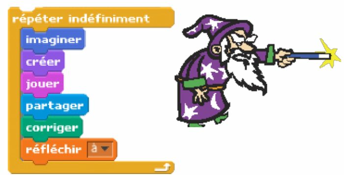
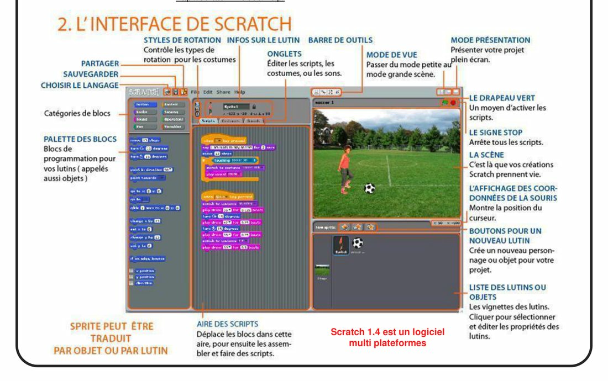
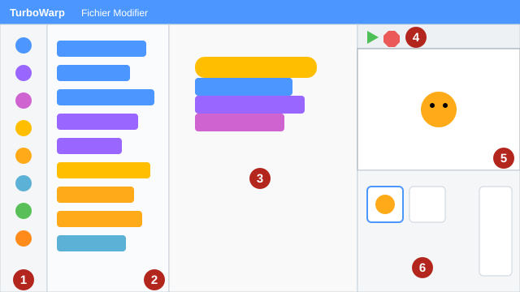

# Séance 1 — Scratch, un logiciel à tout faire

!!! info "Séance 1 sur 4 · 40 minutes · Classe entière"

    Je découvre comment on programme avec des blocs, je repère les zones de l'éditeur et je prépare ma première mission.

    [Fiche élève à imprimer (PDF)](fiches/5e-scratch-seance1-eleve.pdf)

    [Trace écrite de la séance](trace-ecrite-seance-1.md)

## AVANT — j'entre dans la question

#### J'observe

Le professeur projette la couverture du guide « Scratch en technologie » (Jean-Paul Bricard). On y voit un script fait de briques de couleur. Je regarde et je note.

| Je regarde | Ce que j'observe |
|---|---|
| Les mots écrits sur les briques |   |
| La brique qui entoure toutes les autres |   |

#### Ce qu'on cherche

Scratch est un langage de programmation créé au MIT, aux États-Unis. On n'y tape pas de lignes de code : on assemble des briques de couleur. Toutes les missions du site de la classe se programment avec Scratch.

**Comment donne-t-on des ordres à un ordinateur avec Scratch ?**

J'écris deux choses que je crois savoir. Je n'ai pas besoin d'avoir raison : je reviendrai sur ces lignes à la fin de l'heure.

| N° | Mes hypothèses de départ | Vérifié en fin de séance (✔ / ✘) |
|---|---|---|
| 1 |   |   |
| 2 |   |   |

#### Vocabulaire à repérer

| Mot | Ce que j'en comprends, avec mes mots |
|---|---|
| **bloc** |   |
| **script** |   |
| **lutin** |   |

## PENDANT — je recherche

### Activité 1 · Des briques qui s'emboîtent

*Couverture du guide « Scratch en technologie » (J.-P. Bricard)*

Dans Scratch, chaque brique est une **instruction**. Les briques s'emboîtent comme des pièces de puzzle. L'ordinateur les exécute dans l'ordre, de haut en bas.

a\. Dans quel ordre l'ordinateur lit-il les briques de ce script ?

b\. Que fait la brique orange qui entoure les autres ?

Les blocs sont rangés par **catégories**. Chaque catégorie a sa couleur. Le professeur ouvre la palette de TurboWarp : je complète le tableau.

| Bloc | Catégorie | Couleur |
|---|---|---|
| « avancer de 10 pas » |   |   |
| « dire Bonjour ! pendant 2 secondes » |   |   |
| « jouer le son Meow » |   |   |
| « quand le drapeau vert est cliqué » |   |   |
| « répéter 10 fois » |   |   |
| « touche le bord ? » |   |   |
| « nombre aléatoire entre 1 et 10 » |   |   |

### Activité 2 · L'éditeur de Scratch

Le guide présente Scratch 1.4, une ancienne version. En classe, on utilise **TurboWarp** : il fonctionne comme Scratch 3, dans le navigateur, sans compte. On y retrouve les mêmes zones, rangées autrement.

*L'interface de Scratch 1.4 présentée dans le guide*

*L'éditeur TurboWarp utilisé en classe : six zones numérotées*

Je retrouve chaque zone sur le schéma. Les noms à placer : catégories de blocs, palette des blocs, zone des scripts, drapeau vert et bouton stop, scène, liste des lutins.

| N° | Nom de la zone | À quoi elle sert |
|---|---|---|
| 1 |   |   |
| 2 |   |   |
| 3 |   |   |
| 4 |   |   |
| 5 |   |   |
| 6 |   |   |

### Activité 3 · Le parcours Missions Scratch

Le site de la classe propose un parcours de missions en cinq paliers de couleur. Chaque classe commence à son palier : 5e au [palier vert](../../../missions-scratch/palier-1.md), 4e au [palier bleu](../../../missions-scratch/palier-2.md), 3e au [palier orange](../../../missions-scratch/palier-3.md). Toutes les classes commencent par la mission 00.

Je numérote les étapes d'une mission dans l'ordre (la première est déjà numérotée).

| N° | Étape |
|---|---|
|   | Je coche « J'ai réussi » et je tente le défi. |
| 1 | Je regarde la vidéo ou l'image du résultat attendu. |
|   | Je programme en suivant le pas à pas et je teste avec le drapeau vert. |
|   | Je clique sur « Ouvrir l'exercice » : le projet s'ouvre dans TurboWarp. |
|   | En fin de séance, je remplis « Où j'en suis » avec une capture d'écran. |
|   | Je lis la consigne. |
|   | Si je suis bloqué, j'ouvre les coups de pouce dans l'ordre. |

c\. Quel est mon palier de départ, et de quelle couleur est-il ?

### Mon défi

!!! example "Mon défi · 5e"

    J'écris un script de trois blocs qui fait dire « Bonjour » au chat puis le fait miauler quand on clique sur le drapeau vert. J'indique la couleur de chaque bloc.

## APRÈS — je fixe ce que j'ai appris

#### À retenir

##### Scratch, un logiciel à tout faire

Un **programme** est une suite d'instructions que l'ordinateur exécute dans l'ordre. Dans Scratch, chaque instruction est un **bloc** ; les blocs emboîtés forment un **script**, lu de haut en bas.

La couleur d'un bloc indique sa catégorie : bleu pour le mouvement, violet pour l'apparence, jaune pour les événements, orange pour le contrôle.

Chaque **lutin** a ses scripts. Un script commence par un **événement**, par exemple le clic sur le drapeau vert.

Des blocs emboîtés les uns sous les autres forment un **script**.

« Quand le drapeau vert est cliqué » est un **événement** : il déclenche le script.

#### Je reviens sur mes observations et mes hypothèses

Je coche ✔ ou ✘ chaque hypothèse. J'explique ensuite ce que j'ai observé au début de la séance, avec le vocabulaire de la séance :

#### La question de la prochaine séance

Comment ouvrir une mission du site, la programmer sans perdre mon travail et montrer au professeur où j'en suis ?

## S'entraîner

[Ouvrir l'exercice autocorrectif :material-arrow-right:](exercices-seance-1.html){ .md-button .md-button--primary target=_blank }

Dix questions sur la séance. Je réponds, puis je vérifie : la correction et une explication s'affichent sous chaque question. Je recommence autant de fois que je veux ; rien n'est envoyé.

## S'évaluer : l'évaluation de la séance

[Ouvrir l'évaluation de la séance :material-arrow-right:](evaluation-seance-1.html){ .md-button .md-button--primary target=_blank }

Huit questions courtes sur les notions de la séance. J'indique mon nom, mon prénom et ma classe : la note s'affiche à la fin et elle est envoyée au professeur. Je relis la trace écrite avant de commencer.
