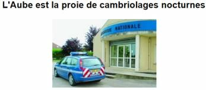
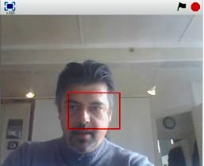
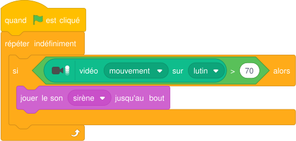
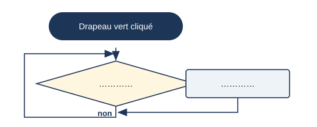

# Séance 3 — Programmer une alarme pour surveiller la maison

!!! info "Séance 3 sur 4 · 40 minutes · Classe entière"

    J'analyse le programme d'une alarme qui surveille une pièce avec une webcam, je le traduis en algorigramme et je l'adapte à deux fenêtres.

    [Fiche élève à imprimer (PDF)](fiches/5e-scratch-seance3-eleve.pdf)

    [Trace écrite de la séance](trace-ecrite-seance-3.md)

## AVANT — j'entre dans la question

#### J'observe

Le professeur projette un article de presse sur une série de cambriolages, puis la photo d'une pièce avec deux fenêtres. Je regarde et je note.

| Je regarde | Ce que j'observe |
|---|---|
| Par où un cambrioleur peut entrer dans la pièce |   |
| Ce qui pourrait prévenir les habitants |   |

#### Ce qu'on cherche

En 2013, une quinzaine de maisons de l'agglomération de Troyes ont été cambriolées en un seul week-end, souvent après 22 heures. Les voleurs cherchaient de l'argent, des bijoux, des téléphones et des ordinateurs. Le guide propose de répondre au problème avec une webcam et un programme Scratch.

**Comment un programme peut-il surveiller une habitation et donner l'alerte ?**

J'écris deux choses que je crois savoir. Je n'ai pas besoin d'avoir raison : je reviendrai sur ces lignes à la fin de l'heure.

| N° | Mes hypothèses de départ | Vérifié en fin de séance (✔ / ✘) |
|---|---|---|
| 1 |   |   |
| 2 |   |   |

#### Vocabulaire à repérer

| Mot | Ce que j'en comprends, avec mes mots |
|---|---|
| **boucle** |   |
| **condition** |   |
| **capteur** |   |

## PENDANT — je recherche

### Activité 1 · Le programme de l'alarme

*Article de l'Est-Éclair (2013) repris dans le guide*

Le guide dessine un lutin en forme de rectangle rouge : c'est la **zone sensible**. La webcam filme la pièce. Quand quelque chose bouge dans la zone, la sirène sonne.

*La zone sensible (rectangle rouge) devant la webcam*

*Le script de l'alarme, sur le lutin Zone (Scratch 3, extension Détection vidéo)*

| Bloc | Catégorie | Ce qu'il fait dans l'alarme |
|---|---|---|
| « quand le drapeau vert est cliqué » | Événements |   |
| « répéter indéfiniment » |   |   |
| « si alors » |   |   |
| « vidéo mouvement sur lutin » |   |   |
| « jouer le son sirène » | Son |   |

a\. Pourquoi le test est-il placé dans la boucle « répéter indéfiniment » ?

b\. Je remplace 70 par 10. Que se passe-t-il ?

### Activité 2 · Du programme à l'algorigramme

Un **algorigramme** dessine les étapes d'un programme. Un rectangle arrondi pour le début, un losange pour une question (oui ou non), un rectangle pour une action. Je complète celui de l'alarme.

*Algorigramme de l'alarme : la flèche de gauche ramène au test, sans fin*

c\. Quel bloc de Scratch correspond au losange ?

!!! note "Essayer l'alarme sur poste"

    [Ouvrir l'exercice « alarme » dans TurboWarp](https://turbowarp.org/editor?project_url=https://numerica-lfh.github.io/Techno/missions-scratch/exercices/alarme.sb3). Sur l'ordinateur sans webcam, la souris remplace la caméra : quand le pointeur touche un rectangle rouge, c'est un intrus (bloc « touche le pointeur de souris ? »). La consigne est dans le projet.

!!! abstract "Pour information : surveiller deux fenêtres"

    On dessine un rectangle rouge par fenêtre. Chaque rectangle surveille sa zone. Quand il détecte un mouvement, il **envoie un message** « alarme » ; la scène reçoit ce message et fait sonner la sirène. L'exercice « alarme » du site permet de l'essayer avec la souris.

### Mon défi

!!! example "Mon défi · 5e"

    Je propose deux autres capteurs que la webcam pour détecter un cambrioleur. Pour chacun, j'écris ce qu'il détecte.

## APRÈS — je fixe ce que j'ai appris

#### À retenir

!!! note "Deux documents, deux usages"

    Ce bloc se complète en classe, à la fin de l'heure : les phrases à trous se remplissent
    pendant la mise en commun. La [trace écrite de la séance](trace-ecrite-seance-3.md)
    reprend les mêmes notions rédigées, avec les définitions exactes et les compétences
    évaluées. C'est elle qui se colle dans le cahier.

Un programme de surveillance commence par un **événement** (le drapeau vert). Une **boucle** « répéter indéfiniment » refait le test sans arrêt.

Le bloc « si alors » pose une **condition** : ses blocs ne s'exécutent que si la réponse est vraie. Le **capteur** (webcam, souris, micro) donne l'information ; le seuil (70 %) fixe à partir de quand on réagit.

Un algorigramme représente le programme : le losange correspond au bloc « si alors ».

Je complète : La boucle « répéter `..........` » refait le test sans arrêt.

Je complète : Dans un algorigramme, le losange correspond au bloc « `..........` ».

#### Je reviens sur mes observations et mes hypothèses

Je coche ✔ ou ✘ chaque hypothèse. J'explique ensuite ce que j'ai observé au début de la séance, avec le vocabulaire de la séance :

#### La question de la prochaine séance

Comment programmer une maison qui allume la lumière toute seule ?

## S'entraîner

[Ouvrir l'exercice autocorrectif :material-arrow-right:](exercices-seance-3.html){ .md-button .md-button--primary target=_blank }

Huit questions sur la séance. Je réponds, puis je vérifie : la correction et une explication s'affichent sous chaque question. Je recommence autant de fois que je veux ; rien n'est envoyé.
