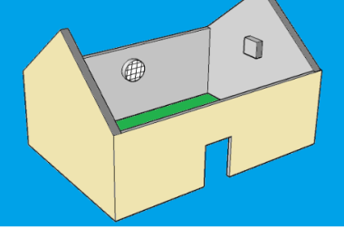
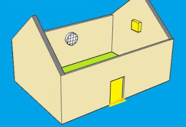
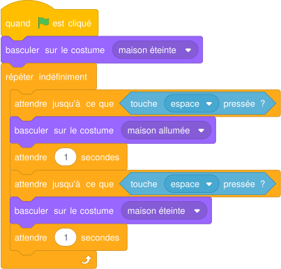

# Séance 4 — Bilan : la maison qui s'éclaire, puis l'évaluation

!!! info "Séance 4 sur 4 · 40 minutes · Demi-groupe (salle informatique)"

    Je programme l'éclairage automatique d'une maison dans TurboWarp, je l'enregistre, puis je passe l'évaluation de fin de séquence.

    [Fiche élève à imprimer (PDF)](fiches/5e-scratch-seance4-eleve.pdf)

    [Trace écrite de la séance](trace-ecrite-seance-4.md)

## AVANT — j'entre dans la question

#### J'observe

Le professeur projette les deux images de la maison du guide, éteinte puis allumée, et lance une version qui fonctionne. Je regarde et je note.

| Je regarde | Ce que j'observe |
|---|---|
| Ce qui change entre les deux images |   |
| Ce qui déclenche le changement |   |

#### Ce qu'on cherche

Dans le guide, une maison dessinée avec SketchUp s'allume quand on appuie sur le bouton d'une carte Picoboard, quand il fait sombre ou quand on claque des mains. Sans carte, l'ordinateur a ses propres capteurs : le clavier et le micro. Une variable réglée avec un curseur peut jouer le rôle du capteur de lumière.

**Comment un programme peut-il allumer la lumière d'une maison tout seul ?**

J'écris deux choses que je crois savoir. Je n'ai pas besoin d'avoir raison : je reviendrai sur ces lignes à la fin de l'heure.

| N° | Mes hypothèses de départ | Vérifié en fin de séance (✔ / ✘) |
|---|---|---|
| 1 |   |   |
| 2 |   |   |

#### Vocabulaire à repérer

| Mot | Ce que j'en comprends, avec mes mots |
|---|---|
| **costume** |   |
| **initialiser** |   |
| **seuil** |   |

## PENDANT — je recherche

### Activité 1 · J'ouvre la maison

*La maison éteinte (costume « maison éteinte »)*

*La maison allumée (costume « maison allumée »)*

1. J'ouvre l'exercice : [Ouvrir l'exercice « maison » dans TurboWarp](https://turbowarp.org/editor?project_url=https://numerica-lfh.github.io/Techno/missions-scratch/exercices/maison.sb3) (page de la séance 4 sur le site).
2. Je lis la consigne dans le commentaire du projet.
3. Je clique sur le lutin Maison, puis sur l'onglet **Costumes**.

| Je cherche dans le projet | Ce que je trouve |
|---|---|
| Le nom du lutin |   |
| Le nom de ses deux costumes |   |

### Activité 2 · L'interrupteur au clavier

La touche espace joue le rôle de l'interrupteur. Je programme ce script sur le lutin Maison, je teste, puis je réponds.

*Script du lutin Maison, version 5e*

a\. Pourquoi le premier bloc après le drapeau vert est-il « basculer sur le costume maison éteinte » ?

b\. À quoi sert « attendre 1 secondes » après chaque changement ?

### Activité 3 · J'enregistre, puis je passe l'évaluation

1. Fichier, Enregistrer sur votre ordinateur : je nomme le fichier maison-prénom.
2. Je fais une capture d'écran de mon script.
3. Je reviens sur la page de la séquence et j'ouvre l'**évaluation de fin de séquence** (40 questions). J'indique mon nom, mon prénom et ma classe.

### Mon défi

!!! example "Mon défi · 5e"

    J'ajoute un son quand la lumière s'allume.

## APRÈS — je fixe ce que j'ai appris

#### À retenir

!!! note "Deux documents, deux usages"

    Ce bloc se complète en classe, à la fin de l'heure : les phrases à trous se remplissent
    pendant la mise en commun. La [trace écrite de la séance](trace-ecrite-seance-4.md)
    reprend les mêmes notions rédigées, avec les définitions exactes et les compétences
    évaluées. C'est elle qui se colle dans le cahier.

Un lutin peut avoir plusieurs **costumes**. Changer de costume change son apparence : c'est ainsi qu'on simule l'éclairage de la maison.

Au clic sur le drapeau vert, on **initialise** : on remet la maison éteinte.

Le programme réagit à un capteur : touche du clavier, volume sonore du micro, luminosité. Le **seuil** fixe la valeur à partir de laquelle il réagit.

Je complète : Remettre la maison éteinte au clic sur le drapeau vert, c'est `..........`.

Je complète : Pour changer l'apparence d'un lutin, on change de `..........`.

#### Je reviens sur mes observations et mes hypothèses

Je coche ✔ ou ✘ chaque hypothèse. J'explique ensuite ce que j'ai observé au début de la séance, avec le vocabulaire de la séance :

#### La question de la prochaine séance

Quelle sera ma prochaine mission sur le site, et quel coup de pouce m'aidera si je bloque ?

## S'entraîner

[Ouvrir l'exercice autocorrectif :material-arrow-right:](exercices-seance-4.html){ .md-button .md-button--primary target=_blank }

7 questions sur la séance. Je réponds, puis je vérifie : la correction et une explication s'affichent sous chaque question. Je recommence autant de fois que je veux ; rien n'est envoyé.

## S'évaluer : l'évaluation de la séance

[Ouvrir l'évaluation de la séance :material-arrow-right:](evaluation-seance-4.html){ .md-button .md-button--primary target=_blank }

Huit questions courtes sur les notions de la séance. J'indique mon nom, mon prénom et ma classe : la note s'affiche à la fin et elle est envoyée au professeur. Je relis la trace écrite avant de commencer.

## S'évaluer : l'évaluation de la séquence

[Ouvrir l'évaluation de fin de séquence :material-arrow-right:](evaluation-sequence.html){ .md-button .md-button--primary target=_blank }

40 questions sur toute la séquence. J'indique mon nom, mon prénom et ma classe : la note s'affiche à la fin et elle est envoyée au professeur.
